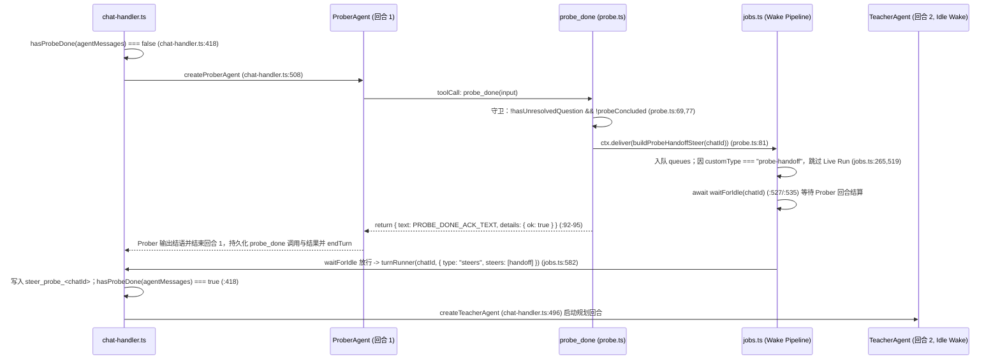

# SKILL: Agent Harness 与 LLM 工程模式拆解 (Agent Harness Dissector)

## 0. 目标与适用范围

帮助读者**将工作区项目中的“智能体行为”还原为确定性的工程控制流、状态转换契约与消息投递管线**：任何一段关于 Agent 角色切换、工具调用、提示词拼装或后台子任务唤醒的描述，读者都能凭 `path:line` 跳到源码核对。

- 适用：
  - 主会话 Agent（`prober` / `teacher` / `practice`）的无状态每回合构造与角色切换缝（Seam）。
  - 工具即控制流（Tool-as-Control-Flow）：问题停止器（`makeQuestionStopper` / `finishTurn`）、参数治愈（`withArgumentHeal`）、内循环校验重试（`invalidInputResult`）、受控提交循环（`runSubmitAgent`）。
  - 分段系统提示词（Segmented System Prompts）加载、排序、热覆盖与动态规则注入（`narrationGuard` / `SEND_TO_USER_DELIVERY_RULE`）。
  - 后台子 Agent（researcher / pdf-reader / demo-builder / visual-maker / extractor / auditor）与主会话的双通道投递（Live Steering vs. Idle Wake）及未消费回收（`settleSteers`）。
  - 模型解析链（`ModelRole` → `ResolvedModelSpec` → `PiEngine`）与 BYOK 拒绝门控。
- 不适用：
  - 纯前端 DOM/Canvas 布局渲染细节。
  - 与 Agent 编排无关的纯文件 I/O 崩溃语义细节（交 `code-execution-trace`）。

核心原则只有一条：**把“AI 决定做什么”徹底翻译成“Harness 用什么输入、暴露什么工具 Schema、靠什么 Hook 拦截、在什么边界终止或重试”。**

---

## 1. 证据规则（最高优先级，先于一切格式要求）

1. **先取证，后叙述。** 写出任何 Agent 工厂函数、工具名、TypeBox Schema、系统提示词片段文件、Hook 名之前，必须已经用 `grep` / `glob` / `read` 在本次会话中确认其存在。
2. **出处格式统一为 `path:line`**（相对仓库根目录），在该标识符**首次出现**时附上。例：`makeQuestionStopper()`（`src/agent/teacher-agent.ts:157`）。
3. **三级置信标记**，凡不是“读到代码原文”的内容都必须标注：
   - 无标记 = 已读到代码原文，直接陈述。
   - `【推断】` = 由已读代码的顺序/结构推出，但没有直接读到对应代码或测试（例：混合 toolCall 批次下某个钩子的触发顺序）。
   - `【未验证】` = 没有读到相关代码（例：`@earendil-works/pi-agent-core` 包内部未展开的循环实现）。
4. **禁止为满足格式而补写。** 模板中的某一项在当前 Agent 或工具中不存在时，写 `N/A — <原因>`，不得虚构重试轮数、门控开关或钩子。
5. **签名与 Schema 照抄。** 函数签名、工具参数 Schema 常量名、返回对象字段以源码为准逐字抄写，不得凭记忆“简化”。
6. **框架行为不凭记忆。** 涉及 Next.js 路由或模块实例行为时，按 `AGENTS.md` 要求先读 `node_modules/next/dist/docs/` 中对应文档；读不到则标 `【未验证】`。

---

## 2. 表达规则

### 2.1 禁止
- **拟人化心理描写**：「Prober 觉得已经摸清了学生的底细，决定移交给 Teacher」「Teacher 发现自己参数写错了，主动重试」。
- **笼统的“调用大模型”**：「把历史对话发给 LLM 得到回复」。
- **混淆“工具返回”与“用户作答”**：把 `questionResult()` 的内存占位返回说成“拿到了学生的回答”。
- **未解释的自造术语**：任何不是代码标识符、也没有给出定义的名词。

### 2.2 允许（并鼓励）
- **代码中真实存在的 Harness 标识符**：如 `AgentKind`、`finishTurn`、`terminate: true`、`steeringMode: "all"`、`handOffEligible`、`settleSteers`、`narrationGuard`。首次出现时注明其定义位置与类型。
- **开头 ≤3 行的总览**，概括所拆解的 Agent 工程模式。
- **Mermaid 状态图/时序图**展示 Agent 循环边界、Tool 拦截点与 Steer 注入点。

### 2.3 工具契约（Tool Contract）的标准六列写法
凡拆解 Agent 挂载的工具，必须使用以下六列表格：

| 工具名 (`name`) | 定义位置 (`path:line`) | 暴露门控条件 | 参数预处理与 Schema (`prepareArguments` / `parameters`) | 软失败返回值（内循环重试） | 成功返回值与 `terminate` 标志 |
|---|---|---|---|---|---|
| 例：`quiz` | `src/agent/teacher-agent.ts:313` | `teacher` 角色常驻 | `withArgumentHeal` + `quizInputObject` | `invalidInputResult("quiz", problems)` (`isError: true`) | `questionResult()` (`details: null, terminate: true`) |

---

## 3. 工作流程

1. **定位 Agent / 工具 / 投递入口**：`grep` 角色构造处（如 `src/server/chat-handler.ts`、`src/agent/teacher-agent.ts`）、工具定义处（`src/agent/tools.ts`、`src/agent/tools/*.ts`）或后台任务调度处（`src/agent/subagents/*.ts`、`src/server/jobs.ts`）。
2. **识别所属工程模式（见第 4 节）**：确定目标属于 6 大 Agent Harness 模式中的哪一个或多个组合。
3. **沿 Harness 装配链取证**：
   - 查角色分派条件（Transcript Seam）。
   - 查系统提示词拼装顺序与动态追加项。
   - 查 `new Agent({...})` 的配置项（`initialState`、`finishTurn`、`steeringMode`、`convertToLlm`、`prepareRequest`）。
   - 查工具 `execute` 内部的守卫、副作用（写盘 / `deliver` 入队）与返回结构。
4. **套用 5 阶段拆解模板（第 5 节）**，并应用第 6 节专项规则。
5. **补充测试佐证**：`grep` `tests/` 中使用假引擎（Fake `PiEngine`）或假工具注册表驱动该模式的测试（`tests/xxx.test.ts:line`）。
6. **执行第 8 节自检清单**，修正后再输出。

---

## 4. 六大 Agent Harness 工程模式切分法则

拆解时必须指明目标机制对应的工程模式编号与边界：

| 模式编号 | 模式名称 | 核心代码特征 | 关键工程机制 |
|---|---|---|---|
| **P1** | **无状态回合重建与转录分派缝（Stateless Turn & Transcript Seam）** | `hasProbeDone(agentMessages)`、`record.kind === "practice"`、`new Agent(...)` | 服务端不驻留跨请求 Agent 状态；每次请求扫描 `ChatRecord.messages` 决定构造 `Prober`、`Teacher` 还是 `Practitioner`，回合结束即丢弃实例 |
| **P2** | **工具即控制流（Tool-as-Control-Flow）** | `questionResult()`、`terminate: true`、`makeQuestionStopper`、`finishTurn`、`invalidInputResult`、`runSubmitAgent` | 工具不仅是外部查询，更是循环控制器：干净的问题提出强制终止整个 Agent 回合；结构/业务校验失败返回 `isError: true` 触发模型同回合自愈重试 |
| **P3** | **分段提示词组装与热覆盖（Segmented Prompt Composition）** | `composeInstructions`、`effectivePromptSegments`、`promptSwitches` | 按确定性规则拼装共享基座、角色专属数字前缀片段与共享附录，支持按设置开关在每回合动态替换本地覆盖片段 |
| **P4** | **叙述守卫与显式输出通道（Narration Guard & Explicit Delivery）** | `narrationGuardApplies`、`makeNarrationGuard`、`sendToUserTool` (`send_to_user`) | 当启用守卫时，要求模型通过显式工具输出面向学习者的正文，拦截“只有推理思考没有面向用户输出就直接发问”的静默跳跃 |
| **P5** | **双通道异步投递与回收（Live Steering vs. Idle Wake）** | `deliverJobResult`、`handOffEligible`、`agent.steer`、`pump`、`waitForIdle`、`settleSteers` | 后台任务完成 ≠ 会话投递；有活跃回合时走 `agent.steer` 在原生回合边界注入（`probe-handoff` 除外），死回合未消费的 Steer 在结算时回收并转入 Idle Wake 新建服务端回合 |
| **P6** | **模型解析链与计费门控（BYOK Resolution & Money Channel）** | `piEngineFor`、`resolveConversationSpec`、`onUsage`、`usageWasAdmitted` | 角色覆盖 → 模型槽（`strong`/`cheap`/`vision`）→ 未配置则显式拒绝；仅非 `aborted` 且通过准入的模型响应才记入账本 |

---

## 5. 单机制 5 阶段拆解模板

每个 Agent 角色或 Harness 机制按顺序展开以下 5 个阶段。**不存在的阶段写 `N/A — <原因>`。**

### 阶段一：构造入口、分派缝（Seam）与引擎绑定
- 构造工厂函数 `path:line`，以及调用方（如 `chat-handler.ts`）进入该分支的**精确布尔判定表达式**。
- 绑定的 `AgentKind` / `ModelRole`、模型解析入口及传入 `new Agent({...})` 的初始消息来源。

### 阶段二：系统提示词拓扑与 `convertToLlm` 转换缝
- 提示词组装函数 `path:line`、静态缓存 vs. 按回合动态组装的触发条件（如 `opts.promptSwitches`）、以及基于模型/工具状态动态拼接的尾部规则（如 `SEND_TO_USER_DELIVERY_RULE`）。
- 挂载到 `convertToLlm` 的函数名与 `prepareRequest` 中的请求级标记逻辑（如 `callPurpose.background` 判定）。

### 阶段三：工具注册表、门控与参数治愈/校验契约
- 填写 **第 2.3 节工具契约标准六列表格**。
- 说明工具如何通过闭包捕获存储端口（`ChatStore` / `JobStore` / `GraphStore`）与投递回调（`deliver` / `spawn`）。

### 阶段四：循环控制钩子与跨回合状态跃迁
- `finishTurn`（停止器）、`narrationGuard`、`steeringMode` 的具体配置值与触发条件。
- 工具执行引发的跨回合副作用：如写入计划树（`saveTree`）、入队唤醒信号（`deliverJobResult`）、或留置悬空未答工具调用等待客户端下次请求。

### 阶段五：结算、计费过滤与未消费 Steer 回收
- `agent.subscribe` 中 `onUsage` 的过滤条件（`stopReason === "aborted"` 等早退分支 `path:line`）。
- 回合结束时，已交接但未注入的 Steer（如被 Question Stopper 提前截断）如何经 `settleSteers` 归还队列并重新触发 `pump`。

---

## 6. 专项规则

### 6.1 区分两层终止机制：`terminate: true` vs. `finishTurn` 停止器
拆解问题类工具（`quiz` / `ask_user_question` / `problem`）时，必须同时交代两层防线（`src/agent/teacher-agent.ts:136-177`、`src/agent/tool-execute.ts:214-233`）：
1. **单工具批次原生终止**：`questionResult()` 和 `problemResult()` 返回 `{ content: [...], details: null, terminate: true }`（`tool-execute.ts:222-250`）。当模型单次消息只调用了该工具时，`pi-agent-core` 原生检测到批次内所有结果均带 `terminate: true` 即结束循环。
2. **混合批次兜底终止（`makeQuestionStopper`）**：若模型在同一条 assistant 消息里同时发出了普通工具调用（如 `send_to_user` / `read`）和问题工具调用，`terminate: true` 的“全批次终止”条件不满足；此时 `finishTurn: (turn) => (stopper(turn) ? { action: "end" } : undefined)`（`teacher-agent.ts:227`）在所有工具结果挂载后、下一轮 `agent.steer` 轮询**之前**强制返回 `{ action: "end" }` 退出循环。
3. **失败不终止**：若问题工具校验失败（`result.isError === true`），`makeQuestionStopper` 返回 `false`（`:172-174`），循环继续，让模型在同一回合内重试。

### 6.2 拆解 Steer 投递：必须区分「注册表（Registry）」与「载具（Vehicle）」
拆解 `src/server/jobs.ts` 时，必须写清：
- **唯一权威注册表**：`globalThis` 上的 `WakeState.queues: Map<string, QueuedSteer[]>`（`src/server/jobs.ts:111`）。
- **两个投递载具**：
  1. **Vehicle 1（Live Run `agent.steer`）**：仅当 `live && isTurnRunning(chatId)`（`:513`）且 `entry.steer.customType !== "probe-handoff"`（`:265`）时，调用 `agent.steer(entry.steer)` 并标记 `entry.handedTo = agent`（`:266-267`）。
  2. **Vehicle 2（Idle Wake `s.turnRunner`）**：等待 `waitForIdle(chatId)`（`:535`）后重读最新 `ChatRecord`（`:540`），确认无用户搁置（`!endsInDismissal` 且 `!endsInQuestionRecovery`，`:569`），再将所有待投递 `steers` 作为一次服务端回合的输入调用 `s.turnRunner(chatId, { type: "steers", steers })`（`:582`）。

---

## 7. 负面约束

1. **严禁把 `probe_done` 当成在同一个 Agent 实例里切换 Prompt。** `probe_done` 绝不修改当前正在运行的 `ProberAgent`；它是将成功结果写入转录并入队 `probe-handoff` Steer，等 `ProberAgent` 回合彻底结束后，由 Idle Wake（或下次客户端请求）扫描到 `hasProbeDone(agentMessages) === true` 从而**新建 `TeacherAgent` 实例**。
2. **路径不可悬空。** 任何标识符首次出现都带 `path:line`。
3. **严禁混淆“入队成功”与“投递完成”。** `deliverJobResult` 入队或 HTTP 返回 200 都不是投递确认；唯有 `steerDelivered(messages, steerId)`（`src/core/contracts/jobs.ts:446`）在持久化 `ChatRecord.messages` 中扫到对应 `steer.id` 才算投递落地（`src/server/jobs.ts:501,556,587`）。
4. **不得为填模板而编造。** 不存在就写 `N/A`，不确定就标 `【推断】` 或 `【未验证】`。

---

## 8. 输出前自检清单

- [ ] 每个函数、工具、常量、文件都在本次会话中 `grep` / `read` 过，且首次出现带 `path:line`。
- [ ] 已明确标注目标所属的工程模式编号（P1~P6）。
- [ ] 工具拆解已包含第 2.3 节的六列标准表格（含软失败 `invalidInputResult` 与成功返回值的对比）。
- [ ] 若涉及问题工具，已同时说明 `terminate: true` 与 `makeQuestionStopper`（`finishTurn`）的配合关系及校验失败不停止的逻辑。
- [ ] 若涉及后台投递或阶段交接，已区分 Registry（`queues`）与 Vehicle（`agent.steer` vs. `turnRunner`）。
- [ ] 没有拟人化表达，推断和未验证内容已标 `【推断】` / `【未验证】`。

---

## 9. 示范案例：Prober → Teacher 阶段交接（`probe_done` 工具 + `probe-handoff` 唤醒 + 转录缝重建）

> 以下行号于 2026-11-09 对照代码核对。使用本案例前**必须重新核对**；代码与本文不一致时以代码为准。

**总览**：拆解教学会话如何从探测阶段（`ProberAgent`）无人工干预地平滑切换到规划/教学阶段（`TeacherAgent`）。涵盖工程模式：**P1 无状态转录分派缝 + P2 工具即控制流 + P5 Idle Wake 异步投递**。

### 阶段一：构造入口、分派缝（Seam）与引擎绑定

1. **分派缝判定（`src/server/chat-handler.ts:418,469-525`）**：
   - 在每个回合请求处理中，`handleChatRequest` 调用 `const teaching = hasProbeDone(agentMessages)`（`src/server/chat-handler.ts:418`）。
   - `hasProbeDone(messages: readonly LhMessage[]): boolean`（`src/core/native-messages.ts:782`）扫描消息列表，通过 `probeDoneResultIds(messages)`（`:760`）查找是否存在已成功结算的 `probe_done` 工具调用。
   - 角色构造三元分支（`src/server/chat-handler.ts:469-525`）：
     - `record.kind === "practice"` → `createPracticeAgent(...)`（`:472`，定义于 `src/agent/teacher-agent.ts:344`）。
     - `teaching === true` → `createTeacherAgent(...)`（`:496`，定义于 `src/agent/teacher-agent.ts:293`）。
     - `teaching === false` → `createProberAgent(...)`（`:508`，定义于 `src/agent/teacher-agent.ts:283`）。
2. **引擎绑定**：
   - 无论 `ProberAgent` 还是 `TeacherAgent`，在 `chat-handler.ts` 中均共享上方解析出的同一个 `conversationEngine`（`src/server/chat-handler.ts:423,450`）；若在未传入 `opts.engine` 的裸调用场景下，`baseAgentOptions` 回退调用 `piEngineFor(kind as "prober" | "teacher")`（`src/agent/teacher-agent.ts:184`）。

### 阶段二：系统提示词拓扑与 `convertToLlm` 转换缝

1. **系统提示词切换（`src/agent/teacher-agent.ts:77-94,187-190`）**：
   - `createProberAgent` 传入 `kind = "prober"`；`createTeacherAgent` 传入 `kind = "teacher"`。
   - `composeInstructions(kind, switches)`（`src/agent/teacher-agent.ts:77`）调用 `effectivePromptSegments(kind, switches ?? {})`（`src/agent/prompt-segments.ts`），将各片段以 `"\n\n---\n\n"` 拼接（`:83`）。
   - 当 `narrationGuardApplies(kind, engine.model, opts.tools !== undefined)`（`:186`）为真时，在系统提示词末尾追加 `SEND_TO_USER_DELIVERY_RULE`（`:190`）。
2. **`convertToLlm` 转换缝（`src/agent/teacher-agent.ts:242`）**：
   - 挂载 `convertToLlm: toLlmMessages`（`src/core/native-messages.ts:583`）。
   - 当回合 2（`TeacherAgent`）启动时，记录中的 `probe-handoff` Marker（`role: "custom", customType: "probe-handoff"`）在 `toLlmMessages` 的 `src/core/native-messages.ts:625-639` 分支中被转换为一条标准模型可见的 `{ role: "user", content: [{ type: "text", text: marker.content }], timestamp: marker.timestamp }`，其中 `marker.content` 为常量 `HANDOFF_TEXT`（`src/core/contracts/chat.ts:189`）。

### 阶段三：工具注册表、门控与参数治愈/校验契约

`ProberAgent` 通过 `createProberTools(ctx, opts.toolToggles)`（`src/agent/tools.ts`）装配工具，其中核心交接工具为 `probeDoneTool(ctx)`（`src/agent/tools/probe.ts:49`）：

| 工具名 (`name`) | 定义位置 (`path:line`) | 暴露门控条件 | 参数预处理与 Schema (`prepareArguments` / `parameters`) | 软失败返回值（内循环重试） | 成功返回值与 `terminate` 标志 |
|---|---|---|---|---|---|
| `probe_done` | `src/agent/tools/probe.ts:51` | 仅 `prober` 角色挂载（`teacher` 与 `practice` 无此工具） | ` healToolRecord` 包装 + `probeDoneInputSchema`（`src/core/contracts/probe.ts:47`） | 经 `serverExecute`（`src/agent/tool-execute.ts:196`）包装为 JSON 文本：`{ ok: false, error: "..." }`（注意：`isError` 未置 `true`，通过业务字段 `ok: false` 告知模型修正） | `toToolResult({ text: PROBE_DONE_ACK_TEXT, details: { ok: true } })`（`probe.ts:92-95`；因满足 `isImageResult` 形状判定 `tool-execute.ts:149-152`，模型收到 `content: [{ type: "text", text: PROBE_DONE_ACK_TEXT }]`，记录保存 `details: { ok: true }`，**无 `terminate: true`**） |

- **`probe_done` 的三条业务守卫（`src/agent/tools/probe.ts:66-79`）**：
  1. `!record` → 返回 `{ ok: false, error: "Chat not found: ..." }`（`:67`）。
  2. `hasUnresolvedQuestion(record.messages)` 为真 → 返回 `{ ok: false, error: "A question is still open — resolve it (or let him answer) before concluding the probe. probe_done only fires with no question outstanding." }`（`:69-75`）。
  3. `probeConcluded(record.messages)`（即 `hasProbeDone(record.messages)`，`:21-23`）为真 → 返回 `{ ok: false, error: "The probe is already concluded — probe_done fires exactly once." }`（`:77-79`）。
- **闭包依赖注入**：`probeDoneTool` 接收 `ProbeDoneContext`（`src/agent/tools/probe.ts:9-16`），由 `chat-handler.ts:509-512` 注入 `chatId`、`chatStore: stores.chatStore` 以及 `deliver: (steer) => void deliverJobResult(steer)`，因此 `src/agent/tools/probe.ts` 无需违反 `eslint.config.mjs` 去导入 `src/server/jobs.ts`。

### 阶段四：循环控制钩子与跨回合状态跃迁

1. **为什么 `probe_done` 不带 `terminate: true`**：
   - 如 `probe_done` 工具描述（`src/agent/tools/probe.ts:61`）所示：*"After it succeeds, say your closing sentence and end your turn."*
   - `probe_done` 返回后，当前 `ProberAgent` 循环继续走完最后一个模型生成步（让 Prober 说完过渡结语），然后自然结束回合。
2. **为什么 `probe-handoff` 严禁走 Vehicle 1（Live Steering）而必须走 Vehicle 2（Idle Wake）**：
   - 在 `probe_done` 的 `execute` 内部（`src/agent/tools/probe.ts:81`），调用 `ctx.deliver(buildProbeHandoffSteer(ctx.chatId))` 时，**`ProberAgent` 的回合仍在运行中**（`isTurnRunning(chatId) === true`）。
   - 如果此时 `jobs.ts` 的 `pump` 将 `probe-handoff` 通过 `live.steer()` 注入当前运行的 Agent，那么接管并处理该 handoff 的将是**还没有退出的 `ProberAgent`**（它既没有 `Teacher` 的系统提示词，也没有 `plan_init` 工具）！
   - 因此，`src/server/jobs.ts` 在两处设置了专门的硬性拦截：
     - `handOffEligible`（`src/server/jobs.ts:265`）：`if (!entry.waking && !entry.deferred && entry.handedTo !== agent && entry.steer.customType !== "probe-handoff")`，显式跳过 `probe-handoff`，绝不调用 `agent.steer`。
     - `pump` 循环（`src/server/jobs.ts:519-535`）：检测到 `handoffWaits` 为真时，不提前 `return`，而是落入下方的 `await waitForIdle(chatId)`（`:535`），一直等到 `ProberAgent` 回合彻底结算并释放 `turn-liveness` 锁。
3. **Idle Wake 启动新回合与角色跃迁**：
   - 当 `ProberAgent` 回合结束，`waitForIdle(chatId)` 放行，`pump` 调用 `await s.turnRunner(chatId, { type: "steers", steers })`（`src/server/jobs.ts:582`）。
   - `turnRunner` 重新进入 `chat-handler.ts`，此时 write-ahead 持久化已包含上一回合的 `probe_done` 调用与结果，`hasProbeDone(agentMessages)`（`src/server/chat-handler.ts:418`）返回 `true`，回合 2 正式构造 `createTeacherAgent`（`:496`）。

### 阶段五：结算、计费过滤与未消费 Steer 回收

- **幂等投递确认**：`buildProbeHandoffSteer(chatId)`（`src/core/contracts/jobs.ts:439`）调用 `newHandoffMessage(chatId)`（`src/core/native-messages.ts:227`），生成确定性 ID（`steer_probe_${chatId}`，见 `jobs.ts:445` 注释）。当 `turnRunner` 返回 `status === 200` 且 `!jobIdOf(entry.steer)`（`probe-handoff` 无关联后台 job，`jobIdOf` 返回 `null`，`src/server/jobs.ts:174,597`）时，调用 `completeEntry(chatId, entry)`（`:599`）移出队列。
- **降级自愈能力**：即使 `ctx.deliver(...)` 排队异常（`src/agent/tools/probe.ts:82-87` try/catch 吞掉异常仅打日志），因为 `probe_done` 的工具调用和 `{ ok: true }` 结果已经随回合 1 落盘，用户下一次发送任何消息时，`hasProbeDone(agentMessages)` 依然为 `true`，系统仍能自动构造 `TeacherAgent`。

**测试佐证**
- `tests/chat-flow.test.ts` 中通过注入自定义 `buildAgent` 工厂（对应 `src/server/chat-handler.ts:469` 的 `buildAgent` 测试缝）或直接调用 `createTeacherAgent(undefined, { engine, messages: opts.messages })`（`tests/chat-flow.test.ts:107`）验证无状态回合重建与工具执行行为。
