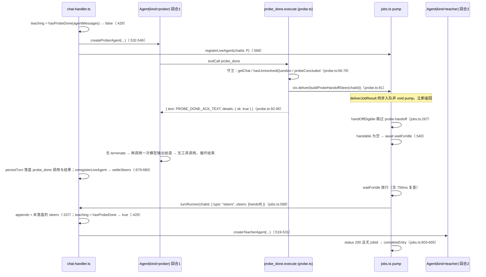

# SKILL: Agent Harness 与 LLM 工程模式拆解 (Agent Harness Dissector)

## 0. 目标与适用范围

把一切「AI 行为」翻译成：**Harness 用什么输入构造 Agent、暴露哪些工具 Schema、在哪个钩子拦截、在什么边界终止或重试、结果经哪个载具送回会话**。读者可凭 `path:line` 逐条核对。

- 适用：
  - P1 每请求重建 Agent 与角色分派（`AgentKind = "prober" | "teacher" | "practice"`，`src/agent/teacher-agent.ts:56`）。
  - P2 工具即控制流：`terminate`、`finishTurn`、工具失败信道、`runSubmitAgent`。
  - P3 分段系统提示词：`composeInstructions`、`effectivePromptSegments`、语言指令。
  - P4 显式输出通道：`send_to_user` 的挂载门控。
  - P5 后台结果投递：注册表、两个载具、`settleSteers`。
  - P6 模型解析链、拒绝门控与计费过滤。
- 不适用：
  - 纯前端渲染细节；消息在视图中的形态（交 `data-model-state-projection`）。
  - 与编排无关的写盘崩溃语义（交 `code-execution-trace`）。
  - Node 并发原语的 Java 对照（交 `java-to-ts-node-bridge`）。

核心原则：**把「AI 决定做什么」翻译成「Harness 在哪一行做了什么判断」。**

---

## 1. 证据规则（最高优先级）

0. **锚点复核。** 开始前执行 `git rev-parse --short HEAD`；第 9 节行号仅对其标注的 commit 有效，引用前用 `grep -n` 按函数名重新定位。
1. **先取证，后叙述。** Agent 工厂、工具名、Schema 常量、提示词片段、钩子名写出前必须本次会话 grep/read 过。
2. **出处 `path:line`**，首次出现时附上。
3. **三级置信**：无标记 / `【推断】` / `【未验证】`。
4. **`pi-agent-core` 行为必须取证到 dist。** 循环语义（`terminate`、`finishTurn`、steering/follow-up 轮询、参数校验）以 `node_modules/@earendil-works/pi-agent-core/dist/agent-loop.js` 为准，并注明包版本（`package.json` 的 `version`）。只引用本仓库注释时标 `【未验证】`。
5. **注释不是代码。** 注释与代码冲突时以代码为准并指出冲突（本仓库已知的例子见 6.5）。
6. **禁止为满足格式而补写。** 不存在写 `N/A — <原因>`，不得虚构重试轮数、门控或钩子。
7. **签名与 Schema 照抄。**

---

## 2. 表达规则

### 2.1 禁止
- 拟人化：「Prober 觉得摸清了学生底细」「Teacher 发现参数写错主动重试」。
- 笼统的「调用大模型」。
- 把 `questionResult()` 的内存占位说成「拿到了学生的回答」。
- 把 `ProberAgent` / `TeacherAgent` / `PracticeAgent` 说成不同的类：它们是 `ReturnType<typeof create…Agent>` 类型别名（`teacher-agent.ts:362-365`），运行时都是同一个 `Agent` 类的实例，区别只在构造参数。
- 未定义的自造术语。

### 2.2 允许
- 真实存在的 Harness 标识符：`AgentKind`、`finishTurn`、`terminate: true`、`steeringMode: "all"`、`handOffEligible`、`settleSteers`、`noteSteersDurable`、`registerLiveAgent`。
- 开头 ≤3 行总览；Mermaid 时序图（参与者为真实文件/函数）。

### 2.3 工具契约表（凡拆解工具必须使用）
| 工具名 | 定义位置 | 暴露门控 | 参数预处理与 Schema | 失败信道与返回值 | 成功返回值与 `terminate` |
|---|---|---|---|---|---|

「失败信道」必须写明属于 6.2 中的哪一类。

---

## 3. 工作流程

1. **锚点复核**，并记录 `pi-agent-core` 版本。
2. **定位入口**：角色构造（`src/server/chat-handler.ts`、`src/agent/teacher-agent.ts`）、工具注册（`src/agent/tools.ts`、`src/agent/tools/*.ts`）、后台投递（`src/server/jobs.ts`、`src/agent/subagents/*.ts`）。
3. **归入模式**（第 4 节）。
4. **沿装配链取证**：
   - 分派条件。
   - 提示词组装顺序与追加项。
   - `new Agent({...})` 配置（`initialState`、`finishTurn`、`steeringMode`、`convertToLlm`、`prepareRequest`），见 `teacher-agent.ts:213-275`。
   - 工具 `execute` 内部守卫、副作用、返回结构。
5. **套用 5 阶段模板**（第 5 节）与专项规则（第 6 节）。
6. **补充测试佐证**：`grep tests/`（注入假 `PiEngine` 或 `buildAgent` 的测试）。
7. **执行第 8 节自检。**

---

## 4. 六大工程模式

| 模式 | 名称 | 代码特征 | 关键机制 |
|---|---|---|---|
| **P1** | 无状态回合与分派 | `hasProbeDone(agentMessages)`、`record.kind === "practice"`、`buildAgent` | 每次请求从 `ChatRecord.messages` 重建 Agent，回合结束丢弃（注释 `teacher-agent.ts:30-36`） |
| **P2** | 工具即控制流 | `questionResult()`、`terminate: true`、`makeQuestionStopper`、`finishTurn`、`invalidInputResult`、`runSubmitAgent` | 问题干净提出即结束回合；工具失败以 `isError: true` 回给模型重试 |
| **P3** | 分段提示词组装 | `composeInstructions`、`effectivePromptSegments`、`promptSwitches`、`LANGUAGE_PROMPT_DIRECTIVES` | 基座 → 角色片段 → shared 附录；开关打开且覆盖文件存在时替换；每回合按需重组 |
| **P4** | 显式输出通道 | `sendToUserTool`、`withArgumentHeal(sendToUserTool)` | 仅在未注入测试工具表且模型为 Claude 系时额外挂载 |
| **P5** | 双载具投递与回收 | `deliverJobResult`、`pump`、`handOffEligible`、`waitForIdle`、`settleSteers`、`noteSteersDurable` | 一个注册表，两个载具；只有持久化记录中出现 steer ID 才算投递完成 |
| **P6** | 模型解析与计费过滤 | `resolveConversationSpec`、`piEngineForSpec`、`piEngineFor`、`onUsage`、`usageWasAdmitted` | 未配置模型或缺少 key 时在回合开始前返回 503；中止的响应不计费 |

---

## 5. 单机制 5 阶段模板

不存在的阶段写 `N/A — <原因>`。

### 阶段一：构造入口、分派条件与引擎
- 工厂 `path:line`；调用方进入该分支的布尔表达式原文。
- `AgentKind`、引擎来源（`piEngineForSpec` 调用行）、初始消息来源。

### 阶段二：提示词与消息转换
- 组装函数、缓存条件、追加项（语言指令等）。
- `convertToLlm` 挂载的函数（规则细节交 `data-model-state-projection`）；`prepareRequest` 中的请求级逻辑。

### 阶段三：工具注册表与契约
- 第 2.3 节表格；工具如何通过闭包获得存储端口与回调（`deliver` / `spawn`）。

### 阶段四：循环控制与跨回合状态
- `finishTurn`、`terminate`、`steeringMode` 的配置值与触发条件，引用 `agent-loop.js` 行号。
- 跨回合副作用：写盘、入队投递、留下悬空调用等待下一次请求。

### 阶段五：结算、计费与回收
- `onUsage` 过滤条件。
- 回合结束时 `unregisterLiveAgent` → `settleSteers` 的顺序与未注入 steer 的回收。

---

## 6. 专项规则

### 6.1 两层终止：`terminate: true` 与 `finishTurn`（依据 `pi-agent-core` 1.4.0）
1. **批次终止**：`shouldTerminateToolBatch()` 要求批次内**全部**结果 `terminate === true`（`agent-loop.js:471-473`）；结果为真时 `hasMoreToolCalls = false`（`:172`），即不再为了工具结果发起下一次模型调用。
2. **`terminate` 不是硬停止**：之后循环仍会轮询 steering 队列，有待注入消息就继续（`:191-194`）；内层循环退出后还会检查 follow-up 队列（`:197-203`）。
3. **`finishTurn` 才是硬停止**：它在工具结果挂上之后、`turn_end` 之前调用（`:184-185`）；返回 `{ action: "end" }` 时立即 `agent_end` 并返回（`:186-189`），**早于** steering 轮询。本仓库配置为 `finishTurn: (turn) => (stopper(turn) ? { action: "end" } : undefined)`（`teacher-agent.ts:241`）。
4. **`makeQuestionStopper`**（`teacher-agent.ts:169-193`）：本条消息含问题工具（`QUESTION_TOOLS`，`src/core/pending.ts:53-59`：`quiz`、`probe`、`ask_user_question`、`explain`、`recall`；`practice` 角色另加 `PRACTICE_PROBLEM_TOOL`）调用，且这些调用的结果没有一个 `isError` → 返回 `true`。任一失败 → `false`，循环继续让模型重试。
5. **小结**：`terminate` 处理「只有问题工具」的批次；`finishTurn` 处理「问题工具与其他工具混在一起」的批次，并阻止已排队的 steer 在提问后被注入。
6. 生成失败（`stopReason` 为 `error` / `aborted`）时循环在 `:148-159` 直接结束，`finishTurn` 被调用但返回值不被使用（`:155`）。

### 6.2 四类工具失败信道（必须区分）
| 信道 | 触发位置 | 结果形态 | 是否触发 stopper 的「失败不停」分支 |
|---|---|---|---|
| A. 循环层校验失败 | 工具不存在（`agent-loop.js:489-495`）；`prepareArguments` 或 `validateToolArguments` 抛错（`:496-498` → `:539-545`）；`stopReason === "length"` 时整批失败（`:168-169`） | `isError: true`，文本为错误消息 | 是 |
| B. 工具内细化校验失败 | `invalidInputResult(toolName, problems)`（`src/agent/tool-execute.ts:118-133`），如 `teachQuizToolFor` 的 nodeId 校验（`src/agent/tools.ts:383-389`） | `isError: true`，`details: { tool, problems }`；`agent-loop.js:588` 按 `result.isError === true` 识别 | 是 |
| C. 业务守卫拒绝 | `serverExecute()` 包装的工具返回 `{ ok: false, error }` 对象（`tool-execute.ts:198-227` → `toToolResult()` `:164-182`） | **`isError` 不置位**；`content` 是 JSON 文本，`details` 是原对象 | 否（问题工具不走 `serverExecute`，见注释 `tool-execute.ts:194-196`） |
| D. 执行抛异常 | `execute` 抛出（`serverExecute` 重新抛出，`tool-execute.ts:222-225`） | 循环转为 `isError: true`（`agent-loop.js:590-598`） | 是 |

- 参数预处理：所有注册表都经 `healToolRecord()`（`src/agent/tools/heal.ts:46-48`）包装，`withArgumentHeal()`（`:34-40`）在 TypeBox 校验**之前**先运行工具自带的 `prepareArguments`，再运行 `healEncodedArguments`。
- `runSubmitAgent()`（`src/agent/subagents/submit-agent.ts:48`）：校验函数返回问题字符串时走信道 B（`:103`），默认 `maxTurns ?? 4`（`:114`）。

### 6.3 Steer 投递：注册表（Registry）与载具（Vehicle）
- **注册表**：`globalThis.__lhWakePipeline`（`src/server/jobs.ts:131-138`）上的 `WakeState.queues: Map<string, QueuedSteer[]>`（`:106-112`）；学习者插话另有 `userSteers`（`:118`）。
- **入队**：`deliverJobResult(steer)`（`:223-229`）同步入队（按 `steer.id` 去重，`queueSteer()` `:231-244`），`void pump(chatId)` 后立即返回 Promise。
- **载具 1：活跃回合的 `agent.steer`**。
  - `registerLiveAgent()`（`:295-303`）在 `runPiTurn` **之前**调用（`chat-handler.ts:568`），并立即 `handOffEligible()`。
  - `handOffEligible()`（`:260-287`）：先要求 `automaticFollowUpAllowed(chatId, agent)`（`:254-258`，订阅类连接的后台同意门控）；对 `!entry.waking && !entry.deferred && entry.handedTo !== agent && entry.steer.customType !== "probe-handoff"` 的条目调用 `agent.steer()`（`:267-271`）。
  - 注入时机由 `pi-agent-core` 决定：运行开始时轮询一次（`agent-loop.js:90`），每个回合结束后轮询（`:191`），轮询结果在下一次模型调用前作为 `message_start` / `message_end` 写入上下文（`:121-126`）；`steeringMode: "all"`（`teacher-agent.ts:249`）一次注入全部。
- **载具 2：Idle Wake**。`pump()`（`:479-622`）在无可交给活跃回合的条目时 `await waitForIdle(chatId)`（`:540`）。`waitForIdle()`（`:703-721`）每 `POLL_MS`（400ms，`:150`）轮询，要求 `!isTurnRunning(chatId) && !hasUnresolvedQuestion(record.messages)`，满足后再等 `GRACE_MS`（750ms，`:165`）复查。随后重读记录（`:545`），检查 `endsInDismissal || endsInQuestionRecovery || !automaticFollowUpAllowed(chatId)`，任一为真则暂停（`:574-577`）；否则 `s.turnRunner(chatId, { type: "steers", steers })`（`:588`）。
- **pump 中活跃回合分支的三种走向**（`:517-535`）：
  - `handable.length > 0 && !handoffWaits` → `return`，由运行中的回合交付。
  - `handable.length > 0 && handoffWaits` → `delay(POLL_MS)` + `waitForIdle` 后 `continue` 重新循环。
  - `handable.length === 0` → 落到下方 Idle Wake 路径。
- **回收**：回合结算时 `unregisterLiveAgent()`（`:348-352`）**必须先于** `settleSteers()`（`:381-406`），见 `chat-handler.ts:679-680`（失败路径 `:605, :611`）。`settleSteers` 对已出现在持久化消息中的条目 resolve，其余清除 `handedTo` 后重新 `pump`。

### 6.4 「入队」不等于「投递完成」
- `deliverJobResult` 返回或 Idle Wake 的 HTTP 200 都不是投递确认（注释 `jobs.ts:609-610`）。
- 投递完成 = 持久化消息中出现该 steer 的 ID：`noteSteersDurable()`（`:183-190`）或 `settleSteers()` 的 ID 比对。
- `steerDelivered(messages, steerId)`（`src/core/contracts/jobs.ts:435-437`，`messages.some(m => m.id === steerId)`）用于过滤唤醒输入中已落盘的 steer（`chat-handler.ts:337`）与恢复流程（`jobs.ts:691`）。
- 例外：无 jobId 的 `probe-handoff` 在唤醒返回 200 时直接 `completeEntry()`（`jobs.ts:603-605`）。

### 6.5 已知的注释与代码冲突
- `teacher-agent.ts:63-66` 注释称顺序为「基座 → shared → 角色片段」；实际 `listSourceSegments()`（`src/agent/prompt-segments.ts:62-97`）是「基座 → 角色片段 → shared」，与 `teacher-agent.ts:41-47` 和 `prompt-segments.ts:16-19` 一致。
- `jobs.ts:473-477` 注释称活跃回合经 `agent.followUp` 交付；实际代码调用 `agent.steer()`（`:269`）。
- `prompt-segments.ts:86` 注释称 practice 的 shared 白名单只有格式指南；实际 `PRACTICE_SHARED_FRAGMENTS`（`:43`）有 4 个文件。

---

## 7. 负面约束

1. **严禁把 `probe_done` 当成在同一个 Agent 实例中切换提示词。** 它只把调用与结果留在本回合消息里，并入队 `probe-handoff`；下一次构造 Agent 时 `hasProbeDone()` 为真才构造 teacher。
2. **严禁混淆「入队成功」与「投递完成」**（6.4）。
3. **严禁把 `terminate: true` 说成「结束回合」**（6.1 第 2 点）。
4. **严禁把 `{ ok: false }` 业务拒绝说成 `isError`**（6.2 信道 C）。
5. **路径不可悬空；不得为填模板编造。**

---

## 8. 输出前自检清单

- [ ] 已记录 HEAD 与 `pi-agent-core` 版本；标识符首次出现带 `path:line`。
- [ ] 已标注模式编号（P1~P6）。
- [ ] 工具表已写明失败信道类别（A/B/C/D）。
- [ ] 问题工具：已说明 `terminate` 与 `finishTurn` 的分工（引用 `agent-loop.js` 行号）。
- [ ] 后台投递：已区分注册表与两个载具，并写明 pump 的分支走向与暂停条件。
- [ ] 回收：已写明 `unregisterLiveAgent` → `settleSteers` 顺序。
- [ ] 没有拟人化表达；注释支撑的结论已标明。

---

## 9. 示范案例：Prober → Teacher 交接（`probe_done` + `probe-handoff` + Idle Wake）

> 行号基于 commit `8b235af`（2026-11-06），`@earendil-works/pi-agent-core` 1.4.0。按第 1 节第 0条复核后使用；代码与本文不一致时以代码为准。

**总览**：prober 调用 `probe_done` 后，其结果随回合 1 落盘；同时入队的 `probe-handoff` 不进入运行中的 prober，而是等回合 1 结束后由 Idle Wake 发起回合 2，此时 `hasProbeDone()` 为真，构造 teacher（模式 **P1 + P2 + P5**）。

### 阶段一：构造入口、分派条件与引擎

1. **分派**（`src/server/chat-handler.ts:429, 480, 493-549`）：
   - `const teaching = hasProbeDone(agentMessages);`（`:429`）
   - `hasProbeDone(messages)`（`src/core/native-messages.ts:782-784`）即 `probeDoneResultIds(messages).size > 0`。`probeDoneResultIds()`（`:760-778`）要求：`probe_done` 调用所在 assistant 消息的 `stopReason` 不是 `error` / `aborted`；存在 `toolName === "probe_done"`、`toolCallId` 匹配、`!isError`、且 `details.ok !== false` 的结果。
   - 构造表达式（`:493-549`）：`buildAgent` 存在时走测试注入（`:494`）；否则 `record.kind === "practice"` → `createPracticeAgent`（`:496`）；`teaching` → `createTeacherAgent`（`:520`）；否则 `createProberAgent`（`:532`）。
2. **引擎**：
   - 三个角色共用 `conversationEngine = piEngineForSpec(conversation, () => callPurpose.background, lifecycle, retentionForSlot("strong"))`（`chat-handler.ts:291-293`），其中 `conversation = resolveConversationSpec(record.settings, effective.models.strong)`（`:247`）。
   - `baseAgentOptions` 中的 `opts.engine ?? piEngineFor(...)`（`teacher-agent.ts:200`）不是回退模型：`piEngineFor()`（`src/agent/models.ts:194-198`）无条件抛错，注释（`:188-193`）称到达此处即为装配错误。

### 阶段二：提示词与消息转换

1. **组装**：
   - `composeInstructions(kind, switches)`（`teacher-agent.ts:79-86`）→ `effectivePromptSegments(kind, switches ?? {})`（`src/agent/prompt-segments.ts:105-125`），开关为真且覆盖文件存在时用覆盖文本，片段 `trim` 后以 `"\n\n---\n\n"` 连接。
   - 顺序（`listSourceSegments()`，`prompt-segments.ts:67-97`）：`system-prompt.md` → `prompts/<kind>/` 下数字前缀片段（排序）→ `prompts/shared/` 片段。`practice` 不含基座，shared 只取白名单 `PRACTICE_SHARED_FRAGMENTS`（`:43`）。
   - 缓存：无 `promptSwitches` 时使用模块加载时的缓存 `composedInstructions[kind]`（`teacher-agent.ts:92-96`）；有则每回合重组（`:202-204`）。chat-handler 总是传入 `promptSwitches`（`chat-handler.ts:470`）。
   - 追加：`opts.language` 命中时追加 `LANGUAGE_PROMPT_DIRECTIVES[opts.language]`（`teacher-agent.ts:205-207`，定义 `:139-145`）。
2. **转换**：`convertToLlm: toLlmMessages`（`teacher-agent.ts:256`）。回合 2 中 `probe-handoff` Marker 被展平为 user 文本，内容为 `HANDOFF_TEXT`（`src/core/contracts/chat.ts:187`）；完整规则见 `data-model-state-projection` 第 6.3 节。
3. **`prepareRequest`**（`teacher-agent.ts:257-274`）：遍历本次请求的消息，按 `nativeInputCause()` 判断是否存在新的自动输入（`probe-handoff` 属于 `"automatic"`，`native-messages.ts:848`），据此设置 `opts.callPurpose.background`。

### 阶段三：工具注册表与契约

prober 注册表由 `createProberTools(ctx, opts.toolToggles)`（`src/agent/tools.ts:287-348`）组装：问题工具 `probe`（或自由回忆模式下的 `recall`，`:312-313`）、`ask_user_question`、`read` / `ls` / `find` / `grep`、`research`（如可用）/ `pdf`、可选图谱读取工具，以及 `probe_done`。`probe_done` 在开关过滤**之后**再次加入（`:346`），因此无法被设置关闭（注释 `:291-292`）。

| 工具名 | 定义位置 | 暴露门控 | 参数预处理与 Schema | 失败信道与返回值 | 成功返回值与 `terminate` |
|---|---|---|---|---|---|
| `probe_done` | `probeDoneTool(ctx)`（`src/agent/tools/probe.ts:49-99`） | 仅 prober 注册表，始终存在 | `healToolRecord` 包装（`tools.ts:317`）；`parameters: probeDoneInputSchema`（`src/core/contracts/probe.ts:47`）；Schema 不符走信道 A | 守卫拒绝走信道 C：`{ ok: false, error }`，`isError` 不置位 | `{ text: PROBE_DONE_ACK_TEXT, details: { ok: true } }`（`probe.ts:92-95`）。`toToolResult()` 因 `isImageResult()`（`tool-execute.ts:151-155`）判定为真，产出 `content: [{ type: "text", text: PROBE_DONE_ACK_TEXT }]`、`details: { ok: true }`；**无 `terminate`** |

- **守卫**（`probe.ts:66-79`）：
  1. `!record` → `{ ok: false, error: \`Chat not found: ${ctx.chatId}\` }`（`:67`）。
  2. `hasUnresolvedQuestion(record.messages)` → 拒绝（`:69-76`）。该函数（`native-messages.ts:746-748`）对最新 assistant 消息中任何未配对的问题调用都返回真，包括 `streaming`、`malformed`、`failed` 状态。
  3. `probeConcluded(record.messages)`（`probe.ts:21`，即 `hasProbeDone`）→ 拒绝（`:77-79`）。
  - 【推断】守卫读取的是 `ctx.chatStore.getChat()` 返回的持久化记录（`:66`），不包含本回合尚未持久化的消息。
- **闭包注入**：`chat-handler.ts:532-549` 传入 `chatId`、`chatStore: stores.chatStore`、`deliver: (steer) => void deliverJobResult(steer)`（`:536`）等，因此 `src/agent/tools/probe.ts` 无需导入 `src/server/jobs.ts`（Zone 4）。
- **入队失败**：`ctx.deliver` 抛错被 `try/catch` 吞掉并记日志（`probe.ts:80-87`）；注释称交接可由下一次客户端消息经分派条件恢复。

### 阶段四：循环控制与跨回合状态

1. **为什么不带 `terminate`**：工具描述要求成功后「say your closing sentence and end your turn」（`probe.ts:61`）。`probe_done` 不在 `QUESTION_TOOLS` 中，`makeQuestionStopper` 返回 `false`；批次未 terminate，`hasMoreToolCalls` 为真（`agent-loop.js:172`），循环再调用一次模型生成结语；该响应无工具调用后循环自然结束。
2. **为什么 `probe-handoff` 不走载具 1**：`ctx.deliver` 执行时 prober 回合仍在运行；若注入运行中的 Agent，处理交接文本的仍是 prober（prober 注册表中没有 `plan_init`，`tools.ts:317-347`）。拦截有两处：
   - `handOffEligible()` 条件中的 `entry.steer.customType !== "probe-handoff"`（`jobs.ts:267`）。
   - `pump()` 的 `handoffWaits`（`jobs.ts:524-526`）：队列中有其他可交给活跃回合的条目时，不提前返回而是等待回合结束后重新循环（`:530-534`）；队列中只有交接时直接落到 Idle Wake（`:540`）。
   - 注释依据：`jobs.ts:27-30`、`:521-523`。
3. **Idle Wake 与角色切换**：回合 1 结算后 `waitForIdle` 放行，`turnRunner`（由 `setTurnRunner` 在 `chat-handler.ts:141` 注册）重新进入 handler；此时记录中已有回合 1 的 `probe_done` 调用与结果，`hasProbeDone` 为真，构造 teacher。

### 阶段五：结算、计费与回收

- **计费过滤**（`teacher-agent.ts:276-285`）：仅对 assistant 的 `message_end` 且带 `usage` 的事件计费；`stopReason === "aborted"`、`!usageWasAdmitted(usage)`、或 `opts.requestCycle && !opts.requestCycle.acceptsUsage(message)` 时跳过。
- **回合 1 结算**：`unregisterLiveAgent(chatId)` → `settleSteers(chatId, stamped, false, constructed)`（`chat-handler.ts:679-680`）。交接不在 `stamped` 中且未 `handedTo` → 保留在队列并调用 `pump`；由于原 pump 仍在运行（`pumping` 集合，`jobs.ts:482`），新调用直接返回。
- **回合 2 确认**：`buildProbeHandoffSteer(chatId)`（`src/core/contracts/jobs.ts:428-430`）调用 `newHandoffMessage(chatId)`，ID 为 `steer_probe_${chatId}`（`native-messages.ts:229`）。唤醒返回 `status === 200` 且 `!jobIdOf(entry.steer)`（`jobIdOf()` `jobs.ts:175-178`）时 `completeEntry()`（`:603-605`）。
- **降级恢复**：即使交接入队失败，回合 1 已落盘的 `probe_done` 结果使下一次任意请求的 `hasProbeDone` 为真，仍会构造 teacher（注释 `probe.ts:84-86`）。

**测试佐证**
- 交接不走活跃回合：`tests/jobs.test.ts:1181`（`"a probe-handoff NEVER rides a live run — it waits the turn out and wakes"`）。
- 注入假引擎重建 Agent：`tests/chat-flow.test.ts:107`（`createTeacherAgent(undefined, { engine, messages: opts.messages })`），另见 `:929`、`:1330`。
