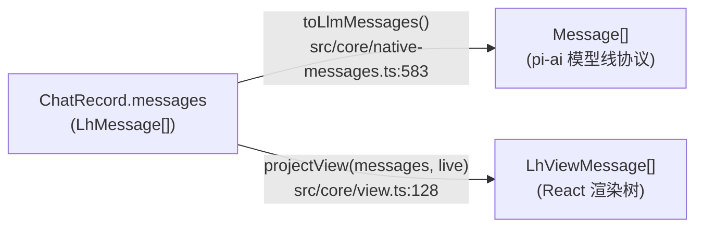

# SKILL: 核心数据模型与状态机投影分析 (Data Model & State Projection Analyzer)

## 0. 目标与适用范围

帮助读者**从数据结构、纯函数投影矩阵与确定性状态机层级理解工作区项目（`learnharness`）**：厘清“磁盘上到底存了什么（Stored Truth）”、“发给大模型的是什么（Model Projection）”、“浏览器渲染的是什么（UI View Projection）”以及“哪些状态从不落盘、完全靠读取时实时派生（Derived State）”。

- 适用：
  - 会话权威记录 `ChatRecord` 与消息联合类型 `LhMessage`（含 9 种 `LhMarkerMessage`）的字段契约与构造函数。
  - 同一份 `LhMessage[]` 在 `toLlmMessages()`（`src/core/native-messages.ts:583`）与 `projectView()`（`src/core/view.ts:128`）两条纯函数管道中的双向变换对比。
  - 知识图谱追加式 JSONL 账本（`nodes.jsonl`、`chains.jsonl`、`coverage.jsonl`、`sessions.jsonl`）与纯函数派生视图（`GraphEdge`、同名链合并、`coverageOf` 未覆盖计算、`phases.ts` 计划节点状态派生）。
  - 客户端无 React 依赖的纯 TS 会话状态机 `SessionModel`（`components/session-core.ts:226`）：乐观更新（`c_` 前缀 ID）、`absorbed()` 吸收判定、SSE 事件流折叠、断线重attach与结算替换。
- 不适用：
  - 服务端 HTTP 路由锁与文件写入系统调用的逐行时序追踪（交 `code-execution-trace`）。
  - 系统提示词工程与子 Agent 并发信号量机制（交 `agent-harness-dissector` 或 `java-to-ts-node-bridge`）。

核心原则只有一条：**严格区分「存储真相（Stored Truth）」与「派生/投影视图（Derived/Projected View）」。** 把派生出来的状态当成数据库落盘字段，或把三条消息管道（存储记录 `LhMessage`、模型线协议 `Message`、前端视图 `LhViewMessage`）混为一谈，是理解本系统的最大障碍。

---

## 1. 证据规则（最高优先级，先于一切格式要求）

1. **先取证，后叙述。** 写出任何接口名、类型别名、`customType` 字面量、投影函数、状态枚举之前，必须已经用 `grep` / `glob` / `read` 在本次会话中确认其存在。
2. **出处格式统一为 `path:line`**（相对仓库根目录），在该标识符**首次出现**时附上。例：`projectView()`（`src/core/view.ts:128`）。
3. **三级置信标记**，凡不是“读到代码原文”的内容都必须标注：
   - 无标记 = 已读到代码原文，直接陈述。
   - `【推断】` = 由已读数据结构与投影分支推出，但没有直接读到对应代码或测试（例：某种极端消息序列组合下的视图合并结果）。
   - `【未验证】` = 没有读到相关代码（例：某个下游 React 组件如何消费该 `LhViewPart` 的具体 JSX 未打开看）。
4. **禁止为满足格式而补写。** 模板中的某一项在当前数据域中不存在时，写 `N/A — <原因>`，不得虚构字段或状态转移边。
5. **类型与签名照抄。** `interface` / `type` 字段、联合类型分支、函数参数与返回类型以源码为准逐字抄写，不得凭记忆“简化”。
6. **框架行为不凭记忆。** 涉及 Next.js 数据获取或缓存行为时，按 `AGENTS.md` 要求先读 `node_modules/next/dist/docs/` 中对应文档；读不到则标 `【未验证】`。

---

## 2. 表达规则

### 2.1 禁止
- **混用三层消息名词**：笼统写“把消息发给前端/模型”，不指明是 `LhMessage`、`Message`（`@earendil-works/pi-ai`）还是 `LhViewMessage`。
- **虚构持久化状态字段**：写出“把问题状态更新为已回答存入数据库”“把图谱的边（edge）写入文件”“把计划树节点标记为 visited 存入 JSON”等违背本仓库派生原则的描述。
- **模糊的数据变形描述**：「清洗一下历史消息」「转换成前端格式」。
- **未解释的自造术语**：任何不是代码标识符、也没有给出定义的名词。

### 2.2 允许（并鼓励）
- **精确的数据结构形状表达式**：如 `{ id: string, role: "custom", customType: "plan-block", content: "", display: true, details: { planCallId, block }, timestamp: number }`。
- **开头 ≤3 行的总览**，点明所分析的数据结构属于哪个域及其核心不变量。
- **Mermaid 数据流/状态机图**：展示从 `ChatRecord` 到双端投影的分叉流向，或 `SessionModel` 的状态跃迁。

### 2.3 双端投影对比矩阵的标准五列写法
凡拆解 `LhMessage`（含各 `role` 与 9 种 `LhMarkerMessage["customType"]`）或工具结果，必须使用以下五列表格：

| 持久化记录项 (`LhMessage` 分支) | 构造入口 (`path:line`) | 模型向投影 `toLlmMessages()` (`native-messages.ts:583`) | 浏览器向投影 `projectView()` (`view.ts:128`) | 双端差异的设计原因 |
|---|---|---|---|---|
| 例：`role: "custom"`, `customType: "plan-block"` | `newPlanBlockMessage()` (`src/core/native-messages.ts:242`) | 在 `:629` 被 `continue` **完全过滤丢弃**（模型不可见） | 在 `projectMarker` (`view.ts:478-488`) 中不生成独立消息，而是 `splice` 插入前一个 assistant 消息组中最后一个成功 `tool-plan_init` 部件之后 | 计划树已在 `plan_init` 工具参数中对模型可见；`plan-block` 只是 UI 历史快照 |

---

## 3. 工作流程

1. **定位类型契约与持久化入口**：`grep` / `read` `src/core/contracts/*.ts`、`src/core/native-messages.ts`、`src/core/ports.ts` 或 `src/store/*.ts`，确认物理存储格式与 TS 类型定义 `path:line`。
2. **识别所属数据域（见第 4 节）**：确定分析对象属于 D1（会话记录与输入折叠）、D2（双端消息投影）、D3（图谱 JSONL 账本与纯函数派生）、D4（客户端 `SessionModel` 状态机）中的哪一域。
3. **追踪纯函数变换与派生链**：
   - 查写入端：哪个工厂函数构造了该记录项？哪些字段是幂等键（如 `id` / `startedAt` / `fp`）？
   - 查读取/投影端：打开 `toLlmMessages`、`projectView`、`coverageOf`、`getGraph` 或 `SessionModel`，逐个 `if / switch` 分支核对输入到输出的字段增删改。
4. **套用 5 阶段拆解模板（第 5 节）**，并应用第 6 节专项规则。
5. **补充测试佐证**：`grep` `tests/` 中对该投影或状态机的断言（如 `tests/golden-fixtures.test.ts`、`tests/pending-authority.test.ts`、`tests/session-core.test.ts`）。
6. **执行第 8 节自检清单**，修正后再输出。

---

## 4. 四大核心数据与状态机域切分法则

拆解前必须先明确目标所属的数据域：

| 域编号 | 域名称 | 核心文件锚点 | 核心真相 vs. 派生准则 |
|---|---|---|---|
| **D1** | **会话权威记录与输入事件折叠** | `src/core/contracts/chat.ts`、`src/core/native-messages.ts`、`src/core/input-events.ts` | `data/chats/<id>.json` 中的 `ChatRecord` 是唯一真相；客户端只发 `{ chatId, input }`，由服务端折叠追加为 `LhMessage[]`；用量日志 `turns` / `extractions` 平行追加，不混入消息体 |
| **D2** | **同源双端纯函数投影** | `src/core/native-messages.ts` (`toLlmMessages`)、`src/core/view.ts` (`projectView`) | 同一份 `LhMessage[]` 经 `toLlmMessages` 产出无应用 `id` 的模型线协议 `Message[]`；经 `projectView` 产出按连续助手文档分组、带实时流状态的 `LhViewMessage[]` |
| **D3** | **知识图谱 JSONL 账本与覆盖率/阶段派生** | `src/core/contracts/graph.ts`、`src/core/graph.ts`、`src/core/coverage.ts`、`src/core/phases.ts`、`src/store/graph.ts` | 磁盘只追加 `nodes.jsonl`、`chains.jsonl`、`coverage.jsonl`、`sessions.jsonl`；图谱边 `GraphEdge`、未覆盖槽位 `uncovered`、当前教学阶段与计划节点状态（`current/visited/upcoming`）**100% 读取时派生** |
| **D4** | **客户端纯 TS 会话状态机** | `components/session-core.ts` (`SessionModel`、`absorbed`、`visibleQueuedSteers`) | 维护 `base`（服务端权威记录）+ `tail`（本地 `c_` 前缀乐观消息与流式临时消息）；通过 `absorbed()` 在权威记录到达时自动去重消解乐观项 |

---

## 5. 单数据模型 / 状态机 5 阶段拆解模板

每个分析单元按顺序展开以下 5 个阶段。**不存在的阶段写 `N/A — <原因>`。**

### 阶段一：持久层契约与物理落盘形状（Stored Truth）
- 类型定义 `path:line`，逐字抄写 `interface` / `type`。
- 对应在 `data/` 下的物理文件路径常量（`config.ts:line`）、文件格式（JSON 全量覆写 vs. JSONL 单行追加）。
- **真相边界声明**：明确列出哪些字段落盘、哪些关联状态绝不落盘。

### 阶段二：构造工厂、写入源与幂等不变式（Write Origins & Invariants）
- 构造该数据结构的纯函数签名与 `path:line`（如 `newAnswerResult`、`newPlanBlockMessage`、`newThinkingMessage`）。
- ID 生成规则（随机 UUID / 时间戳前缀 / 确定性幂等键如 `steer_probe_${chatId}`）与写入顺序约束。

### 阶段三：双端投影变换对比矩阵（Dual-Projection Matrix）
- 填写 **第 2.3 节标准五列表格**，完整呈现该数据在 `toLlmMessages()` 与 `projectView()` 中的分支行号、字段剥离/注入、位置移动（如 `splice` 或反向挂载）及设计理由。
- 若分析对象不属于消息记录（如纯图谱节点坐标 `positions.json`），写 `N/A — 该数据不进入会话消息双端投影`。

### 阶段四：派生算法或状态机跃迁矩阵（Derivation / State Transition）
- **若为派生视图（域 D2/D3）**：写出纯派生函数的输入参数、遍历/折叠（Fold）规则、输出类型及时间复杂度/确定性保证。
- **若为状态机（域 D4 `SessionModel`）**：以状态转移表写出：`当前 SessionStatus` × `输入动作/SSE 事件` → `下一 SessionStatus` + `base / tail / executions / streamingIds` 的精确变更。

### 阶段五：异常、中断与历史压缩（Compaction）边界语义
- 当遇到以下 4 种边界情况时，该数据结构或投影如何处理（附 `path:line`）：
  1. **回合中途 Abort / 未答悬空工具调用**（如 `INTERRUPTED_TEXT` 合成 vs. `pendingQuestionOf` 判定）。
  2. **Compaction 历史截断**（`activeCompactionOf` 在模型端截断历史 vs. 在浏览器端保留全部历史并插入 `data-compaction-cut` 分割线）。
  3. **流式进行中 vs. 已结算重读**（`LiveTurnState` 正向证据门控 `streamingIds.has(m.id)`）。
  4. **JSONL 坏行或未知版本记录容错**。

---

## 6. 专项规则

### 6.1 拆解问答数据流：必须讲清「一问一答在两端的非对称表示」
在 `learnharness` 中，一次选择题/问答题（`quiz` / `ask_user_question`）在持久层、模型端、UI 端呈现三种截然不同的形态，拆解时必须交代清楚：
1. **提问刚结束、学习者尚未作答时（Pose → Answer 窗口）**：
   - **磁盘 `ChatRecord.messages`**：只有 `AssistantMessage` 里的 `toolCall` 块，**没有任何对应的 `ToolResultMessage`**（内存中的 `questionResult()` 占位符在结算落盘时被过滤丢弃，见 `src/core/native-messages.ts:28-33`）。
   - **UI `projectView`**：`toolPartOf`（`src/core/view.ts:311-348`）将该悬空调用投影为 `state: "input-available"`（`:345`），驱动底部答题面板（Question Dock）挂载。
   - **模型 `toLlmMessages`**：若此时因异常中止或后续回合跨越了该未答调用，`toLlmMessages`（`src/core/native-messages.ts:647-664`）为已完成生成的悬空 `toolCall` 自动合成一条 `content: [{ type: "text", text: INTERRUPTED_TEXT }]` 的 `toolResult`，防止大模型 API 因缺少匹配的 `tool_result` 报协议错误。
2. **学习者提交答案后（Answer Time）**：
   - **磁盘 `ChatRecord.messages`**：通过 `newAnswerResult(toolCallId, toolName, answer)`（`src/core/native-messages.ts:206-223`）追加一条原生 `ToolResultMessage`。注意**一鱼两吃（Two Audiences）**设计：
     - `content` 字段存的是 `JSON.stringify(compactAnswerForModel(answer))`（`:216`）——**只含学习者作答精简信息**，省去重复题目与选项 Token。
     - `details` 字段存的是完整的 `QuestionAnswerData`（`:219`）。
   - **模型 `toLlmMessages`**：保留原生 `ToolResultMessage`（剥离记录 `id`），模型只读取精简的 `content` 文本。
   - **UI `projectView`**：遍历到 `role === "toolResult"` 时，不生成新消息气泡，而是通过 `findToolPart(toolCallId)`（`src/core/view.ts:143-158,199-201`）从后往前找到原提问的 `LhViewPart`，调用 `applyResult`（`:103-113`）将其状态改为 `state: "output-available"`，并将 `part.output = result.details`（完整判分数据）挂载上去，原地渲染为已答卡片。

### 6.2 拆解 Compaction（上下文压缩）：必须对比「模型截断」与「UI 全量保留」
- **模型端（`toLlmMessages`，`src/core/native-messages.ts:584-634`）**：取最新的 `activeCompactionOf(lhMessages)`（`:592`），找到 `keptIndexFor(lhMessages, active)`（`:596`）；保留 `[0]` 号 `system` 声明消息（`:617-620`），注入一条包含压缩摘要的 `head` 用户消息（`:599-603,621`），然后直接从 `kept` 下标开始遍历（**`kept` 之前的历史消息全部从模型上下文中切除**），且跳过后续残留的所有 `compaction` Marker（`:633`）。
- **浏览器端（`projectView`，`src/core/view.ts:160-182,459-476`）**：**从不隐藏任何历史消息**。遍历全部消息，在 `m.id === compaction.details.firstKeptMessageId` 之前插入一条 `id: "cut_" + compaction.id`、`type: "data-compaction-cut"` 的分割线消息（`:170-182`），并在 `compaction` Marker 原位置渲染 `type: "data-compaction"` 标记（`:459-476`）。

---

## 7. 负面约束

1. **严禁混淆 `base` 与 `tail`。** 分析 `SessionModel`（`components/session-core.ts:241-242`）时，必须明确 `base` 是服务端已确认的 `LhMessage[]`，`tail` 是当前客户端乐观追加或正在流式接收的临时列表。
2. **路径不可悬空。** 任何标识符首次出现都带 `path:line`。
3. **严禁遗漏 `streamingMessage` 正向证据门控。** 在 `src/core/view.ts:224,307-346` 中，一个未拿到执行结果的 `toolCall` 只有在 `live?.streamingIds.has(m.id) === true` 时才渲染为 `"input-streaming"`（闪烁加载态）；只要所属消息不在本轮 `streamingIds` 中，即使整个会话 `live.inFlight === true`，已落盘的历史悬空调用也必须保持 `"input-available"`，绝不重新变成转圈动画。
4. **不得为填模板而编造。** 不存在就写 `N/A`，不确定就标 `【推断】` 或 `【未验证】`。

---

## 8. 输出前自检清单

- [ ] 每个类型、函数、常量、文件都在本次会话中 `grep` / `read` 过，且首次出现带 `path:line`。
- [ ] 已明确区分持久化真相（`LhMessage` / JSONL 账本）与纯函数派生视图（`Message` / `LhViewMessage` / `GraphEdge` / `uncovered`）。
- [ ] 包含第 2.3 节的双端投影对比五列表格，行号精确到 `toLlmMessages` 与 `projectView` 内部的具体分支。
- [ ] 若涉及 `ToolResultMessage`（如答题结果），已说明 `content`（面向模型精简 JSON）与 `details`（面向 UI 完整结构）的双受众分离设计。
- [ ] 若涉及 `SessionModel`，已说明乐观 ID（`c_` 前缀）如何被 `absorbed()` 判定吸收。
- [ ] 推断和未读到的内容已标 `【推断】` / `【未验证】`。

---

## 9. 示范案例：`LhMessage` 核心分支的双端投影矩阵与客户端乐观吸收状态机

> 以下行号于 2026-11-09 对照代码核对。使用本案例前**必须重新核对**；代码与本文不一致时以代码为准。

**总览**：拆解会话记录 `LhMessage`（特别是问答闭环、`plan-block`、`probe-handoff`、`send_to_user` 与 `compaction`）如何在 `toLlmMessages` 与 `projectView` 中分道扬镳，以及客户端 `SessionModel` 如何通过 `absorbed()` 实现无闪烁的乐观消息替换（涵盖数据域：**D1 + D2 + D4**）。

### 阶段一：持久层契约与物理落盘形状（Stored Truth）

1. **权威消息联合类型 `LhMessage`（`src/core/native-messages.ts:95-100`）**：
   ```ts
   export type LhMessage = (UserMessage | AssistantMessage | ToolResultMessage | LhMarkerMessage) & {
   	id: string;
   	cliContextWindow?: number;
   };
   ```
2. **应用扩展标记消息 `LhMarkerMessage`（`src/core/native-messages.ts:66-86`）**：
   ```ts
   export interface LhMarkerMessage {
   	id: string;
   	role: "custom";
   	customType:
   		| "graph-context"
   		| "probe-handoff"
   		| "subagent-steer"
   		| "subagent-abort"
   		| "plan-block"
   		| "practice-thinking"
   		| "practice-next"
   		| "problem-dismissed"
   		| "compaction";
   	content: string;
   	display: boolean;
   	details: unknown;
   	timestamp: number;
   }
   ```
3. **物理落盘位置与真相边界**：
   - 存放于 `data/chats/<chatId>.json` 的 `ChatRecord.messages` 数组中（由 `ChatStore.saveMessages(id, messages)`，`src/core/ports.ts:45` 写入）。
   - **真相边界**：
     - 落盘的只有上述 4 种 `role`（`"user" | "assistant" | "toolResult" | "custom"`）。
     - UI 中的连续助手文档分组（`LhViewMessage`）、步骤分割线（`{ type: "step-start" }`）、题卡状态（`"input-streaming" | "input-available" | "output-available" | "output-error"`）以及模型端的中断占位结果（`INTERRUPTED_TEXT`）**均不落盘**。

### 阶段二：构造工厂、写入源与幂等不变式

| 消息类别 | 构造工厂函数 (`path:line`) | ID 命名规则 | 关键字段不变式 |
|---|---|---|---|
| 用户普通输入 | `newUserMessage(text: string)` (`src/core/native-messages.ts:182`) | `newMessageId()` (`:174`) | `role: "user"`, `content: [{ type: "text", text }]` |
| 学习者问题作答 | `newAnswerResult(toolCallId, toolName, answer)` (`src/core/native-messages.ts:206`) | `newMessageId()` | `role: "toolResult"`, `content` 为 `compactAnswerForModel(answer)` 的 JSON 字符串（省 Token），`details` 为完整 `answer` 对象（供 UI 渲染） |
| 探测交接唤醒 | `newHandoffMessage(chatId: string)` (`src/core/native-messages.ts:227`) | 确定性 ID：`` `steer_probe_${chatId}` `` (`:229`) | 每会话唯一，由 `steerDelivered` (`src/core/contracts/jobs.ts:446`) 按 ID 幂等去重；`content: HANDOFF_TEXT` |
| 计划树快照块 | `newPlanBlockMessage(planCallId, block)` (`src/core/native-messages.ts:242`) | `` `pb_${Date.now().toString(36)}_${crypto.randomUUID().slice(0, 8)}` `` (`:247`) | `content: ""`（模型不可见），`details: { planCallId, block }` |
| 客户端乐观临时项 | `localId()` (`components/session-core.ts:56`) | `` `c_${Date.now().toString(36)}_${(localSeq++).toString(36)}` `` (`:57`) | 仅存在于客户端内存 `SessionModel.tail`（`:242`），以 `c_` 前缀标识，绝不原样作为服务端 ID 落盘 |

### 阶段三：双端投影变换对比矩阵（Dual-Projection Matrix）



| 持久化记录项 (`LhMessage` 分支) | 构造入口 (`path:line`) | 模型向投影 `toLlmMessages()` (`native-messages.ts:583`) | 浏览器向投影 `projectView()` (`view.ts:128`) | 双端差异的设计原因 |
|---|---|---|---|---|
| `AssistantMessage` 含 `thinking` 块 + `text` 块 | `pi-agent-core` 原生生成 | `:642-643`：剥离 `id` 与 `cliContextWindow`，保持 `content` 数组原始块顺序原样输出 | `:214-264`：将 `thinking` 块提取为 `type: "reasoning"` 并**稳定重排到所有 `text`/`toolCall` 块上方**；连续多个 assistant 消息合并进同一个 `LhViewMessage`，中间插入 `{ type: "step-start" }`（`:280-286`） | 部分模型（如 GLM）会在回答末尾吐出尾随思维链 token；UI 必须把思考过程固定在正文上方，并把多步工具调用合并为一篇连续讲义 |
| `AssistantMessage` 含 `toolCall` (`name === "send_to_user"`) | 模型调用 `send_to_user` 工具 | `:642-643`：保留原生 `toolCall` 块及紧随其后的 `toolResult` | `:236-252`：若未报错，调用 `sendToUserText(block)`（`:245`）直接转化为普通 `{ type: "text", state: "done" }` 正文部件，**隐藏工具调用卡片与成功结果**；仅当 `outputErrors.get(block.id)` 存在时才渲染错误卡片（`:240-243`） | 对模型而言它是受叙述守卫约束的显式输出工具；对学习者而言它是普通教学正文，不应露出工具边框 |
| `AssistantMessage` 含未答 `quiz` `toolCall`（无对应 `toolResult`） | 模型调用 `quiz` 后触发停止器 | `:647-664`：若该消息非 `error`/`aborted`，发现 `answered.has(call.id)` 为假，**凭空合成一条 `content: [{ type: "text", text: INTERRUPTED_TEXT }]` 的 `toolResult`** 追加在后（`:655-662`） | `:231,311-348`：生成 `type: "tool-quiz"` 部件；若不在本轮 `streamingIds` 中，置 `state: "input-available"`（`:345`），不生成任何假结果，触发底部答题栏挂载 | 若该回合曾被中断而后续又开启新回合，LLM 协议严禁出现没有 `toolResult` 配对的 `toolCall`；而 UI 依靠悬空调用驱动答题交互 |
| 已答问题的 `ToolResultMessage` | `newAnswerResult()` (`native-messages.ts:206`) | `:642-643`：剥离 `id`，保留 `content`（即 `compactAnswerForModel` 产出的精简 JSON 文本） | `:199-201`：调用 `findToolPart(toolCallId)`（`:143-158`）反向查找所属 `tool-quiz` 部件，经 `applyResult`（`:103-113`）将其状态改为 `"output-available"` 并把 `part.output` 设为 `result.details` | 模型只需要知道学生选了什么、对不对（省去题目复述 Token）；UI 需要把答案原地嵌回几轮前提出问题的那张卡片上 |
| `LhMarkerMessage` (`customType: "plan-block"`) | `newPlanBlockMessage()` (`native-messages.ts:242`) | `:629`：命中 `marker.customType === "plan-block"`，直接 `continue` **丢弃** | `:478-488`：在 `out` 末尾的 assistant 组内通过 `lastSuccessfulPlanInit`（`:116`）定位最后一个成功的 `tool-plan_init` 部件，用 `group.parts.splice(idx + 1, 0, ...)` 原地插入 `data-plan-block` | 模型已从 `plan_init` 调用本身获知计划；UI 需要把固化快照紧挨着规划工具渲染在助手文档流内部 |
| `LhMarkerMessage` (`customType: "probe-handoff"`) | `newHandoffMessage()` (`native-messages.ts:227`) | `:634-638`：展平为 `{ role: "user", content: [{ type: "text", text: HANDOFF_TEXT }], timestamp }` | `:391-398`：生成 `{ id: marker.id, role: "user", parts: [{ type: "data-probe-handoff", id: "ph_...", data: marker.details }] }` | 模型需要看到明确的交接指令文本 `HANDOFF_TEXT` 以启动规划；UI 只需渲染一条安静的阶段切换系统提示线 |
| `LhMarkerMessage` (`customType: "compaction"`) | `newCompactionMarker()` (`src/core/compaction.ts`) | `:592-605,633`：将最新激活的 compaction 摘要作为 `head` 放在 `[0]` 号 system 消息之后，并**切除 `firstKeptMessageId` 之前的所有历史消息** | `:165-182,459-476`：**完整保留所有历史消息**；在 `firstKeptMessageId` 消息前插入 `data-compaction-cut` 分割线，并在原位渲染 `data-compaction` 摘要入口 | Compaction 的目的是给模型的上下文窗口减负，但学习者向上滚动页面时绝不能丢失之前的学习记录 |

### 阶段四：状态机跃迁矩阵（`SessionModel` 乐观追加与权威吸收）

在 `components/session-core.ts` 中，`SessionModel`（`:226`）将客户端消息拆分为 `private base: LhMessage[]`（服务端权威历史，`:241`）与 `private tail: LhMessage[]`（本地乐观消息与流式进行中消息，`:242`）。

当服务端 write-ahead 持久化完成或回合结算重读权威记录时，客户端通过纯函数 `absorbed(m: LhMessage, record: readonly LhMessage[]): boolean`（`components/session-core.ts:139-172`）判定 `tail` 中的乐观项是否已被 `base` 吸收：

| `tail` 中的消息形态 | 吸收前提 (`:140`) | `absorbed()` 判定已被服务端 `record` 吸收的充要条件 (`path:line`) | 为什么不能按 `m.id === r.id` 匹配 |
|---|---|---|---|
| 用户文本消息 (`role === "user"`) | `m.id.startsWith("c_")` | `record` 中存在 `r.role === "user" && r.content === m.content`（`:142-147`） | 乐观消息的 `id` 是客户端 `localId()` 生成的 `c_...`（`:56`），而服务端落盘时会调用 `newMessageId()` 重新分配正式 ID |
| 答题结果 (`role === "toolResult"`) | `m.id.startsWith("c_")` | `record` 中存在 `r.role === "toolResult" && r.toolCallId === m.toolCallId`（`:148-155`） | 每个问题 `toolCallId` 仅能被回答一次，服务端落盘的回答必然携带相同的 `toolCallId` |
| 自定义标记 (`role === "custom"`, 如 `practice-thinking`) | `m.id.startsWith("c_")` | `record` 中存在 `r.role === "custom" && r.customType === marker.customType && JSON.stringify(r.details) === JSON.stringify(marker.details)`（`:156-178`） | 防止练习模式下乐观提交的思考卡片与服务端 write-ahead 持久化的副本在流式期间同时出现导致双卡闪烁（注释 `:157-160`） |
| 流式生成的助手消息 (`!m.id.startsWith("c_")`) | 不满足 `c_` 前缀，直接返回 `false`（`:140`） | N/A — 永远不会被 `absorbed` 丢弃，直到整个回合结算（Settle）清空 `tail` 并整体替换为服务端 `base` | 保护正在流式接收的助手输出不被中途状态同步误删 |

### 阶段五：边界与异常恢复语义

1. **已落盘悬空问题在并发流中的防复活保护（Positive Evidence Gate）**：
   - 在练习会话中，当上一回合留下一个已结算的问题/题目卡片，而学习者在本回合提交了一条 `practice-thinking` 触发新的流式响应时，整个会话处于 `live.inFlight === true`。
   - `projectView` 在 `src/core/view.ts:224` 严格计算 `const streamingMessage = live?.streamingIds.has(m.id) === true`，并将其传给 `toolPartOf`（`:231`）。由于上一回合的助手消息 `m.id` 不在本轮的 `streamingIds` 中，其工具部件稳定保持 `state: "input-available"`（`:345`），绝不会因为会话繁忙而退化回 `"input-streaming"` 骨架屏（注释 `:218-223`）。
2. **模型生成的畸形问题调用不阻塞答题栏（Malformed Question Recovery）**：
   - 若模型生成的 `quiz` 调用在参数校验阶段失败（`ToolResultMessage.isError === true`），`applyResultTo`（`src/core/view.ts:350-372`）进入 `applyResult`（`:104-108`），将部件设为 `state: "output-error"`，且 `pendingQuestionOf`（`src/core/native-messages.ts:685`）将其排除，因此畸形调用永远不会挂载到用户的答题 Dock 上（验证见 `tests/malformed-question-recovery.test.ts:71`）。

**测试佐证**
- 双端投影一致性与黄金数据回归：`tests/golden-fixtures.test.ts:45-90`（对真实会话记录同时运行 `toLlmMessages` 与 `projectView`）。
- 悬空问题状态与分组权威性：`tests/pending-authority.test.ts:16-125`。
- 显式输出工具 `send_to_user` 的双端投影与刷新幂等性：`tests/send-to-user.test.ts:172-178,385-393`。
- 客户端 `SessionModel` 状态机与 `projectView` 实时图层：`tests/session-core.test.ts:1804-1836`。
