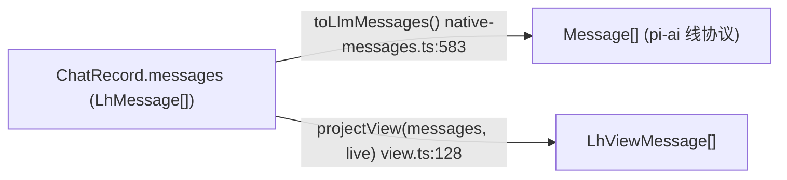

# SKILL: 核心数据模型与状态机投影分析 (Data Model & State Projection Analyzer)

## 0. 目标与适用范围

帮助读者厘清四个问题：**磁盘上存了什么**（Stored Truth）、**发给模型的是什么**（Model Projection）、**浏览器渲染的是什么**（View Projection）、**哪些状态从不落盘而在读取时派生**（Derived），以及**哪些是派生结果在某一时刻的冻结快照**（Snapshot）。

- 适用：
  - `ChatRecord` / `LhMessage` 的字段契约、构造函数、ID 规则与写入路径。
  - 同一份 `LhMessage[]` 在 `toLlmMessages()`（`src/core/native-messages.ts:583`）与 `projectView()`（`src/core/view.ts:128`）中的分支级对比。
  - 图谱账本（`nodes.jsonl` / `chains.jsonl` / `coverage.jsonl` / `sessions.jsonl`）与派生视图（图谱边、`uncovered`、计划节点状态）。
  - 客户端 `SessionModel`（`components/session-core.ts:227`）：`base` / `tail`、乐观追加、SSE 事件折叠、`absorbed()` 吸收、重连与结算。
- 不适用：
  - 服务端路由锁、写盘系统调用的逐行时序（交 `code-execution-trace`）。
  - 提示词、工具控制流、Steer 投递时机（交 `agent-harness-dissector`）。
  - 语言/并发机制的 Java 对照（交 `java-to-ts-node-bridge`）。

核心原则：**严格区分四类数据——存储真相、投影、派生、快照。** 三条消息管道必须分名：`LhMessage`（记录，`native-messages.ts:95`）、`Message`（`@earendil-works/pi-ai` 线协议，`toLlmMessages` 的返回类型）、`LhViewMessage`（视图，`view.ts:66`）。

---

## 1. 证据规则（最高优先级）

0. **锚点复核。** 开始前执行 `git rev-parse --short HEAD`；第 9 节行号仅对其标注的 commit 有效，引用前用 `grep -n` 按函数名重新定位。
1. **先取证，后叙述。** 接口名、类型别名、`customType` 字面量、投影分支、状态值写出前必须本次会话 grep/read 过。
2. **出处 `path:line`**，首次出现时附上。
3. **三级置信**：无标记（读到原文）/ `【推断】`（由已读分支推出，无直接代码或测试）/ `【未验证】`（未读到，如某个 React 组件如何消费 `LhViewPart`）。
4. **注释不是代码。** 只由注释支撑的结论写成「注释称…（`path:line`）」。注释之间或注释与代码冲突时，以代码为准并指出冲突。
5. **禁止为满足格式而补写。** 不存在写 `N/A — <原因>`。
6. **类型与签名逐字抄写**，包括字段是 `string` 还是 `Array`（例：`newUserMessage` 的 `content` 是 `string`，不是 `[{ type: "text", text }]`）。
7. **框架行为不凭记忆。** 涉及 Next.js 数据获取/缓存先查 `node_modules/next/dist/docs/`，查不到标 `【未验证】`。

---

## 2. 表达规则

### 2.1 禁止
- 混用三层消息名词（如「把消息发给前端」而不说明是哪一种）。
- 虚构持久化字段：「把问题标记为已回答存入数据库」「把图谱边写入文件」「把节点 visited 状态写入 JSON」。
- 反过来，把冻结快照说成「从不落盘」（见 6.4）。
- 模糊变形描述：「清洗一下历史」「转换成前端格式」。
- 未定义的自造术语。

### 2.2 允许（并鼓励）
- 精确形状表达式：`{ id, role: "custom", customType: "plan-block", content: "", display: true, details: { planCallId, block }, timestamp }`。
- 开头 ≤3 行总览；Mermaid 数据流/状态图（节点必须是真实标识符）。

### 2.3 双投影对比表（凡拆解 `LhMessage` 分支必须使用）
| 记录项（`LhMessage` 分支） | 构造入口 | `toLlmMessages()` 分支与产出 | `projectView()` 分支与产出 | 差异原因（代码或注释依据） |
|---|---|---|---|---|

- 拆解 Marker 时，**必须覆盖全部 9 种 `customType`**，或写明「本次只分析 X、Y，其余未覆盖」。不得用 2~3 行代替全集。

---

## 3. 工作流程

1. **锚点复核。**
2. **定位类型契约与持久化入口**：`src/core/contracts/*.ts`、`src/core/native-messages.ts`、`src/core/ports.ts`、`src/store/*.ts`、`config.ts`。
3. **归入数据域**（第 4 节）。
4. **追踪写入端**：构造函数 → 调用方（如 `persistTurn()`，`src/server/turn-service.ts:59`）→ 存储方法 → fs 写法。
5. **追踪读取端**：逐个 `if` / `switch` 分支核对 `toLlmMessages`、`projectView`、`projectMarker`、`coverageOf`、`derivePlanStatuses`、`SessionModel` 方法的字段增删改。
6. **套用 5 阶段模板**（第 5 节）与专项规则（第 6 节）。
7. **补充测试佐证**：`grep tests/`；无覆盖时写明。
8. **执行第 8 节自检。**

---

## 4. 四大数据域

| 域 | 名称 | 核心锚点 | 真相 / 投影 / 派生 / 快照 |
|---|---|---|---|
| **D1** | 会话记录与输入折叠 | `src/core/contracts/chat.ts`、`src/core/native-messages.ts`、`src/core/input-events.ts`、`src/store/chats.ts` | 真相：`data/chats/<id>.json`（目录 `PATHS.chats`，`config.ts:27`）中的 `ChatRecord`，含 `messages`、`tree`（`saveTree`，`ports.ts:46`）、用量日志（`appendTurnUsage` 按 turn id 幂等，`ports.ts:47-51`）。写法：`writeChat()` 用 `fs.writeFileSync` 直接覆盖（`src/store/chats.ts:58`，非原子）。客户端只发 `{ chatId, input }`（`ChatInput` 联合，`input-events.ts:50-66`），服务端折叠为 `LhMessage[]` |
| **D2** | 同源双投影 | `toLlmMessages`（`native-messages.ts:583`）、`projectView`（`view.ts:128`） | 投影：同一份 `LhMessage[]` 产出 `Message[]` 与 `LhViewMessage[]`，两者都不落盘 |
| **D3** | 图谱账本与派生 | `src/core/ports.ts:68-104`、`src/store/graph.ts`、`src/core/coverage.ts`、`src/core/contracts/plan.ts` | 真相：JSONL 账本以追加为主（`appendLine()`，`graph.ts:53-57`），`chains.jsonl` 可经 `rewriteLedgers()` 原子重写（`graph.ts:217`）。派生：图谱边（注释 `ports.ts:69-74`）、`uncovered`（SHA-256 指纹对账，注释 `coverage.ts:8-14`）、计划节点状态（`PlanNodeStatus`，`contracts/plan.ts:42-43`） |
| **D4** | 客户端状态机 | `components/session-core.ts`（`SessionModel`、`absorbed`、`visibleQueuedSteers`） | 内存态：`base`（最近一次同步的服务端记录）+ `tail`（本地乐观项与流式消息），不落盘 |

---

## 5. 单数据模型 / 状态机 5 阶段模板

不存在的阶段写 `N/A — <原因>`。

### 阶段一：持久层契约与落盘形状
- 类型定义 `path:line`，逐字抄写。
- 文件路径常量（`config.ts:line`）、写法（直接覆盖 / 原子替换 / 追加）。
- 真相边界：落盘字段、绝不落盘的关联状态、以冻结快照形式落盘的派生值。

### 阶段二：构造工厂、写入源与不变式
- 构造函数签名与 `path:line`。
- ID 规则：`newMessageId()`（`msg_…`，`native-messages.ts:174-176`）/ 确定性 ID（如 `steer_probe_${chatId}`）/ 客户端 ID（`c_…`）。
- 幂等键与写入顺序。

### 阶段三：双投影对比
- 第 2.3 节表格。非消息数据写 `N/A — 不进入会话消息投影`。

### 阶段四：派生算法或状态转移
- 派生：输入、折叠规则、输出类型、确定性保证。
- 状态机：`当前 SessionStatus × 触发` → `下一 SessionStatus` + `base / tail / executions / streamingIds` 的变化。

### 阶段五：边界语义
至少检查以下 5 种情况，不适用的写 N/A：
1. 回合中止 / 悬空工具调用（`INTERRUPTED_TEXT` 合成 vs. `pendingQuestionOf`）。
2. Compaction 截断与降级（切点 ID 缺失时）。
3. 流式进行中 vs. 已结算（`streamingIds` 正向证据门控）。
4. 文件损坏（JSON 整文件损坏 → `getChat` 返回 `null`；JSONL 坏行 → 跳过）。
5. 投影找不到挂载点时被静默丢弃（如 `plan-block` 前面没有 assistant 组）。

---

## 6. 专项规则

### 6.1 问答数据流：一问一答在三处的非对称表示
1. **提问后、作答前**：
   - 运行时：问题工具返回内存占位 `questionResult()`（`src/agent/tool-execute.ts:237-249`，`details: null, terminate: true`）。
   - 落盘：`persistTurn()` 过滤掉 `QUESTION_TOOLS` 的非错误工具结果（`src/server/turn-service.ts:72-79`）→ 记录中只有 `AssistantMessage` 里的 `toolCall`，没有对应 `ToolResultMessage`。`QUESTION_TOOLS = ["quiz", "probe", "ask_user_question", "explain", "recall"]`（`src/core/pending.ts:53-59`）。注意 `problem` 不在其中，其结果会落盘（注释 `tool-execute.ts:251-255`）。
   - 客户端流式期间：`turn_end` 把占位结果以 `c_` ID 追加进 `tail`（`session-core.ts:471-483`）；`pendingQuestionOf()` 通过 `isLiveQuestionPlaceholder()`（`native-messages.ts:711-715`）排除它。
   - 视图：`toolPartOf()`（`view.ts:311-348`）对无执行结果的悬空调用给出 `streamingMessage ? "input-streaming" : "input-available"`（`:345`）；对干净的问题执行结果保持 `"input-available"`（`:331-335`）；`applyResultTo()` 对 `details == null` 的问题类结果也保持 `"input-available"`（`:360-369`）。
   - 模型：只有在 `toLlmMessages` 被调用时（即下一次构造 Agent 时）才会遇到悬空调用，见 6.3。
2. **作答后**：
   - 落盘：`newAnswerResult(toolCallId, toolName, answer)`（`native-messages.ts:206-223`）。双受众设计：`content` 是 `JSON.stringify(compactAnswerForModel(answer))`（`:216`），`details` 是完整 `QuestionAnswerData`（`:219`）。
   - 模型：去掉 `id` / `cliContextWindow` 后原样输出（`:642-643`），模型只读 `content`。
   - 视图：`findToolPart()`（`view.ts:143-158`）从新到旧找到原提问部件，`applyResult()`（`:103-113`）置 `"output-available"` 并挂 `part.output = result.details`。

### 6.2 Compaction：模型截断 vs. UI 全量保留，并检查降级
- 模型端（`native-messages.ts:584-639`）：
  - `activeCompactionOf()`（`src/core/compaction.ts:278-291`）取最新的、带 `firstKeptMessageId` 的 compaction Marker。
  - `keptIndexFor()`（`compaction.ts:296-302`）找到切点；**仅当 `kept > 0`** 时生成 `head`（摘要作为 user 消息，`native-messages.ts:597-604`）并从切点开始遍历。
  - 若 `messages[0]` 是 `role: "system"`（Agent 注入的系统消息），它被保留在 `head` 之前（`:617-622`）。
  - 有 `head` 时跳过所有 compaction Marker（`:633`）。
  - **降级**：切点 ID 缺失（`keptIndexFor` 返回 `-1`）或切点是第 0 条时，`head` 为 `null`，不切除任何历史，compaction Marker 走通用分支被展平为 user 文本（`:634-638`）。
- 浏览器端（`view.ts:160-182, 459-476`）：不隐藏任何消息；在 ID 等于 `firstKeptMessageId` 的消息前插入 `data-compaction-cut`（只有该 ID 存在时才插入），并在 Marker 原位渲染 `data-compaction`。

### 6.3 `toLlmMessages` 的完整规则（必须全部核对）
1. `plan-block` 与 `problem-dismissed` → `continue` 丢弃（`:629`）。
2. 有 `head` 时 compaction Marker → 丢弃（`:633`）。
3. 其余所有 Marker → 展平为 `{ role: "user", content: [{ type: "text", text: marker.content }], timestamp }`（`:634-638`）。
4. 非 Marker → 去掉 `id` 与 `cliContextWindow` 后原样输出（`:642-643`）。
5. `assistant` 消息若 `stopReason` 不是 `"error"` / `"aborted"`，则对其后没有结果的**每一个** `toolCall`（不限问题工具）合成 `{ role: "toolResult", content: [{ type: "text", text: INTERRUPTED_TEXT }], isError: false }`（`:647-663`；常量 `:53-54`）。

### 6.4 派生 vs. 冻结快照
- 计划节点实时状态是派生值：`derivedNodeStatus()`（`src/core/contracts/plan.ts:76-80`）由 quiz 调用推导（规则注释 `:45-60`），`PlanTree` 只存结构。
- 但 `plan-block` Marker 的 `details.block` 是在 `persistTurn` 时由 `planBlocksFor()`（`src/core/plan-blocks.ts:75-95`）调用 `snapshot()`（`:37-50`）写入的**冻结快照**，其中每个节点带 `status`（`:46`）。拆解时必须写明：实时状态不落盘，快照状态随 Marker 落盘且不再重算（注释 `:33-36`）。

---

## 7. 负面约束

1. **严禁混淆 `base` 与 `tail`。** `base`（`session-core.ts:242`）是最近一次同步得到的服务端记录；`tail`（`:243`）是乐观项与流式消息。
2. **严禁把 `absorbed()` 说成结算路径。** 它只被 `adoptRecord()`（`session-core.ts:949-963`，追加式采纳）使用；全量同步走 `setMessages()`（`:928-940`）或 `resumeStream(true)` 的记录重取（`:594-619`），二者直接清空 `tail`。
3. **严禁遗漏正向证据门控。** 未拿到执行结果的 `toolCall` 只有在 `live?.streamingIds.has(m.id) === true`（`view.ts:224`）时才是 `"input-streaming"`。
4. **严禁只覆盖部分 Marker 却宣称完整。** 见 2.3。
5. **路径不可悬空；不得为填模板编造。**

---

## 8. 输出前自检清单

- [ ] 已记录 HEAD；所有标识符首次出现带 `path:line`。
- [ ] 已区分真相 / 投影 / 派生 / 快照四类。
- [ ] 双投影表覆盖了声称覆盖的全部分支（Marker 为 9 种）。
- [ ] `toLlmMessages` 的 5 条规则已逐条核对（6.3）。
- [ ] 涉及答题结果：已说明 `content` / `details` 双受众，以及占位结果在服务端被过滤、在客户端被排除。
- [ ] 涉及 `SessionModel`：已区分 `adoptRecord` / `setMessages` / `resumeStream` 三条同步路径。
- [ ] 第 5 节阶段五的 5 种边界已逐项给出结论或 N/A。
- [ ] 推断和未验证内容已标记。

---

## 9. 示范案例：`LhMessage` 全分支双投影 + `SessionModel` 状态机

> 行号基于 commit `8b235af`（2026-11-06）。按第 1 节第 0 条复核后使用；代码与本文不一致时以代码为准。

**总览**：`ChatRecord.messages` 中的 4 种 role 与 9 种 Marker 在 `toLlmMessages` 与 `projectView` 中分道扬镳；客户端 `SessionModel` 用 `base + tail` 叠加乐观项与流式消息，再由三条同步路径收敛到服务端记录（数据域：**D1 + D2 + D4**）。

### 阶段一：持久层契约

```ts
// src/core/native-messages.ts:66-86
export interface LhMarkerMessage {
	id: string;
	role: "custom";
	customType:
		| "graph-context"
		| "probe-handoff"
		| "subagent-steer"
		| "subagent-abort"
		| "plan-block"
		| "practice-thinking"
		| "practice-next"
		| "problem-dismissed"
		| "compaction";
	content: string;   // 面向模型的文本（plan-block 为 ""）
	display: boolean;
	details: unknown;  // 面向 UI 的载荷，模型不可见
	timestamp: number;
}

// src/core/native-messages.ts:95-100
export type LhMessage = (UserMessage | AssistantMessage | ToolResultMessage | LhMarkerMessage) & {
	id: string;
	cliContextWindow?: number;
};
```
- `LhMarkerMessage` 经声明合并加入 `pi-agent-core` 的 `CustomAgentMessages`（`:88-92`）。
- 写入：`persistTurn()`（`src/server/turn-service.ts:59-93`）过滤占位结果（`:72-79`）、为无 ID 消息补 `newMessageId()`（`:80`）、追加 `planBlocksFor()` 产出的 Marker（`:83-86`），然后 `chatStore.saveMessages(...)`（`:87`）→ `writeChat()` 直接覆盖（`src/store/chats.ts:58`）。
- 不落盘：`LhViewMessage` 分组、`step-start` 分隔、部件 `state`、`INTERRUPTED_TEXT` 合成结果、内存占位 `questionResult()`、`SessionModel` 的全部字段。

### 阶段二：构造工厂与 ID 规则

| 类别 | 构造函数 | ID | 关键字段 |
|---|---|---|---|
| 用户文本 | `newUserMessage(text: string)`（`native-messages.ts:182`） | `newMessageId()` → `msg_…`（`:174-176`） | `role: "user"`, `content: text`（**string**） |
| 用户插话 | `newUserSteer(text, id)`（`:196`） | 客户端生成的 `steer_${localId()}`（`session-core.ts:816`），原样落盘 | `role: "user"`, `content: text` |
| 作答 | `newAnswerResult(toolCallId, toolName, answer)`（`:206`） | `newMessageId()` | `content` 为精简 JSON，`details` 为完整作答 |
| `graph-context` | `newGraphContextMessage(picks, chains)`（`:279`） | `newMessageId()` | `content` 为 `[Session context]…` 文本，`details: { propositions, chains }` |
| `probe-handoff` | `newHandoffMessage(chatId)`（`:227`） | 确定性 `steer_probe_${chatId}`（`:229`） | `content: HANDOFF_TEXT`，`details: { chatId }` |
| `subagent-steer` / `subagent-abort` | `buildSubagentSteer()` / `buildAbortSteer()`（`src/core/contracts/jobs.ts:368,391`） | 注释称 `steer_<jobId>`（`contracts/jobs.ts:432-434`） | 【未验证】字段细节，使用前打开 |
| `plan-block` | `newPlanBlockMessage(planCallId, block)`（`:242`） | `pb_${Date.now().toString(36)}_${uuid8}`（`:247`） | `content: ""`，`details: { planCallId, block }`；按 `planCallId` 幂等（`plan-blocks.ts:54-64`） |
| `practice-thinking` | `newThinkingMessage(problemCallId, text)`（`:316`） | `newMessageId()` | `content: \`${THINKING_LABEL}:\n${text}\``，`details: { problemCallId, text }` |
| `practice-next` | `newNextMessage()`（`:334`） | `newMessageId()` | `content: NEXT_PROBLEM_TEXT`，`details: {}` |
| `problem-dismissed` | `newProblemDismissedMarker(problemCallId)`（`:352`） | `newMessageId()` | `content: ""`，`details: { problemCallId }` |
| `compaction` | `newCompactionMarker(summary, details)`（`src/core/compaction.ts:263`） | `newMessageId()` | `content` 为标题 + 摘要 |
| 客户端临时项 | `localId()`（`session-core.ts:57-59`） | `c_${Date.now().toString(36)}_${seq}` | 仅存在于 `tail`；`c_` 前缀本身从不作为服务端 ID 落盘 |

### 阶段三：双投影对比



**按 role**

| 记录项 | `toLlmMessages()` | `projectView()` | 差异原因 |
|---|---|---|---|
| `user` | 去 `id` 原样（`:642-643`） | 独立 user 消息，`content` 为 string 或数组时都转 text 部件（`view.ts:184-191`） | — |
| `assistant`（text / thinking） | 去 `id` 原样，块顺序不变 | thinking 稳定前置（`view.ts:206-229, 264`）；连续 assistant 合并进同一组，每步前插 `{ type: "step-start" }`（`:280-286`）；已结算的空消息不渲染，流式中的空消息渲染一个空 reasoning 部件（`:265-279`） | 注释（`:206-213`）：部分模型在正文后输出 thinking，UI 固定把推理放在上方 |
| `assistant` 含 `send_to_user` 调用 | 原样 | 生成/中止失败的消息跳过（`:239`）；若有错误结果显示错误卡片（`:240-243`），否则 `sendToUserText()` 转为普通 text 部件（`:245-248`） | 对模型是工具调用，对学习者是正文 |
| `assistant` 含悬空调用 | 合成 `INTERRUPTED_TEXT` 结果（规则 6.3-5） | `toolPartOf()`：`input-streaming` 或 `input-available`（`:345`） | 模型协议要求 `toolCall` 必须配对 `toolResult`；UI 用悬空调用挂载答题面板 |
| `toolResult` | 去 `id` 原样 | 不生成消息，`findToolPart()` 反向挂载（`:199-201`）；找不到部件则丢弃（`:373-374`） | 作答可能在几轮之后到达 |

**按 Marker（9 种全覆盖）**

| `customType` | `toLlmMessages()` | `projectView()` → `projectMarker()`（`view.ts:378-490`） |
|---|---|---|
| `graph-context` | 展平为 user 文本（`:634-638`） | user 消息 + `data-graph-context` 部件（`:380-390`） |
| `probe-handoff` | 展平：`HANDOFF_TEXT` | user 消息 + `data-probe-handoff`（`:391-398`） |
| `subagent-steer` | 展平 | user 消息：`textPart(marker.content)` + `data-subagent-artifact`，`metadata.subagentResult`（`:399-420`） |
| `subagent-abort` | 展平 | user 消息：文本 + `data-subagent-aborted`（`:421-430`） |
| `plan-block` | **丢弃**（`:629`） | 不生成消息；只有 `out` 末尾是 assistant 组且组内有成功的 `tool-plan_init`（`lastSuccessfulPlanInit`，`:116-124`）时才 `splice` 到其后（`:478-488`），否则静默丢弃 |
| `practice-thinking` | 展平：`THINKING_LABEL` + 文本 | user 消息 + `data-practice-thinking`（`:431-442`） |
| `practice-next` | 展平：`NEXT_PROBLEM_TEXT` | user 消息 + `data-practice-next`，`data: null`（`:443-454`） |
| `problem-dismissed` | **丢弃**（`:629`） | **丢弃**（`:455-458`）；注释称模型侧在下次输入时以合成的 conclude 调用对出现 |
| `compaction` | 有 `head` 时丢弃，否则展平（6.2） | user 消息 + `data-compaction`（`:459-476`），另在切点前插入 `data-compaction-cut`（`:170-182`） |

### 阶段四：`SessionModel` 状态转移

状态：`SessionStatus = "ready" | "submitted" | "streaming" | "error"`（`session-core.ts:39`）。`getState()` 只在 `submitted` / `streaming` 时构造 `LiveTurnState`（`:291-294`）并调用 `projectView([...base, ...tail], live)`（`:306`）。

| 当前 | 触发 | 下一状态 | `base` / `tail` / 其他变化 |
|---|---|---|---|
| `ready`（或 `error` 恢复中） | `send(input)`（`:653`） | `submitted`（`:668`） | `text` / `thinking` / `next` / `answer` 以 `localId()` 推入 `tail`（`:702-721`） |
| `submitted` | POST 返回 409 | 不变 | `postInputEvent()` 每 `pollMs` 查一次 `turnInFlight`，空闲后重发同一 body，最长 `waitMaxMs`（`:356-364`；默认 500ms / 30s，`:42-44`） |
| `submitted` | 最终仍 409 或非 2xx | `error`（`:792-793`） | 失败的 `answer` 乐观项从 `tail` 移除（`:785-791`）；失败的首条消息气泡移除（`:771-778`） |
| `submitted` | POST 2xx | 不变 → `resumeStream(true)`（`:768`） | 重取记录：成功时**原子地** `base = record.messages; tail = []`（`:609-618`） |
| `submitted` | 第一个产生视图工作的 SSE 事件 | `streaming`（`:517-519`） | `agent_start` / `turn_start` 不算视图工作（`:386-391, 484-485`） |
| `submitted` / `streaming` | assistant `message_*` 事件 | 不变 | ID = `message.id ?? streamingMessageId ?? localId()`（`:427`），按槽位替换 `tail` 中同一条；`message_start` 加入 `streamingIds`（`:438-443`） |
| 同上 | 非 assistant `message_*`（插话、Marker） | 不变 | 按 `id` upsert 进 `tail`（`:399-413`） |
| 同上 | `tool_execution_end` | 不变 | 写入 `executions`（`:455-470`） |
| 同上 | `turn_end` | 不变 | `toolResults` 以 `localId()` 追加进 `tail`（`:471-483`） |
| 同上 | `[DONE]` | `ready`（`:530`） | 清空 `streamingIds` / `executions`（`:528-529`）；**`tail` 保留**，由页面层的同步调用 `setMessages()` 收敛【未验证：调用方位于 session-core.ts 之外】 |
| 同上 | `turn-settled` 事件 | `ready` | 调用 `onReattachSettled()` 后返回（`:508-514`） |
| 同上 | 流在 `[DONE]` 前断开 | 不变 | 只读恢复一次：`resumeStream(true, false)`（`:533-537`） |
| 恢复中 | 再次失败 | `error` | 错误文本 `STREAM_DROPPED`（`:642-643`，常量 `:85`） |
| 任意 | `stop()`（`:899-906`） | `ready` | 中断消费；清空 `streamingIds` / `executions`；**保留 `tail`** |
| 任意 | `adoptRecord(record)`（`:949-963`） | 不变 | 仅当记录是现有 `base` 的纯追加时：`base = record`，`tail` 去掉被 `absorbed()` 判定吸收的项 |
| 任意 | `setMessages(record)`（`:928-940`） | 不变 | `base = record; tail = []` |
| 任意 | `steer(text)`（`:813-841`） | 不变 | 只更新 `steerQueue`；409 时退回 `send({ type: "text" })` |

**`absorbed(m, record)`（`session-core.ts:140-173`）**

| `tail` 项 | 判定吸收的条件 | 说明 |
|---|---|---|
| ID 不以 `c_` 开头 | 直接 `false`（`:141`） | 如 `steer_c_…` 的插话 |
| `role: "user"` | `record` 中存在 `role === "user"` 且 `content ===` 相同（`:143-148`） | `content` 是 string，`===` 即值比较 |
| `role: "toolResult"` | 存在相同 `toolCallId` 的结果（`:149-156`） | 也会吸收 `turn_end` 产生的 `c_` 工具结果 |
| `role: "custom"` | `customType` 相同且 `JSON.stringify(details)` 相同（`:157-171`, `:177-179`） | 修复练习模式思考卡片重复显示（注释 `:158-163`） |
| `role: "assistant"`（流式消息也带 `c_` ID） | 无分支，返回 `false`（`:172`） | 流式助手消息只能被全量同步清除 |

### 阶段五：边界语义

1. **悬空调用**：模型侧合成 `INTERRUPTED_TEXT`（6.3-5）；客户端答题面板由 `pendingQuestionOf()`（`native-messages.ts:685-706`）决定，它只接受最新 assistant 消息中状态为 `"answerable"` 的问题调用（`questionCallsOf()`，`:724-742`）；`stopReason` 为 `error` / `aborted` 的记为 `failed`，`length`、参数解析失败记为 `malformed`（`:732-735`）。
2. **Compaction**：见 6.2，包括降级路径。
3. **流式 vs. 已结算**：练习会话中旧回合的 `problem` 调用不会因为本回合在流式而重新显示为加载动画，因为其消息 ID 不在本次 `streamingIds` 中（`view.ts:218-224`）。
4. **文件损坏**：`chats/<id>.json` 直接覆盖写，崩溃可能截断；`getChat` 对损坏文件返回 `null`（接口注释 `ports.ts:38`）。图谱 JSONL 坏行由 `readRawLines()` 跳过（`src/store/graph.ts:59-78`）。
5. **静默丢弃**：`plan-block` 找不到 assistant 组或成功的 `plan_init` 时不显示（`view.ts:482-484`）；`toolResult` 找不到部件时不显示（`:373-374`）；两者都仍在记录中。

**测试佐证**
- 黄金数据：`tests/golden-fixtures.test.ts:90`（对真实记录运行 `toLlmMessages`），fixture 覆盖的 Marker 类型见 `tests/fixtures/golden-data/README.md:19`。
- Compaction 截断：`tests/compaction.test.ts:239-311`（多处 `toLlmMessages` 断言），视图 `:386, :397`。
- 悬空问题权威性：`tests/pending-authority.test.ts:16-60`。
- 畸形问题不挂载：`tests/malformed-question-recovery.test.ts:71`。
- `SessionModel`：409 重试 `tests/session-core.test.ts:206, :218`；`adoptRecord` `:433, :505, :549, :922`；`turn-settled` `:624, :749`。
