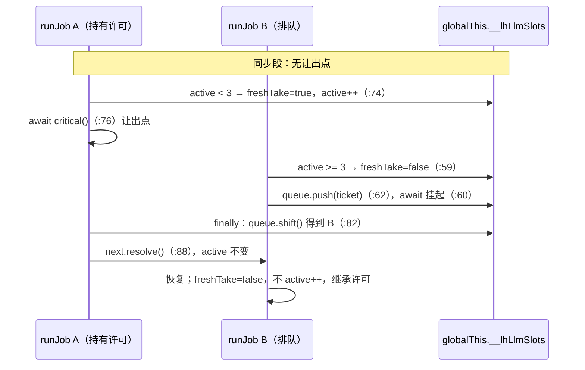

# SKILL: Java → TS/Node/Next.js 心智迁移拆解 (Java-to-TS/Node Mental Model Bridge)

## 0. 目标与适用范围

帮助具有 Java Web 经验的读者**从代码与运行时物理层级理解 `learnharness` 中的 TypeScript / Node.js / Next.js 16 机制**：用精确的 Java/Spring 参照物定位「表面相似、底层语义不同」的陷阱。

- 适用：
  - M1 TypeScript 结构化类型、可辨识联合、模块声明合并（`declare module`）、TypeBox 运行时校验。
  - M2 无 IoC 容器的依赖注入：端口接口（`src/core/ports.ts`）、组合根（`src/server/stores.ts`）、工厂闭包、`eslint.config.mjs` 模块红线。
  - M3 单线程事件循环并发：`globalThis` 进程级状态、Promise 链互斥锁、异步信号量、`AbortSignal` 取消传播。
  - M4 Next.js 16 App Router 服务端/客户端边界、Barrel（`src/core/index.ts` / `src/server/index.ts`）打包隔离。
  - M5 Web `ReadableStream` / `AsyncGenerator` SSE 消费与同步 `fs` 写盘的崩溃语义。
- 不适用：
  - 单条端到端业务调用链的逐行追踪（交 `code-execution-trace`）。
  - 提示词、工具控制流、Steer 投递（交 `agent-harness-dissector`）。
  - 消息双投影与客户端状态机的数据形态（交 `data-model-state-projection`）。

核心原则：**对比必须落在物理机制上，而不是落在名词类比上。** 只写「相当于 Spring Singleton Bean」而不指出 `globalThis` 的生命周期差异，比不对比危害更大。

### 0.1 适用前提（每次输出必须显式声明）
本 Skill 中「同步代码段天然互斥」「`globalThis` 即全局单例」「同步 `fs` 读-改-写不交错」三条结论**只在单 Node 进程、单事件循环、未使用 `worker_threads` 的部署下成立**。多进程（cluster、多实例 `next start`、Serverless）下这些原语全部失效。若分析对象的正确性依赖这三条，输出中必须写一行「前提：单进程部署」。

---

## 1. 证据规则（最高优先级，先于一切格式要求）

0. **锚点复核。** 开始前执行 `git rev-parse --short HEAD` 记录版本；第 9 节示范案例中的行号仅对该案例标注的 commit 有效，引用前用 `grep -n "<函数名>" <文件>` 重新定位。
1. **先取证，后叙述。** 任何本仓库函数、常量、类型、文件、环境变量、ESLint 规则写出前，必须已在本次会话中 `grep` / `glob` / `read` 确认存在。
2. **出处格式 `path:line`**（相对仓库根），在标识符**首次出现**时附上。例：`withBgLlmSlot()`（`src/agent/subagents/bg-llm-semaphore.ts:52`）。
3. **三级置信标记**：
   - 无标记 = 已读到代码原文。
   - `【推断】` = 由已读代码与事件循环规则推出，但无直接代码或测试佐证（例：两个请求在某个 `await` 处交错后的内存状态）。
   - `【未验证】` = 未读到相关代码或文档。
4. **注释不是代码。** 仅由源码注释支撑的结论（例如「Next dev 按路由编译独立模块实例」）必须写成「注释称…（`path:line`）」，并按第 6 条核对框架文档；无法核对时标 `【未验证】`。
5. **第三方包可取证。** `node_modules/<pkg>/dist/*.js` 可以直接 `read`；读到则无标记并给出 `node_modules/...:line`，未读则标 `【未验证】`。
6. **框架行为不凭记忆。** Next.js 路由/缓存/Server-Client 边界先查 `node_modules/next/dist/docs/`；查不到标 `【未验证】`。
7. **禁止为满足格式而补写。** 模板项不存在写 `N/A — <原因>`。
8. **签名逐字抄写。** 类型定义、函数签名、对象字面量以源码为准，不得把被包装的值写成裸值（例：`stores` 的每个字段都经过 `traceObject(...)` 包装，不能写成 `{ chatStore, graphStore }`）。

---

## 2. 表达规则

### 2.1 术语表（首次使用时按此定义，禁止自造其他说法）
| 术语 | 定义 |
|---|---|
| 同步段 | 两个让出点之间连续执行的 JS 代码；单进程内不会被其他 JS 回调打断 |
| 让出点 | `await`、`yield`、回调注册后返回事件循环的位置；此后其他请求的 JS 可以执行 |
| 交错窗 | 一个让出点挂起到恢复之间的时间段；此期间共享状态可能被其他回调修改 |
| async 函数 | 不称「协程」或「线程」；它是返回 Promise 的函数，挂起时不占用线程 |

### 2.2 禁止
- 浅层名词替换：只写「相当于 `@Autowired` / `synchronized` / `@Transactional`」不交代差异。
- 把 `interface` / `type` 当成运行时存在的类或反射元数据。
- 把 `await` 说成「阻塞线程」；把 `fs.writeFileSync` 说成「非阻塞」。
- 把源码中有已知缺陷的机制描述为「保证」（见第 6.1 条第 4 点）。

### 2.3 允许（并鼓励）
- 精确的 Java 参照物：`java.util.concurrent.Semaphore`、`ReentrantLock`、`ThreadLocal`、`CompletableFuture`、Spring AOP 代理、`ApplicationContext`、Jackson `@JsonTypeInfo`、Servlet `AsyncContext`、ArchUnit。
- 对应的 Node 参照物：`AsyncLocalStorage`（对标 `ThreadLocal`）、`worker_threads`（对标真正的多线程）。
- 开头 ≤3 行总览；Mermaid 事件循环交错时序图（参与者必须是真实文件/函数/变量）。

### 2.4 标准四行对比表（凡做机制对比必须包含）
| 对比维度 | Java Web 机制（参照系） | 本仓库实现（带 `path:line`） | 核心差异与迁移陷阱 |
|---|---|---|---|
| **编译期 vs. 运行时存在性** | 字节码保留类型，可反射 / `instanceof` | TS 类型擦除；运行期靠判别字段或 TypeBox 校验 | … |
| **内存作用域与生命周期** | Spring Bean 随 `ApplicationContext` 存活 | `globalThis.__lh*` 随进程存活，重启清空 | … |
| **调度与交错边界** | OS 线程任意指令处可被抢占 | 单线程；只在让出点交错 | … |
| **异常与取消传播** | `Thread.interrupt()` / `InterruptedException` / 事务回滚 | `AbortSignal` 监听 + `err.name = "AbortError"`；无自动回滚 | … |

---

## 3. 工作流程

1. **锚点复核**（第 1 节第 0 条）。
2. **定位目标代码**：`grep` / `read` 用户指定的模块、类型、锁、端口或配置。
3. **归类映射域**（第 4 节）。
4. **追踪上下游**：
   - 类型：定义处 → 构造处 → 消费处的收窄或校验。
   - DI：端口（`src/core/ports.ts`）→ 适配器（`src/store/`）→ 组合根（`src/server/stores.ts`）→ 工厂调用点（如 `src/server/chat-handler.ts`）→ 闭包使用点。
   - 并发原语：`globalThis` 挂载点 → 获取点 → 每个让出点 → `finally` 释放点 → `AbortSignal` 处理点；**额外推演一次「排队者中止」路径**（第 6.1 条第 4 点）。
5. **套用 5 维模板**（第 5 节）与专项规则（第 6 节）。
6. **补充测试佐证**：`grep tests/`；**找不到覆盖测试时如实写「无测试覆盖」**，这本身是结论。
7. **执行第 8 节自检**。

---

## 4. 五大心智迁移域

| 域 | 名称 | 代码特征 | 必查问题 |
|---|---|---|---|
| **M1** | 类型系统与运行时校验 | `type A = B \| C`、`declare module`、`Type.Object`（TypeBox）、`x is Y` | 擦除后对象长什么样？靠哪个判别字段收窄？HTTP body / 磁盘 JSON / LLM 工具参数进入系统时由哪个函数做运行时校验？ |
| **M2** | 端口 DI 与模块红线 | `ports.ts`、`stores.ts`、`createXxx(deps)`、`eslint.config.mjs` 的 `zones` | 依赖经哪个参数/闭包传入？组合根在哪一行装配？违反哪个 zone？ |
| **M3** | 事件循环并发 | `globalThis.__lh*`、`async/await`、`new Promise` 队列、`Map`/`Set` 注册表、`AbortController` | 同步段为何不需要锁？哪个让出点打开交错窗？中止路径是否仍保持互斥？ |
| **M4** | Next.js 同构与 Barrel 隔离 | `app/**/page.tsx`、`app/api/**/route.ts`、`"use client"`、`src/core/index.ts`、`src/server/index.ts` | 该文件在 Node 还是浏览器执行？Barrel 是否真的只导出浏览器安全模块？ |
| **M5** | 流与同步文件 I/O | `ReadableStream`、`async function*`、`fs.writeFileSync`、`fs.appendFileSync`、`fs.renameSync` | 写法属于直接覆盖 / 原子替换 / 追加中的哪一种？崩溃后读取端如何容错？同步调用阻塞事件循环多久？ |

---

## 5. 单机制 5 维拆解模板

不存在的维度写 `N/A — <原因>`。

### 维度一：源码定位与签名原貌
- `path:line`、所属层（`app` / `components` / `server` / `agent` / `core` / `store`）。
- 逐字抄写核心类型或函数签名。

### 维度二：Java 对标（同构点 vs. 异构点）
- 最贴近的 Java/Spring 机制（写到具体类或注解）。
- 第 2.4 节四行对比表。

### 维度三：物理运行机制
- 状态存放位置与结构（`globalThis` 字段名、类型、定义行）。
- 执行序列：逐个标出同步段与让出点。
- 若有中止/异常路径：逐步推演，并判断不变式（互斥、计数守恒）是否保持。

### 维度四：Java 惯性反模式
- 2~3 条「按 Java 习惯改写会出什么事故」，每条写明可观测后果（编译错误文本 / ESLint zone 消息 / 死锁 / 竞态）。后果若是推演出来的，标 `【推断】`。

### 维度五：测试验证对照
- 引用 `tests/*.test.ts:line`，说明如何不借助 Spring TestContext / Mockito，只靠参数注入完成隔离。
- 无覆盖测试时写「N/A — 无测试覆盖（grep 关键字：…）」。

---

## 6. 专项规则

### 6.1 并发原语（M3）
1. **同步检查并置位**：`if (cond) mutate` 之间没有让出点时，单进程内天然互斥，不需要 `synchronized` / CAS。
2. **交错窗**：每个让出点之后，必须写明哪些共享内存或磁盘文件可能已被修改，以及代码是否在恢复后重读或 `signal?.throwIfAborted()`。
3. **为什么挂 `globalThis`**：引用源码注释（如 `src/agent/subagents/bg-llm-semaphore.ts:41-43`、`src/server/jobs.ts:55-57`），按第 1 节第 4 条处理其可信度；同时说明 dev 热重载重新求值模块时，模块顶层状态会被重置而 `globalThis` 上的不会。
4. **中止路径必须重新验证不变式**。Promise 链锁、信号量在「排队者被中止」时最容易破坏互斥或计数。必须给出反例推演或证明，不得因为源码注释写了 "successors never hang" 就等同于「互斥成立」。
5. **可重入性**：JS 没有线程身份，Promise 链锁天然不可重入；若要可重入，需要用 `AsyncLocalStorage` 自行记录持有者。

### 6.2 依赖注入与模块红线（M2）：核对 `eslint.config.mjs:41-70`
| Zone | 行号 | `target` | `from` | `except`（**相对 `from` 解析**，见注释 `:45`） |
|---|---|---|---|---|
| 1 | `:42-49` | `./components` | `./src` | `./core/index.ts` |
| 2 | `:50-56` | `./app` | `./src` | `./core/index.ts`、`./server/index.ts` |
| 3 | `:57-62` | `./src/core` | `./src/agent`、`./src/server`、`./src/store` | — |
| 4 | `:63-68` | `./src/agent` | `./src/server`、`./src/store` | — |

- 未被禁止的方向同样要写明：例如 `src/server` 可以导入 `src/agent`（`src/server/jobs.ts:71` 导入 `../agent/subagents/aborts.ts`）。
- ESLint 只约束 import 路径，**不约束** `src/core` 内部是否使用 `node:` 内建模块（见 6.4）。

### 6.3 类型系统（M1）
- 编译期：说明 `if (m.role === "custom")` 等判别如何触发控制流收窄。
- 运行时：外部输入进入系统时，指出具体的校验函数或 Schema 及其 `path:line`；LLM 工具参数的校验点在 `@earendil-works/pi-agent-core` 的 `prepareToolCall()`（`node_modules/@earendil-works/pi-agent-core/dist/agent-loop.js:487-545`，调用 `validateToolArguments`），校验失败转成 `isError: true` 的工具结果而不是抛出。

### 6.4 Barrel 与打包边界（M4）
- `src/core/index.ts:1-4` 头注释声称导出内容「no node builtins」，但该文件 `:86` 重新导出了 `./coverage.ts`，而 `src/core/coverage.ts:22` 导入 `node:crypto`。分析客户端打包问题时必须核对此类不一致；是否真的进入浏览器 bundle，取决于打包器的 tree-shaking 与客户端实际引用，未验证时标 `【未验证】`。

### 6.5 写盘（M5）：区分三种写法，并写出阻塞代价
| 写法 | 本仓库实例 | 崩溃语义 |
|---|---|---|
| 直接覆盖 | `writeChat()`（`src/store/chats.ts:58`，`fs.writeFileSync`） | 非原子；可能留下截断文件。`ChatStore.getChat` 对损坏文件返回 `null`（接口注释 `src/core/ports.ts:38`） |
| 原子替换 | `rewriteLedgers()`（`src/store/graph.ts:217`，tmp + `fs.renameSync` `:238`） | 旧文件或新文件二选一；可能残留 tmp |
| 追加 | `appendLine()`（`src/store/graph.ts:53-57`，`fs.appendFileSync`） | 末行可能截断；`readRawLines()`（`:59-78`）跳过坏行 |

- 同步 `fs` 的取舍必须两面都写：好处是一个同步段内读-改-写不会被其他请求交错（前提见 0.1）；代价是调用期间整个事件循环停顿，所有并发请求与 SSE 推送一起等待。
- 没有跨文件事务：多文件写入的恢复语义只能靠写入顺序加读取端容错。

---

## 7. 负面约束

1. **严禁伪造 Java 映射。** 无直接对应时写「无直接对应」并说明差异。
2. **路径不可悬空。** 首次出现必带 `path:line`。
3. **严禁忽略让出点。** 漏掉 `await` 带来的交错属于严重错误。
4. **严禁省略前提。** 依赖单进程语义的结论必须带 0.1 的前提声明。
5. **严禁把注释当证明。** 见第 1 节第 4 条。
6. **不得为填模板编造。** 不存在写 `N/A`，不确定标 `【推断】` / `【未验证】`。

---

## 8. 输出前自检清单

- [ ] 已记录 HEAD commit；所有本仓库标识符本次会话中 grep/read 过，首次出现带 `path:line`。
- [ ] 签名与对象字面量逐字对照源码（包括包装函数）。
- [ ] 已包含第 2.4 节四行对比表。
- [ ] 并发分析：已标出同步段、每个让出点、`globalThis` 挂载原因、`finally` 释放逻辑，并推演过中止路径。
- [ ] 依赖单进程语义的结论已写前提声明。
- [ ] 模块依赖分析：已核对 6.2 的 zone 及 `except` 路径语义。
- [ ] 已列 Java 惯性反模式；测试佐证带 `path:line`，或明确写「无测试覆盖」。
- [ ] 仅由注释支撑的结论已标明来源或 `【未验证】`。

---

## 9. 示范案例：后台 LLM 并发控制（异步信号量 + Promise 链互斥锁）与无容器 DI

> 行号基于 commit `8b235af`（2026-11-06）。按第 1 节第 0 条复核后使用；代码与本文不一致时以代码为准。
> 前提：单进程部署（0.1）。

**总览**：抽取流水线在单线程事件循环上用 `withBgLlmSlot`（3 许可信号量）限制后台 LLM 并发，用 `withAuditLock`（Promise 链 FIFO 锁）串行化「审计 + 合并」临界区，并通过工厂参数获得存储端口（映射域：**M3 + M2**）。

### 维度一：源码定位与签名原貌

1. **进程级信号量**（`src/agent/subagents/bg-llm-semaphore.ts`，agent 层）：
   ```ts
   const PERMIT_COUNT = 3;                       // :30

   export interface LlmSlots {                   // :32-35
   	active: number;
   	queue: { resolve: () => void; dead: boolean }[];
   }

   export function bgLlmSlots(): LlmSlots {      // :44-47
   	const g = globalThis as typeof globalThis & LhLlmSemaphoreGlobal;
   	return (g.__lhLlmSlots ??= { active: 0, queue: [] });
   }

   export async function withBgLlmSlot<T>(       // :52-55
   	signal: AbortSignal | undefined,
   	critical: () => Promise<T>,
   ): Promise<T>
   ```
2. **审计互斥锁**（定义在 `createExtractionPipeline()` 闭包内，`src/agent/subagents/extraction.ts:803`）：
   ```ts
   __lhAuditLock?: { tail: Promise<void> };      // :678（LhExtractionGlobal 字段）

   async function withAuditLock<T>(jobKey: string, kind: "chat" | "notes", label: string | undefined, critical: () => Promise<T>): Promise<T>   // :896
   ```
3. **端口与组合根**：
   - `export interface ChatStore`（`src/core/ports.ts:33`）、`export interface GraphStore`（`src/core/ports.ts:76`）。
   - `export interface GraphDeps { chatStore: ChatStore; graphStore: GraphStore; }`（`src/core/graph.ts:74-77`）。
   - `export interface ExtractionPipelineDeps extends GraphDeps, ExtractionModels`（`src/agent/subagents/extraction.ts:743`）；工厂签名 `export function createExtractionPipeline(deps: ExtractionPipelineDeps): ExtractionPipeline`（`:803`），首行 `const { chatStore, graphStore } = deps;`（`:804`）。
   - 组合根（`src/server/stores.ts:18-34`）：每个适配器都经 `traceObject(scope, label, target, options)`（`src/core/logger.ts:179`，注释称其为「transparent ES Proxy」）包装：
     ```ts
     export const stores = {
     	chatStore: traceObject("STORE", "chatStore", chatStore, { exclude: new Set(["getChat", "listChats"]) }),
     	graphStore: traceObject("STORE", "graphStore", graphStore, { exclude: new Set([/* read* 方法 */]) }),
     	sourceOrganizationStore: traceObject(/* … */),
     	jobStore: traceObject(/* … */),
     	settingsStore: traceObject(/* … */),
     };
     ```
   - 装配点：`export const extraction = createExtractionPipeline({ ...stores, engineFor: …, providerKeyMissing: … })`（`src/server/chat-handler.ts:121-134`）。

### 维度二：Java 对标

- `withBgLlmSlot` ≈ `new Semaphore(3, true)`（公平）。差异：许可释放时直接移交给队首等待者，不经过「归还再争抢」。
- `withAuditLock` ≈ `new ReentrantLock(true)`。差异：**不可重入**；`release` 可以由任意回调调用，不要求同一「线程」。
- `stores` + `traceObject` ≈ `@Configuration` 装配 + Spring AOP 代理（日志切面）；`createExtractionPipeline(deps)` ≈ 构造器注入。差异：没有容器、没有按类型自动装配，装配是一次普通函数调用。

| 对比维度 | Java Web 机制 | 本仓库实现 | 核心差异与迁移陷阱 |
|---|---|---|---|
| **编译期 vs. 运行时存在性** | `ChatStore` 编译为字节码接口，容器按类型反射注入 | `ChatStore` / `GraphStore`（`src/core/ports.ts:33,76`）编译后擦除；`stores` 是普通对象字面量，按结构类型满足 `GraphDeps` | 不能 `instanceof GraphStore`；注入错对象只在编译期由结构类型检查发现，运行期无容器兜底 |
| **内存作用域与生命周期** | 锁作为 Singleton Bean 字段，随 `ApplicationContext` 存活 | `globalThis.__lhLlmSlots`（`bg-llm-semaphore.ts:46`）、`globalThis.__lhAuditLock`（`extraction.ts:899`），`??=` 惰性创建，进程重启清空 | 注释（`bg-llm-semaphore.ts:41-43`）称 Next dev 为每个路由入口编译独立模块实例；`node_modules/next/dist/docs/` 中未找到对应说明 →【未验证】。无论是否如此，dev 热重载也会重置模块顶层状态 |
| **调度与交错边界** | 多线程抢占，`active++` 需 AQS/CAS | `if (slots.active >= PERMIT_COUNT)`（`:58`）到 `slots.queue.push(ticket)`（`:62`）是同步段；让出点只有 `await new Promise(...)`（`:60`）与 `await critical()`（`:76`） | 同步段不会被打断；跨过让出点后其他请求可能已修改任意共享状态 |
| **异常与取消传播** | `acquireInterruptibly()` 收到中断抛 `InterruptedException`，AQS 清理节点 | 排队中 abort：`die()` 置 `ticket.dead = true` 并 reject `AbortError`（`:64-69`），释放方跳过死票据（`:87`）；锁侧用 `Promise.race([prev, aborted])`（`extraction.ts:916`）+ `signal?.throwIfAborted()`（`:917`） | Promise 无法从外部取消，只能靠标记位与 `finally`；锁侧的中止路径会破坏互斥（见维度三第 3 点） |

### 维度三：物理运行机制



1. **信号量的许可移交**（`bg-llm-semaphore.ts:57-91`）：
   - 空闲时 `freshTake = true`，同步执行 `slots.active++`（`:74`）。
   - 满额时排队；被唤醒者因 `freshTake === false` 不再自增。释放者在 `finally` 中只有队列为空（或剩下的全是 dead 票据）时才 `slots.active--`（`:84`），否则 `next.resolve()`（`:88`）且计数不变。
   - 作用：避免「释放者减 1 后、被唤醒者恢复前，新来的同步调用抢占许可」导致的计数错乱（注释 `:16-20`）。
   - 中止：排队者 abort 时在进入 `try` 之前抛出，因此不会执行 `active++`，也不会进入释放它的 `finally`；它的票据留在队列里，由下一次释放跳过。计数守恒成立。
2. **Promise 链锁的获取**（`extraction.ts:898-902`）：同步段内完成「读旧队尾 `prev = lock.tail`」与「`lock.tail` 换成自己的新 Promise」，相当于 AQS 的 `tail.getAndSet(node)`，但单线程下不需要 CAS。
3. **已知缺陷：排队者中止会破坏互斥** 【推断】
   - 源码在 `finally` 中无条件 `release()`（`:919-922`），注释（`:893-895`）只保证「后继者不会永久挂起」，没有保证互斥。
   - 反例：A 持锁执行 `critical()`；B 排队（`prev = TA`，`tail = TB`）；C 排队（`prev = TB`，`tail = TC`）。B 被中止 → `Promise.race` 以 `AbortError` 结束 → B 的 `finally` 立即 resolve `TB` → C 的 `await Promise.race([TB, …])` 通过，C 进入 `critical()`，此时 A 仍在临界区内。
   - 后果：两个「审计 + 合并」同时运行，正是 `extraction.ts:887-889` 注释要防止的重复建节点。
   - 修复方向：中止者在 `finally` 中先等待 `prev` 落定，再 `release()`。
   - 测试：`tests/` 中 grep `withAuditLock` / `withBgLlmSlot` 无结果 → 无测试覆盖。
4. **依赖如何遵守红线**：Zone 4（`eslint.config.mjs:63-68`）禁止 `src/agent` 导入 `src/server` / `src/store`。`extraction.ts` 只做类型导入 `import type { GraphStore } from "../../core/ports.ts"`（`:27`），其余通过 `ExtractionPipelineDeps extends GraphDeps` 获得；具体实例在 `src/server/chat-handler.ts:121` 以 `...stores` 传入。

### 维度四：Java 惯性反模式

1. **在 `src/agent/` 直接导入 `src/store/graph.ts` 单例**：触发 Zone 4，消息原文为 `The agent layer receives its dependencies (storage ports via factories/closures) — it never imports the server layer or store adapters (architecture: docs/architecture.md).`（`eslint.config.mjs:66-67`），`npm run lint` 失败。
2. **把信号量写成模块顶层 `const slots = { active: 0, queue: [] }`**：dev 热重载重新求值模块时计数被重置，正在排队的票据被遗弃【推断】；若注释描述的「按路由独立模块实例」成立，还会出现每个实例各有 3 个许可【推断】。
3. **在 `withAuditLock` 的 `critical()` 内再次调用 `withAuditLock`**：永久挂起。内层的 `prev` 是外层的 tail，外层要等 `critical()`（包括内层）返回后才 `release()`，形成环形等待。JS 没有线程身份，要实现可重入必须自己用 `AsyncLocalStorage` 记录持有者。

### 维度五：测试验证对照

- Spring 中通常用 `@SpringBootTest` 或 `@ExtendWith(MockitoExtension.class)` + `@Mock ChatStore`。
- 本仓库直接调用工厂并传入内存假对象（`tests/extraction.test.ts:440`）：
  ```ts
  const pipeline = createExtractionPipeline({ chatStore, graphStore: ledgers, extractor, auditor: submitModel("submit_review", verdict) });
  ```
- 拒绝门控（`tests/extraction.test.ts:2517-2518`）：不传模型 → `assert.rejects(..., ModelsNotConfiguredError)`；传入 `providerKeyMissing` → `assert.rejects(..., ProviderKeyMissingError)`。
- 并发原语本身：N/A — 无测试覆盖（grep 关键字：`withBgLlmSlot`、`bgLlmSlots`、`withAuditLock`、`__lhAuditLock`）。
