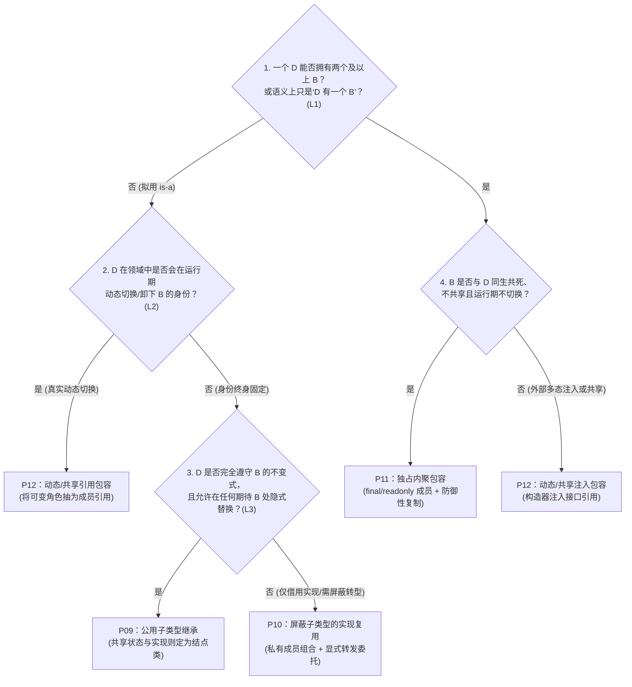
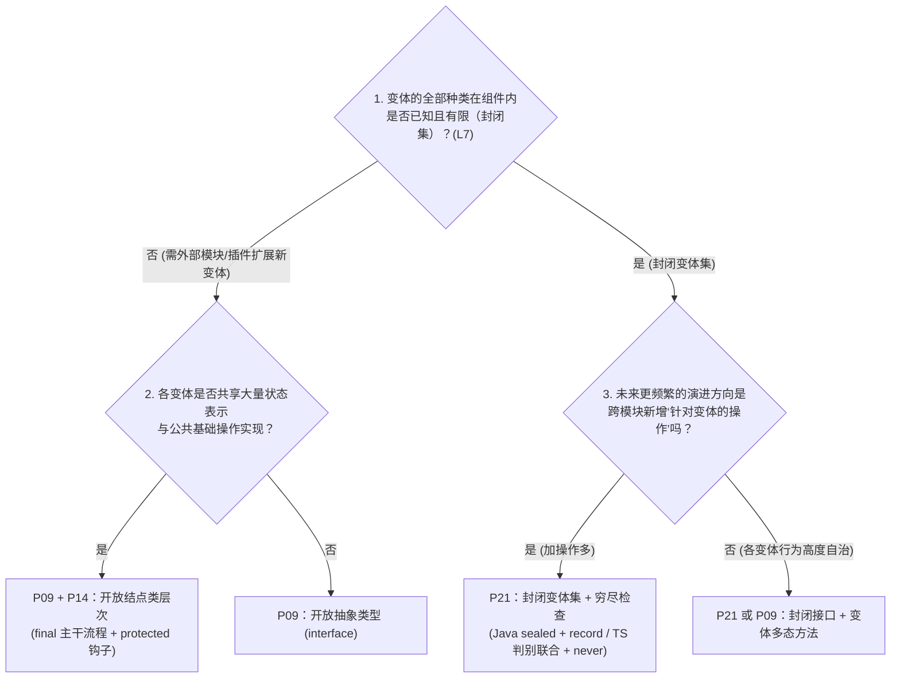
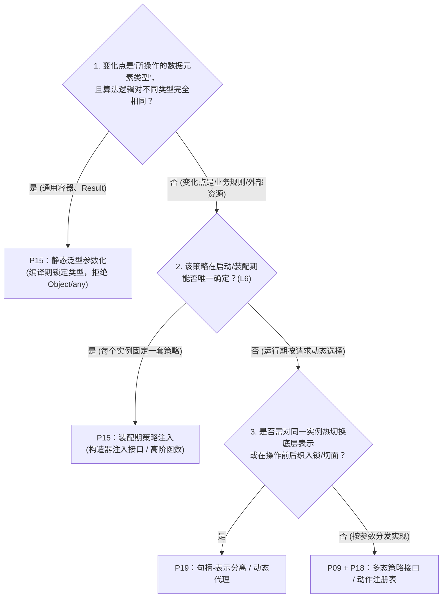
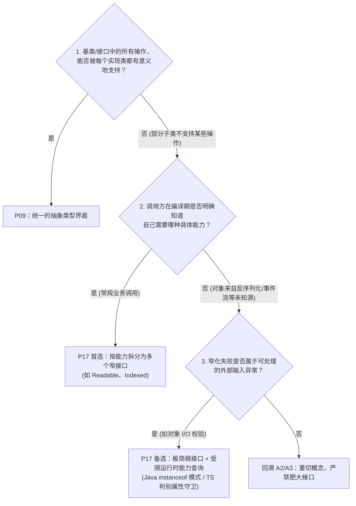

# 四大核心设计权衡决策树

> 当活动 A3/A4 遇到结构取舍分歧时，按以下四棵决策树推导，叶子节点指向 `20-primitives.md` 原语编号。

---

## 权衡一：继承（Inheritance） vs 成员包容（Containment）`[§24.3.2, §24.3.4, §24.3.4.2]`

- **要点**：公用继承隐含向基类的隐式类型转换 `[§24.3.4]`，需要访问控制时（如 `Cfield`）选 **P10**；TS 结构化类型会造成意外 `is-a` 兼容，关键类型配合 **P08 Branded Type** `[扩展]`。

---

## 权衡二：开放类层次（Open Hierarchy） vs 封闭变体集（Closed Variants）`[§24.3.4.1 · 扩展]`

- **要点**：Java 17 支持 `sealed interface` + `record`，但**无 `default` 的穷尽 `switch` 类型模式匹配需 Java 21+**；Java 17 下在 `sealed` 接口上声明多态方法或用 Visitor；TS 用判别联合 + `never` `[§24.3.4.1 · 扩展]`。

---

## 权衡三：泛型（Generics） vs 多态接口（Polymorphism） vs DI 策略`[§24.4.1 · 扩展]`

- **要点**：Java 与 TS 泛型均存在**类型擦除**，不具备 C++ 模板内联的运行期性能收益，核心价值是**静态类型安全** `[§24.2.3, §24.4.1 · 扩展]`；泛型与多态接口可组合互补 `[§24.4.1]`。

---

## 权衡四：窄接口拆分（Narrow Interfaces） vs 肥大接口（Fat Interface）`[§24.4.3, §25.4.1]`

- **要点**：肥大接口迫使调用方捕获 `Bad_oper` 或写冗长类型查询，“检查很容易，而恢复很困难” `[§24.4.3]`；TS `interface` 运行期擦除，落入 `P17_Q` 时须在边界检验所需能力；对 `unknown` 单看判别字段并不足够 `[扩展]`。
