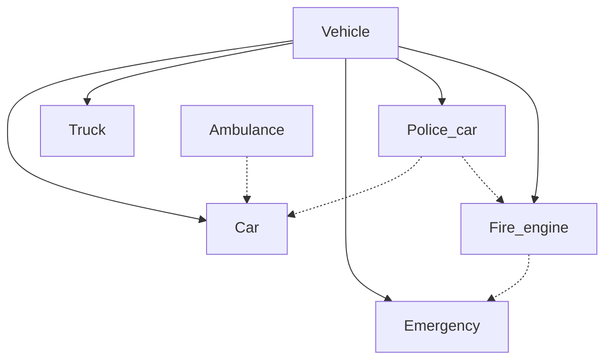
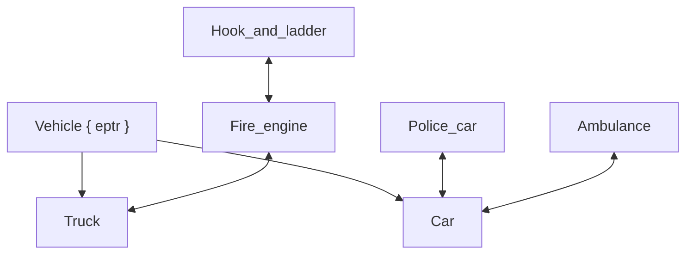
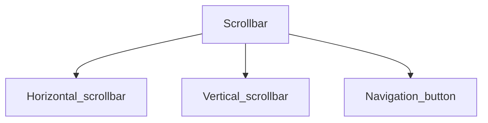

## 第四部分 用C++做设计

这一部分将在软件开发的更大背景中介绍C++及其支持的技术，其焦点在于设计，以及基于语言的各种结构去有效地实现这些设计。

## 章目

- 第23章 开发和设计
- 第24章 设计和编程
- 第25章 类的作用

“……我刚刚开始发现在纸上表述人的想法的困难性。只要想法是孤立的，描述它就非常容易；但在推理介入进来之处，为形成正确的联系、一些清晰性加上一种适度的流畅，就像我刚才所说的，对于我就成为说不清楚的困难了。”

—— 查尔斯·达尔文

## 第23章 开发和设计

没有银弹。$^{①}$

—F. Brooks

构筑软件——目的与手段——开发过程——开发循环——设计目标——设计步骤——发现类——描述操作——描述依赖性——描述界面——类层次结构的重组——模型——试验和分析——测试——软件维护——效率——管理——重用——规模——个人的重要性——混成设计——参考文献——忠告

## 23.1 概述

本章是介绍软件生产的三章中的第一章。这个讨论将逐渐细化，从有关设计的相对高层次的观察开始，结束于直接支撑这些设计的C++特殊程序设计技术和概念。在引言和23.3节中关于目的与手段的简短讨论之后是本章的两个主要部分:

23.4节 有关软件开发过程的一种观点。
23.5节 有关软件开发过程组织的实践性评述。

第24章将讨论设计与程序设计语言之间的关系。第25章将从设计的观点出发，介绍类在软件组织中所扮演的一些角色。总而言之，第四部分中这三章的目标，就是填补所谓的独立于语言的设计和程序设计之间裂隙，这方面细节尚未引起足够的重视。这个连续谱的两端在大项目中都有其重要位置，但为了避免灾难和高昂的代价，它们必须成为一些具有连续性的概念和技术的有机组成部分。

## 23.2 引言

构造出任何非平凡的软件片段都是一项很复杂的而且常常使人气馁的工作。即使是对于作为个人的程序员，实际写程序语句也仅仅是这个过程的一部分。在典型情况下，分析问题、程序的整体设计、写文档、测试以及维护，还有对全部这些事务的管理，大量的工作使写出代码片段及排除其中错误的活动相形见绌。当然，有人也可以简单地将所有这些活动都贴上“程序设计”的标签，并随之做出一种富于逻辑性的断言，“我不做设计，我只是编程”。但是，无论人们如何称呼这些活动，关注其中各个独立的部分都是极其重要的——就像偶尔需要去关注这整个过程一样重要。在突击工作使系统得以发布的过程中，绝不应该丢掉了其中的细节或大的背景——然而这些正是经常发生的事情。

本章将集中关注程序开发过程中不涉及到写出代码片段及排除其中错误的那些部分。与本书其他地方有关个别语言特征和特定程序设计技术的讨论相比，这里的讨论不太精确，也没有那么细致。这是必需的，因为并不存在创造出好软件的烹调手册。对于某些特定的已经深入理解的应用，有可能存在详细的“怎样做”的描述，而对更一般的应用则没有这种东西。任何东西都不可能代替程序设计中的智慧、经验和鉴赏力。由于这些，本章将只能提供一些一般性的忠告、可以选择的途径，以及警示性的观点。

<small><span class="docvortex-page-footnote" data-block-type="page_footnote" style="color:#6b7280">意为:没有无坚不摧的利器，没有万能的灵药。——译者注</span></small>

这个讨论受到软件的抽象性质的阻碍，事实上，一些对小项目（比如说，一个或两个人写10 000行代码）行之有效的技术，却未必能扩展后用到中型或者大型项目中。由于这个原因，这里的一些讨论将采用与抽象的工程实践相类比的方式进行，而不是通过代码实例。请记住，“通过类比证明”是有意的欺骗，所以，这里只是想借助于类比阐述一些问题。采用C++特定术语，并附以实例的关于设计问题的讨论留待第24章和第25章里去做。本章所表述的思想既反映在C++语言本身的设计中，也反映在贯穿本书的各个具体实例的讨论里。

还要请读者记住在应用领域、人、程序开发环境等方面异乎寻常的多样性，你绝不要期望这里所提出的每个观点都能直接应用于你当前的问题。这些观点来自真实生活中的项目，能够应用于范围广泛多变的许多情况，但绝不应该认为它们是放之四海而皆准的。在考察这些观点时，请一定带着一种健康的怀疑态度。

$\mathbf{C}++$ 可以简单地作为一种更好的C，但那样做，实际上就是将最有力的技术和语言特征弃之不顾，而只获取由使用 $\mathbf{C}++$ 中能够得到的潜在利益中很小的一部分。本章将集中关注那些能有效地利用 $\mathbf{C}++$ 的数据抽象和面向对象程序设计功能的设计方法，这种技术通常被称为面向对象的设计。

贯穿本章的若干主要论题是:

一 软件开发中最重要的一个方面就是弄清楚你试图去构造的东西。

— 成功的软件开发是一项长期活动。

— 我们开发的系统倾向于位于我们和我们所用的工具能够处理的复杂性的边缘上。

— 不存在能够代替设计和编程中的智慧、经验和鉴赏力的“烹调手册”方法。

一 试验对所有非平凡的软件开发都是必不可少的。

— 设计和编程是相互交叉、互相影响的活动。

— 软件项目的各个阶段，例如设计、编程和测试，不可能严格分离。

一 如果没有对编程和设计活动的管理，就无法考虑这些活动。

很容易（但常常是代价沉重的）低估这些观点的重要性。很难将它们蕴于其中的抽象思想转变成实际活动。这里特别要提出的是经验。就像造小船、骑自行车和编程一样，设计也不是一种只通过理论学习就能够掌握的技能。

一些情况太常见了，我们往往忘记了系统构筑过程中人的因素，而将软件开发简单地看做是“一系列具有良好定义的步骤，每一步都按照预先定义好的规则，对输入执行一些特定动作，产生所需要的输出”。这句话完全忽略了所涉及的人！设计和编程都是人的活动，忘记这一点就会丧失一切。

本章将特别关心这样一类系统的设计，相对于构造它们的人们的经验和资源而言，完成这些系统需要竭尽全力。这看起来正是个人或者组织试图去做那种位于他们能力极限上的项目时所遇到的情况。如果一个项目没有提出这种挑战，那么就不需要认真地讨论设计，这类项目早已有现成的框架，没有必要去颠覆它。只有在某种东西需要竭尽全力才可能完成时，人们才需要采纳新的更好的工具或者过程。在选定项目时也常常有这种倾向，那些相对的新手常常认为“我们知道怎么做”，但实际上却不是这样。

绝没有设计和构筑所有系统的“惟一正确道路”。我确实希望把有关“惟一正确道路”的想法看做一种幼稚病，但许多有经验的程序员和设计师也经常趋附于这种认识。请记住，只因为某种技术对于你在去年可行，或者对于一个项目可行，并不意味着它可以不加修改地适用于其他人或不同的项目。保持一种开放的心态是最重要的。

很清楚，这里的大部分讨论将与大规模软件的开发有关。未涉足这种开发的读者可以舒舒服服地坐下来，愉快地观看自己悠然处于事外的那些恐怖场面。换种方式，他们也可以只去看这个讨论中与个人工作方式有关的那些部分。关于什么时候就必须先做设计而后再编程，在代码规模上并不存在一个下限。不过，用于设计和文档的每种途径都有其适用下限，请看23.5.2节有关规模的讨论。

软件开发中最基本的问题就是复杂性。只存在一种对付复杂性的基本方法:分而治之。如果一个问题可以分成两个能分别处理的子问题，这个划分就已经解决了问题的一多半。这一简单原理可能以令人吃惊的丰富多彩的方式去应用。特别是，在系统设计中使用一个模块或者类，就把程序分成了两部分（实现与其用户），它们之间只通过一个（理想情况）定义良好的界面相互联系。这是处理程序中内在复杂性的基本方式。与此类似，设计一个程序的过程也可以分割成一些独立活动，在所涉及的人之间（理想情况）也有定义良好的相互关系。这就是处理开发过程的和所涉及人员的内在复杂性的基本途径。

在两种情况下，各个部分的选择以及不同部分之间界面的刻画都是最需要经验和鉴赏力的地方。这种选择不是一种简单的机械性过程，通常都需要某种洞察力，而这种洞察力的获得，只能通过在某个适当抽象层次上对一个系统的透彻理解（参见23.4.2节、24.3.1节、25.3节）。对程序或者软件开发过程的短视观点经常导致带有严重缺陷的系统。还应当注意，无论是对人还是对程序，分开总是容易的，更困难的部分是保证分界两边各个部分间的有效通信，而又不破坏这种分解，不抑制为协作所需要的通信。

本章将介绍的是一种设计途径，而不是一种完整的设计方法。某种完全形式化的设计方法已超出了本书的范围。这里介绍的途径可能被用于不同程度的形式化，或者作为不同形式化的基础。同样，本章不是一个文献综述，不想去触及与软件开发有关的每一个论点或者介绍每一种观点。这同样也超出了本书的范围。有关文献的综述可以在 [Booch,1994] 里找到。还请注意，这里对术语的使用也采取了最普通最方便的方式。最“有意思”的术语（例如设计、原型和程序员）在各种文献中都有许多不同的甚至相互冲突的定义。请小心，不要基于某些术语的特定的或者具有局部精确性的定义，从这里所写的文字中读出了某些并不是这里原意的东西。

## 23.3 目的与手段

专业程序设计的目标就是发布满足用户需要的产品。达到这一目的的基本手段就是生产出具有清晰内部结构的软件，培养出一批设计师和程序员，并使之具有足够的技能和动力去快速有效地应对各种变化和机遇。

为什么？程序的内部结构和将它开发出来的过程，按照理想情况，都是最终用户不必关心的。说得更重一点，如果最终用户不得不关注程序是怎样写出来的，那么这个程序一定有什么地方出了毛病。承认了这些事实之后，一个程序的结构以及创建它的人员的重要性又体

现在哪里呢？

程序需要有一个清晰的结构，以便较容易:

一 调试。
一 移植。
一 维护。
一 扩展。
一 重组。
一 理解。

这里的重点是，软件中每个成功的主要部分都会有一个很长的生命期，一系列程序员和设计师将在它上面工作，移植到新的硬件，去适应原本没有预料到的用户，并反复地重新组织。贯穿着这个软件的整个生命期，它的新版本必须被生产出来，带着可接受的错误率，而且要及时。没有为这一点做计划就是失败。

注意，尽管按照理想的情况，最终用户不必知道一个系统的内部结构，但他们实际上也可能希望知道。例如，一个用户可能希望知道某系统的设计细节，以便能评价它大致的可靠性以及修改和扩充潜力。如果所论及的软件不是一个完整系统，而是为构造其他软件的一组库，那么用户将希望知道更多的“细节”，以便能更好地使用这些库，并更好地将它们作为获取思想的资源。

必须努力在缺乏对软件整体设计和过度强调结构之间寻找一种平衡。前者将引起无穷无尽的修改（“我们将立即发布这一个，并将在下一个版本里解决这个问题”）。后者导致一个过于精致的设计，使最具根本性的东西被淹没在形式主义之中，还由于不停地重新组织而导致实现的延误（“但这种新结构比原来的那个好得多，人们会愿意等着它的”）。这经常会导致系统对资源的需求非常强烈，以至于大部分潜在用户都无法承受其代价。这种平衡总是在设计中最困难的方面出现，这也正是才能和经验发挥作用的地方。对作为个人的设计师和程序员，做出这种选择也是很困难的；对于涉及到许多具有不同技能水平的人员的大型项目，做出这种选择就更加困难。

一个程序需要由一个组织生产出来并继续维护，它应该能完成这件事情，无论其人事、方向和管理结构发生了什么变化。对付这一问题有一种很流行的方式，那就是试图将系统的开发归约到能够塞进一个严格框架的一些相对低层次的任务里。也就是说，其基本思想是创建一支容易训练的（廉价的）并具有互换性的低水平程序员（“编码员”）队伍和另一个不那么廉价但同样具有互换性（因此有同样可依赖性）的设计师队伍。假定编码员不做任何设计决策，而且假定设计师本人都不涉足卑微的代码细节。这种途径经常失败。在它还能行的地方，将生产出性能较差且过于庞大的系统。

这种途径的问题在于:

— 实现者与设计者之间不充分的通信。这将导致机会的丧失、延期、低效率，以及缺乏从经验中学习而引起的种种问题。
一 未给实现者的主动精神提供充分的发展空间。这将导致专业培养不足、缺乏原动力、懒散和很高的人员流动比率。

简而言之，这样一种系统缺乏反馈功能，不能使人们从其他人的经验中获益。它是对宝贵的人类才能的浪费。我们需要创建一种框架，使人们能在其中应用各自的聪明才智，开发出新的技能，贡献各种思想，并为自己所完成的东西不仅能说得过去，而且很实际很经济而感到愉快。

另一方面，如果没有某种形式结构，一个系统也不可能无限期地构筑、写文档、维护下去。简单地找到一批最好的人，让他们按自己所想的最佳方式去专攻某个问题，对于一个需要创新性的项目，这常常是一个很好的起点。然而，随着项目的进展，在项目中引进更多安排好的、专门的、更形式化的交流就变得越来越必要了。对于“形式化”，我的意思并不是某些数学的或者能够机械验证的记法（虽然这很好，在那些可用的且可以应用的地方），而是一组有关记法、命名、文档书写、调试等的指导性规则。再说一次，取得平衡和有意识的适度很有必要。过分严格的系统将阻碍成长，窒息创新。在这种情况下，被测试的将是管理者的才能和经验。对于个人而言，与之等价的两难问题是要做出选择:在哪里试着做得更聪明些，而在哪里就简单地“按书本行事”。

这里的基本建议是，我们不只要为当前项目的下一个版本做计划，还要考虑更长远的问题。只计划下一个版本就是计划失败。我们必须面向生产和管理许多项目的许多版本去发展组织结构和软件开发策略，我们必须计划一系列的成功。

“设计”的宗旨在于为程序创建起一种清晰且相对简单的内部结构，有时被称为体系结构。换句话说，我们希望建立起一个框架，使单独的代码片段可以纳入其中，并能对这些单独代码片段的书写起指导作用。

设计是有关的设计过程的最终产品（就算是一个不断重复的过程，也存在着一个最终产品）。它是设计师和程序员之间、程序员之间交流的焦点。在这里有权衡轻重的能力就非常重要了。如果我作为一个个人程序员设计了一个小程序，准备明天去实现，其精确性和细节程度可能就只是在一个信封背面的随意几笔。而在另一个极端，在开发一个涉及到数以百计的设计师和程序员的系统时，就可能需要用形式化或者半形式化的记法，仔细写出很多本规范。为设计确定一种恰当层次的细节、精确程度和形式方式，这本身也是一项富于挑战性的技术和管理任务。

在本章和随后的两章里，我假定一个系统的设计被表述为一组类声明（典型情况是将它们的私用声明忽略，作为假想的细节）及其相互关系。这是一种简化。在一个特定设计中还要加入比这多得多的细节，例如，并发性、名字空间管理、非成员函数和数据的使用、参数化类和函数、为最少的重新编译而做的代码组织、持续性功能，以及多种计算机的使用等。然而，为了能在这个层次上讨论就必须做一些简化，而类正是在C++里进行设计的最恰当的焦点。在这一章的讨论进程中将提到其中的一些问题，那些直接影响C++程序的设计的问题将在第24章和第25章讨论。有关一种特殊的面向对象设计方法的细节讨论和实例，可以参见[Booch, 1994]。

我没有去划清分析和设计之间的界线，是因为对这个问题的讨论已经超出了本书的范围，而且它对特定设计方法的变化也比较敏感。找到一种能够与设计方法相匹配的分析方法，找到一种能够与程序设计风格和所用语言相匹配的设计方法都是最重要的事情。

## 23.4 开发过程

软件开发是一个不断重复的递进的过程。在开发中将不断地重新经历这一过程中的各个阶段，每次经历时都通过精化产生出该阶段的最终产品。一般说，这一过程既没有开始，也没有结束。在设计和实现一个系统时，你在其他人的设计、库和应用软件的基础上开始工作。当你结束时，你留下了一个包括设计和代码的实体，供其他人去精化、修改、扩展和移植。自然，一个特定项目必然有其确定的开始和结束，将一个项目的时间和范围划分得清晰精确是极其重要的（但又常常困难得令人不可思议）。然而，自以为你是从一个清晰的状态开始却可能引起严重的问题，自以为那个世界终结在“最终交付”，将给你的继任者造成类似的严重问题，而这个继任者常常就是扮演着另一个角色的你自己。

这种情形蕴含着的一件事，就是下面几节可以按任意顺序阅读，因为在实际项目中，设计和实现的各个方面几乎能任意地交叉出现。也就是说，“设计”几乎总是在原来设计和某些实现经验基础上的重新设计。进一步说，这个设计又受到计划安排、所涉及的人员的能力、兼容性等因素的束缚。对于设计师/管理人员/程序员的一项主要挑战，就是为此过程建立一种秩序，而又不会窒息创新，不破坏反馈循环，因为它们对于成功的开发都是必不可少的。

开发过程包含三个阶段:

一 分析:定义需要解决的问题的范围。
— 设计:建立系统的整体结构。
一 实现:写出代码并完成测试。

请切记这个过程不断重复的本性——这些阶段不是编号的，这一点非常重要。注意，程序开发还有一些重要方面没有作为单独的阶段出现，是因为它们应该弥漫在整个过程之中:

— 试验。
一 测试。
— 对设计和实现的分析。
一 撰写文档。
一 管理。

软件 “维护” 不过是穿过这一开发过程的更多循环罢了（23.4.6节）。

最重要的是，分析、设计和实现不应该过分地相互分离，应该使涉足其中的所有人员能共享一种文化，使他们能有效地交流。在大型项目中，实际情况却常常不是这样。理想的情况是，参与项目的个人应该从一个阶段转移到另一个阶段，因为传递精微信息的最好方式就是通过人的头脑。不幸的是，组织机构常常建立起某些阻碍，阻止这种转移。例如，给予设计师比“仅为程序员者”更高的地位或者更高的待遇。如果让人们来来去去参与学习和讲授的想法不能实现，那么至少也应鼓励他们与涉足同一开发中的“其他”步骤的人们开展常规性的交流讨论。

对于小型到中型的项目，在分析和设计之间常常没有清晰的划分，这两个阶段常常被合二为一。与此类似，在小项目中，设计和实现之间常常也没有分开。当然，这样就解决了交流的问题。重要的是，对给定项目应当有适度的形式规定，并维持各个阶段间适度的分离（23.5.2节）。并不存在做这些事情的惟一正确方法。

这里所描述的软件开发模型与传统的“瀑布模型”截然不同。在瀑布模型中，开发过程具有一种顺序的线性形式，开发从分析阶段一直到测试阶段。瀑布模型受到这种单向信息流动所造成的基本缺陷的损害。在“下游”发现问题时，通常存在着强有力的方法学上的和组织上的压力，要求去做局部修正，也就是说，强烈要求解决问题时不影响开发过程的前面阶段。缺乏反馈将导致有缺陷的设计，局部修正将导致扭曲的实现。当出现不可避免的情况，使信息必须流向源头并引起设计的改变时，结果只是一股极慢的拖累沉重的涓涓细流穿过整个系统。该系统特别适合阻止这种改变，至多是极不情愿地极其缓慢地做出回应。这样，有关“不要改变”或者“局部修正”的论点就变成了另一种论点:一个子组织不能“为了它自己的方便”将大量的工作强加给其他的子组织。特别是，在发现了一个主要缺陷时，常常出现大量与决策缺陷有关的纸面工作，涉及修改文档的工作常大大超过修正代码所需要的工作。按照这种方式，纸面工作很可能变成软件开发中的主要问题。很自然，这一问题可能而且确实出现了，无论人们如何去组织大型系统的开发。话说回来，有些纸面工作毕竟是不可或缺的，但是，采用线性开发模型（一道瀑布）将极大地增加这一问题变得失去控制的可能性。

瀑布模型的问题在于不充分的反馈，以及无能力对修改做出响应；而这里勾勒出轮廓的交互式途径中也有危险。在这里存在着一种诱惑，使我们可能用一系列不收敛的变化去代替真正的思想和进步。这两个问题都很容易诊断，但却都很难解决。无论人们如何去组织一项工作，都很容易受到诱惑，将错误的行为当做进步。很自然，随着项目进展，对开发过程不同阶段的重视程度也应有所变化。开始时，重点是分析和设计，较少关心编程问题。随着时间的推移，更多的资源将移到设计和编程，而后将更多地关注编程和测试。但无论如何，关键点是绝不能在关注分析/设计/实现这个连续谱中某部分时，完全忽略了其他各个部分。

请记住，如果你对试图达到什么目标没有一个很清晰的想法，无论你将多少注意力放在细节上，使用的是多么合适的管理技术，采用了多少高级技术，都不会有多少帮助。由于缺乏定义清晰的实际目标而失败的项目比因为其他原因而失败的项目更多。无论你要做什么，也不管你怎样去做，请定义好一些实实在在的目标和阶段性标志，而且不要企图去为社会问题寻找技术性解决方案。另一方面，应当使用任何可用的合适技术——即使它涉及到投资。有了合适的工具，在合理的环境中，人们可以工作得更好。请不要欺骗自己，以为按照这些建议去做很容易。

## 23.4.1 开发循环

开发一个系统是一件不断重复的活动。其主要循环是通过如下序列的一再重复的旅行:

[0] 考察问题。

[1] 创建一个整体设计。
[2] 找出一些标准组件。

-- 为本设计而定制这些部件。

[3] 创建一些新的标准组件。

一 为本设计而定制这些组件。

[4] 装配起整个设计。

作为类比，让我们来考虑一个汽车工厂。在一个项目开始时，需要有对一种新型汽车的总体设计，最先的决策将基于某些分析，用一些一般性的术语刻画这种汽车，主要是根据对该车所设想的应用，而并不牵涉如何才能达到所需要的性质的具体细节。确定需要有哪些性质（或者采取更好的方式，为确定究竟需要什么性质提供一个相对简单的准则）常常是一个项目中最困难的部分。如果这件事真能做好，那么通常总是由某个富于洞察力的个人独立完成的，这常常被称为一个透视（vision）。一个项目缺乏这种清晰目标的情况也是相当常见的，许多项目因此而踉踉跄跄以至于失败。

比如说，我们希望制造一种四门中型车，带有相当强劲的引擎。设计中的第一步通常都不是从空白开始去设计这辆车（及其所有的零部件）。软件设计师和程序员也处于类似环境中，但却可能很不明智地想从空白开始。

第一步是考虑从工厂自身的库存和可靠供应商那里能够得到哪些组件，这样找到的组件并不一定正好适合这种新车。存在许多方式去改制这些组件，或许可能去影响这些组件的“下一个版本”的规范，使之更适合我们的项目。例如，可能存在一种具有合适特性的引擎，但它的输出功率却略显不足。我们或者引擎的提供商可以添加一个涡轮增压器，又不影响其基本设计。注意，如果引擎的原始设计并没有结合进某种定制的可能性，那么要做这种修改而又“不影响其基本设计”就未必可行了。这种改制通常需要你与你的引擎供应商之间的合作。软件设计师和程序员也有类似的选择机会。特别地，多态性的类和模板常常可用于有效地改制。当然，如果没有一点前瞻性，如果不能得到这种类的提供者的合作，我们就没指望去做任意的扩充。

在穷尽了合适的标准组件后，汽车设计师还不急于去为新车设计最优化的新组件，因为这样做代价会太高昂。假定不存在合适的空调装置，而在引擎舱里有一块合适的L形空间可以利用。一种解决方案就是设计一种L形的空调单元。但是，将这种独特设备用于其他车型的可能性将非常小——即使是经过高成本的定制。这也意味着，我们的汽车设计师将不能与其他汽车设计师共同承担这种单元的生产成本，而且这种单元的可用生命期也会比较短。根据这种认识，看来值得去设计能满足更广泛需求的单元，也就是说，设计一种在设计上比我们所假想的L型怪物更清晰也更适宜改制的空调单元。这样做，所涉及的工作通常会比做L型单元更多一些，甚至可能涉及到修改我们汽车的整体设计，以适应这种具有更一般用途的单元。又因为这种新单元的设计要比我们的L型奇异物件更加广泛可用，它也将需要做一点定制，才能正好符合我们修正之后的需要。同样，软件设计师和程序员也有类似的选择机会。也就是说，设计师可以不去写项目专用的代码，而是设计一种具有普遍意义的组件，这将使它成为某些世界中一个标准的候选品。

最后，当弄完了所有潜在的标准组件之后，我们去装配起“最后的”设计。我们尽可能少地采用了若干特殊组件，因为下一年我们将不得不为下一个新车型再次经历这个工作的某种变形，而这些特别设计的组件将是我们最可能重新去做或者丢掉的。非常糟糕，在传统软件设计中的经验是:一个系统里很少有几个部分能看做是可分离的组件，这些之中更少有什么可以用到它们原来的项目之外。

我并没有说所有汽车设计师都像我所勾勒的这一类比中那样富于理性，也没有说所有软件设计师都犯这里所提及的错误；相反，我想说的是，这个模型对软件也可行。特别是，本章及随后几章要介绍一些技术，可以使之对于C++可行。不过我也确实声明，由于软件的无形的本质，要避免这些错误是更困难的（24.3.1节、24.3.4节）。在22.5.3节里，我还要争辩说，企业文化常常妨碍人们去使用这里所描绘的模型。

注意，只有在你有长远打算之时，这里的开发模型才能真正工作得很好。如果你的视野只延伸到下一个版本，那么创建和维护标准组件就完全没有意义了，它只能被看做是一种臆造出来的额外负担。这个模型只是提供给那样一种组织，其生命期将跨过几个项目，其规模使得在工具方面（为了设计、编程和项目管理）的额外投资具有实际价值。这是一类软件工厂的蓝图。有意思的是，这种模型与最好的个人程序员的实践只有规模上的差异。这些人在多年中为提高个人的工作效率，创造起一大批技术、设计、工具和库。看起来，实际中大部分组织机构都未能利用最好的个人实践活动的经验，因为缺乏远见，也因为没有能力在超过很小的规模之上管理这种实践性活动。

注意，期望“标准组件”成为全球性的标准并不合理。确实会出现少量国际性的标准库，但是，绝大部分将只能成为一个国家、一个产业、一个公司、一条生产线、一个部门、一个领域等内部的标准。这个世界太大，使我们不可能对所有组件和工具都实现全球性的标准，这也确实不应该成为一个目标。

在初始设计时就将全球性作为目标，实际上就是命令这个项目永远也不能完成。开发循环之所以是一个循环，也因为取得一个能工作的系统是必不可少的，因为只有从那里才能取得经验（23.4.3.6节）。

## 23.4.2 设计目标

设计的总体目标是什么？当然，简单性是其中之一，但简单性又要依据什么准则呢？我们应假定一个设计将要演化，也就是说，这个系统将要扩展、移植、调整，一般说，将以某些不可能都事先预见到的方式改变。因此，我们就必须确定目标，使设计和实现出来的系统比较简单，有关的约束条件使它能够以多种方式变化。事实上，应该假定在它的初始设计到第一个版本间，这个系统就已改变了几次。这种假定是很现实的。

这也就意味着，系统的设计必须能在一系列变化之后仍然尽可能简单。我们必须为变化而设计，也就是说，我们必须将目标定在:

一灵活性。
— 可扩充性。
— 可移植性。

解决这种问题的最好方式是将系统中可能变化的区域封装起来，并为设计师/程序员提供某些非侵入式的方法，使他们能够修改代码的行为。完成这项工作需要标识出应用中的关键性概念，给每个类一种排他性的责任，要求它维护着与某个单一概念有关的全部信息。在这种情况下，一项变化的实施就只需要修改与之相关的类。最理想的情况是，一个概念的修改可能通过一个派生类（23.4.3.5节），或者通过给某模板传递一个不同参数而完成。当然，陈述这种理想比实现它要容易得多。

现在考虑一个例子。在一个涉及天气现象的模拟中，我们希望显示出一种雨云。但怎样做呢？我们不能有一种通用例程来完成云的显示，因为云的视觉形象依赖于云的内部状态，而这种状态完全在云的职责范围之中。

对于这种问题的第一种解决方案就是让云去显示自己。这种风格的解法在许多受限的环境中都是可以接受的。但是它不够一般，因为存在许多观察云的方式:例如，作为一个细致的图形、作为一个粗略的轮廓或者作为地图上的一个图标。换句话说，云的视觉形象依赖于云和它的环境。

这一问题的第二种解决方案是让云意识到它的环境，而后让云去显示自己。在更多的环境里可以接受这种解决方案。但这仍然不是一种一般性的解法。让云了解其环境的这些细节也违反了前面的决断，即让一个类对一件事情负责，且每件“事情”都是某一个类的责任。很可能无法创造出一个具有内在和谐性的“云的环境”的概念，因为一般来说，云的视觉形象依赖于云和观察者。甚至在现实生活中，云的视觉形象也在很大程度上依赖于我怎么去看它。例如，是通过我的裸眼、通过偏振滤镜，还是通过气象雷达。除了云雨观察者之外，某些“一般性的背景”，例如太阳的相对位置等，也必须予以考虑。此外，其他实体，例如其他的云和飞机等，将进一步使问题复杂化。如果再加上可以同时存在多个观察者，设计者的日子就更难过了。

第三种解决方案是让云以及其他物体（如飞机和太阳）将自己描述给环境。这一解法对于大部分目的而言都具有足够的一般性 $^{①}$ 。然而，这样做可能带来复杂性和运行时间方面的显著代价。例如，我们将如何安排，使观察方可以理解由云和其他实体产生出的描述呢？

雨云在程序里并不经常出现（要找一个实际例子，请见15.2节），但涉及到许多I/O操作的对象则在程序里比比皆是。这就使这个有关云的例子与程序有了一般性的联系，特别是与库设计的联系。针对逻辑上类似的C++代码实例，可以在流I/O系统中格式化输出所用的操控符那里看到（21.4.6节、21.4.6.3节）。注意，这里的第三个解决方案并不就是“那个正确的解法”，而只是最具一般性的解法。设计师需要权衡在一个系统里的各种需要，去选择适合特定系统里针对特定问题的一般性和抽象层次。作为一种经验法则，一个长寿命程序的合适抽象层次就是你可以理解和负担的层次中最一般的，当然不是绝对的最一般。超出特定项目范围和参加者经验的一般性可能很有害，也就是说，它可能造成延期、无法接受的低效率、无法管理的设计，或者就是失败。

为使这种技术成为可管理的、经济的，我们必须为重用而设计和管理（23.5.1节），而且不能完全忽视效率（23.4.7节）。

## 23.4.3 设计步骤

考虑如何设计一个单独的类。通常这并不是一种好想法。概念并非孤立存在的，相反，一个概念通常总是定义在其他概念形成的环境之中。与此相似，一个类也不应孤立地存在，而应该与逻辑上相关的类一起定义。典型情况是人需要做出一个相关的类的集合，这样一个集合常被称为一个类库或一个组件。有时一个组件里的所有类组成了一个类层次结构，有时它们是一个名字空间的成员，有时它们不过是实际汇集在一起的一些声明（24.4节）。

在一个组件里的一组类总是通过某种逻辑准则结为一体的，常常是由于一种共同风格，常常由于依赖于一种公共服务。这样，一个组件就是一种设计、写文档、拥有和重用的单位。这并不意味着如果你使用了某个组件里的一个类，你就必须理解和使用这个组件里所有的类，也不意味着可能要把该组件中每个类的代码都装入你的程序。正相反，我们总是要努力去保证，一个类的使用只给机器资源和人们的付出带来最小的开销。当然，为了使用一个组件里的任何一部分，我们将需要理解定义这一组件的逻辑准则（希望文档里写得足够清楚）、使用约定、该组件设计中所蕴涵的风格以及它的文档，还有那些公共服务（如果存在的话）。

现在考虑应该如何完成一个组件的设计。因为这常常是一项挑战性的工作，我们值得将它分解为一些步骤，以便能以一种逻辑的和完全的方式，集中关注其中的各项子工作。如常，做这件事也不是只有一条正确道路，不管怎样，下面是一些人所采用的一系列步骤:

[1] 找出概念/类及其最基本的相互关系。

<small><span class="docvortex-page-footnote" data-block-type="page_footnote" style="color:#6b7280">$\Theta$ 即使这一模型对于某些极端情况也可能不够，例如要求基于光线跟踪的高质量图形。我设想，要达到那样的细节，将要求设计师转移到另一个抽象层次去。</span></small>

[2] 精化这些类，描述它们的一组操作。

一 将这些操作归类，特别是考虑所需要的构造函数、复制和析构函数。

一 考虑最小化、完全性和方便性。

[3] 精化这些类，描述它们之间的依赖关系。

— 考虑参数化、继承和使用方面的依赖关系。

[4] 描述界面。

一 将函数分为公用操作和保护操作。

— 描述这些类中各操作的确切类型。

注意，这也是在一个重复性过程中的一些步骤，要为初始实现或者重新实现产生一个用起来很舒服的设计，通常需要经过这一工作序列的几次循环。像这里所描述的很好完成的分析和数据抽象有一个优点，它能使重新安排类之间的关系变得相对容易些，即使是在代码已经写成之后。当然，这绝不会是一件平凡工作。

## 23.4.3.1 步骤1:发现类

找出概念/类及其最基本的相关关系。一项好设计的关键是直接模拟“真实世界”的某个侧面，也就是说，将应用领域中的概念拿来作为类，用良好定义的方式表示类之间的关系（例如用继承），并且在不同的层次上反复地这样做。但是我们怎么能找出这些概念？确定我们所需要的类的实际途径是什么呢？

开始寻找的最佳地方应该是在应用本身，而不是去看计算机科学家口袋里的抽象和概念。听听某些在系统完成后将成为专家用户的人，以及对现有的将被取代的系统不满意的人说些什么。注意他们所用的词汇。

人们常说名词将对应于程序里所需的类和对象，确实经常如此。但是，这并不意味着故事的结束。动词有可能指称对象上的操作、传统的基于其参数值产生新值的（全局）函数，或者甚至是类。作为最后一种情况的例子，请注意函数对象（18.4节）和操控符（21.4.6节）。像“重复”或者“将……用于”一类的动词可能用一个迭代器对象，或者代表数据库提交操作的对象表示。再考虑形容词“可存储的”、“并行的”、“注册的”和“约束的”，这些也可能成为一些类，以使设计师或程序员能通过描述虚基类，提供随后设计的类所需捡取或者选择的属性（15.2.4节）。

并不是所有的类都与应用层中的概念相对应。例如，那些表示系统资源和实现层的抽象（24.3.1节）。避免过近地模拟老系统也非常重要。例如，我们不会希望一个以数据库为中心的系统亦步亦趋地重复一个手工系统的各个方面，原来系统的存在可能不过是为使人们能物理地将纸片移来移去。

继承用于表述概念之间的共性。最重要的是，用它表示一种基于各个类所代表的个别概念的层次性组织（1.7节、12.2.6节、24.3.2节）。这有时被称为分类（classification）或分类学（taxonomy）。共性必须去主动寻找，推广和聚类都是高层次的活动，需要借助于洞察力，才能取得有用且耐久的结果。公共基类应当代表某种一般性的概念，而不是某个与之相近的概念，只不过其中需要表示的数据恰好比较少。

请注意，这种分类应该基于所模拟系统中的概念的某些方面，而不是基于在别的领域中可能合法的一些东西。例如，在数学里圆是椭圆中的一类，但是在大部分程序里，圆不应该由椭圆派生，椭圆也不应由圆派生。常听到这样的论点，如“因为这就是数学里的情况”或者“因为圆的表示是椭圆表示的子集”。这些都不是决定性的，常常都是错误的。这是因为，对于大部分程序而言，一个圆的关键属性是它有一个中心和到其圆周的固定距离，圆的所有行为（所有操作）必须维护这些属性（不变式，24.3.7.1节）。而在另一方面，椭圆则由两个焦点描述，在许多程序里这两个焦点可以独立地改变。如果焦点重合，这个椭圆看起来就像圆，但是它不是圆，因为它的操作并不能维持圆的不变式。许多系统里都对这种差异有所反应，方式是为圆和椭圆提供的操作集合相互都不为子集。

我们不会一下就想出了一组类和这些类间的相互关系，并将它们用于最终的系统。相反，我们会先创建出一组初始的类和关系，而后又反复对它们做精化（23.4.3.5节），以达到一组类关系，使之足够一般、灵活和稳定，确实能对系统的进一步演化有所帮助。

找出初始的关键性概念/类的最好工具就是黑板，对它们的初始精化的最好方法就是与应用领域的专家和一些朋友讨论。要开发出一组有活力的词汇和概念框架，这种讨论是必不可少的，少数几个人就可以独立地去做。为从初始的候选类集合中发展出一组有价值的类，一种方式就是去模拟一个系统，让设计师去扮演类的角色。这样做，能使初始想法中不可避免的荒谬情况暴露到一种开放的、使人兴奋的有关替代方案的讨论中，使人们在如何改变设计上取得共识。这种活动也可以用索引卡片支持，在卡片上记下文档。这种卡片通常被称为CRC卡片（类、职责和协作，“Class, Responsibility, and Collaboration” [Wirfs-Brock, 1990]）。

一个用例（use case）就是关于一个系统的一次特定使用的描述。这里是某电话系统的用例的一个简单例子:将电话拿起，拨号，在另一端的电话振铃，另一端的电话被拿起。做出一组这样的用例对于开发的各个阶段都有巨大的价值。在开始阶段，找出这种用例能帮助我们认识准备去构造的是什么。在设计阶段，可以利用它们跟踪贯穿这个系统的路径（例如，使用CRC卡片），从某种用户观点检查相对静态的系统描述，看看各种类和对象是否真正有意义。在程序设计和测试中，这些用例也成为测试实例的源泉。在这种方式中，一组用例为观察所开发的系统提供了另一种角度，可以作为一种实在的检查。

用例将系统看做一种（动态的）工作的实体。因此，它们有可能诱使设计者从功能性的角度去观察这个系统，并使他们偏离了找出能映射到类的有用概念的本质性工作。特别是到了那些有着结构分析背景，且较少面向对象程序设计经验的人们手里，强调用例很容易引向某种功能分解。一组用例并不是一个设计，对于系统使用的关注也必须和与之互为补充的对系统结构的关注相配合。

一支开发队伍也可能被引诱到想去发现和描述所有的用例。这实际上并无益处，而且是一项代价高昂的作业。就像我们在为系统寻找候选类中的情况一样，在某个时候我们必须说，“够了就是够了，现在是去试一试我们已经找出的东西，看看会出现什么情况的时候了。”只有通过一组表面上能说得通的类和一组说得通的用例，我们才能在进一步的开发中获得反馈，这种反馈对于最终得到一个好系统是必不可少的。要确定何时应该结束一种有价值的活动确实很困难，而在这里，我们明明知道以后还会再转回来以便完成整个工作，确定何时结束这种活动就更困难了。

多少用例就足够了呢？一般说，这个问题不可能有答案。当然，对于一个特定项目，会有一个时刻，那时我们很清楚已经覆盖了系统的大部分常规功能，更多不那么平常的情况以及错误处理问题中的相当一部分也有了处理。这就是进入下一轮设计和编程的时候了。

当你试图评价一组用例对系统的覆盖情况时，将它们划分为主要用例和次要用例常常很起作用。主要用例描述了系统的最常见的和“正常的”活动，次要者描述那些不那么正常的或者出错时的情景。次要用例的一个实例是上面“打电话”的一个变形，其中在拿起话筒后拨的是自己的号码。人们常说，如果已经覆盖了80%的主要用例和某些次要用例，这就是前进的时候了。当然，因为我们并不知道到底哪些东西组成了“所有的用例”，所以这只能是一条经验规则。实际经验和明智的判断将能在这里起作用。

这里所提到的概念、操作和关系都是从我们对应用领域的理解中自然产生的，或者是在对类结构的进一步工作中浮现出来的。它们代表了我们对应用的理解，经常是对基本概念的一种分类方式。例如，云梯车是一种救火车，救火车是一种卡车，卡车是一种车辆。23.4.3.2节和23.4.5节从取得进展的角度解释了观察类和类层次结构的几种方式。

注意视觉图形工程。在某个阶段，你将被要求将设计展示给某些人，你将做出一组图形，以解释将要构造的系统的结构。这将是一种极其有益的演习，因为它能帮助你将注意力集中到系统最主要的方面，要求你用其他人能够理解的方式去表述你的想法。做报告是一种最宝贵的设计工具。为那些有兴趣并能提出建设性批评意见的人准备一个意在使他们能真正理解的报告，这是一个将自己的想法概念化并清晰地表达出来的很好练习。

然而，有关设计的正式报告也是一种很危险的活动，因为存在着很强的诱惑力，使人想去描述一个理想的系统（一个你盼望自己能构造出的系统，一个你的高级管理层盼望他们能够拥有的系统），而不是你所有的或者你可能在合理时间内生产出来的系统。当存在着相互竞争者，而且行政部门并不真正理解或者不关心“细节”时，报告也可能变成一种编造谎言的比赛。开发队伍在这里展示其最浮夸的系统，以便保住自己的工作。在这种情况下，代替思想的清晰表述的常常是大量莫名其妙的难懂辞藻和缩略语。如果你是这种报告的听众，特别当你是决策者或者资源的控制者时，绝对重要的就是你应该从实际计划中区分出哪些仅仅是意愿性的想法。高质量的报告材料并不能保证所描述的系统也有高的质量。事实上，我常常看到一些真正关心实际问题的组织，在与那些较少关心实际产出系统的组织竞争中，在展示其结果时却很快就落入了陷阱。

在寻找能够用类表述的概念时，应该注意到，系统里的某些重要性质是不可能用类表示的。例如，可靠性、性能和可测试性都是系统里能实测的重要性质，然而，即使是最彻底的面向对象系统也无法将其可靠性局部化为一个可靠性对象。系统里的这种弥漫性的属性只能描述并去为它们而进行设计，最终通过实测进行验证。对这些性质的关注必须应用于所有的类中，可能需要反应在一些类和组件的设计与实现规则中（23.4.3节）。

## 23.4.3.2 步骤2:描述操作

精化有关的类，描述它们的一组操作。很自然，不可能将找类的工作与确定它们所需操作的工作截然分开。然而，这里也存在着一种实际的区分，确定类时的注目点在于关键性的概念，有意淡化了类的计算性质；而在描述操作时，关心的就是找出一组完整可用的操作。同时考虑这两方面的问题常常会因为太困难而没法做，特别是因为许多相关的类还需要一起设计。在需要同时考虑这些问题的时候，CRC卡片常常很有帮助（23.4.3.1节）。

在考虑需要提供哪些函数时，存在几种不同的哲学。我建议采用如下策略:

[1] 考虑这个类的对象应该如何构造、复制（如果允许）和析构。
[2] 定义由该类所代表的概念所需要的最小操作集合。典型情况是将它们作为成员函数（10.3节）。

[3] 考虑为了记述的方便需要增加哪些操作，只将其中最重要的几个包括进来。这些操作常常成为非成员的“协助函数”（10.3.2节）。

[4] 考虑哪些操作应该是虚的，也就是确定那些将这个类作为界面，应该由派生类提供实现的函数。

[5] 对于本组件中所有的类，通盘考虑它们在命名方面和功能方面可能取得哪些共性。这很显然是一种最小化的说法。把想像中可能有用的函数都加进去，并把所有函数都做成虚的将容易许多。但是，函数越多，其中的某些函数始终都不使用的可能性也就越大，它们也更容易限制随后的实现以及系统将来的演化。特别是那些直接读写对象状态中某些部分的函数，它们常常会将类束缚于某种单一的实现策略，从而严重地限制重新设计的可能性。这种函数降低了抽象的层次，使之脱离了被实现的概念。增加函数也增加了实现者的工作——还有重新设计时的设计师的工作。与某个函数已变成一种责任之后再去删除它相比，在某种需要已经弄清楚后加入一个函数，做起来要容易得多。

这里要求明确地做出将函数作为虚函数的决策，而没有把这件事情作为默认规定或者实现细节。提出这种要求的原因是，将一个函数做成虚函数，将对其所在类的使用以及这个类与其他类的关系产生至关重要的影响。即使在某个类里只有一个虚函数，该类的对象的布局也不会像C或者Fortran语言的对象那样简单了。还有，如果某个类有了一个虚函数，它也就有潜力作为一些尚未实现的类的界面，而这个虚函数也就隐含着对那些尚未实现的类的依赖性(24.3.2.1节)。

注意，这种最小化要求设计师做更多的工作，而不是更少。

在选择函数时，最重要的就是集中关心它应该做什么，而不是去关心它应该怎样做。也就是说，我们应该更多地注意所需要的行为，而不是去关注实现中的问题。

按照函数对于对象内部状态的使用情况将它们分类，有时也很有用处:

一 基础操作:构造函数、析构函数和复制操作

— 探查操作:那些不改变对象状态的操作。

— 修改操作:修改对象内部状态的操作。

一 转换操作:那些基于操作所针对的对象的值（状态），产生其他类型的对象的操作。

— 迭代器:访问或使用所包容的一系列对象的操作。

这些分类并不是互不相关的。例如，一个迭代器也可以设计为一个探查操作或者修改操作。这些类比也就是一种分类方式，可以帮助人们处理类界面的设计问题。很自然，同样可以有其他分类方式。这种分类方式在维持一个组件内部各个类间的统一性方面特别有用。

C++ 通过const和非const成员函数的方式支持对探查操作和修改操作的划分。与此类似，这里还直接支持构造函数、析构函数、复制操作和转换函数的概念。

## 23.4.3.3 步骤3:描述依赖性

精化有关的类，描述它们之间的依赖关系。24.3节里讨论了各种各样的依赖关系。在设计环节中，特别应该考虑的是参数化、继承关系和使用关系。这里的每种关系都涉及到有关一个类在为系统里某单一性质负责的意义方面的考虑。担负起明确的责任并不意味着这个类本身就要保存所有的数据，也不意味着它的成员函数需要直接完成所有必须的操作。与此相反，每个只需占有责任中的一片领地的类，应保证这个类完成的大部分工作是通过直接请求“其他地方”，由另一些以有关的子工作为己任的类去处理。当然也要当心，这种技术的过度使用可能导致低效率和无法理解的设计，可能做出大量的类和对象，以至于它们什么都不做，只去产生瀑布式向前传送的服务请求。如果某件事情现在可以在这里做，就应该在这里完成。

在设计阶段（而不是在实现阶段）就需要考虑继承关系和使用关系，这一需求直接源于采用类来表示概念。它也意味着设计的单位应该是组件（23.4.3、24.4节），而不是类。

参数化（常常引向使用模板）是一种将隐式的依赖关系显式化的方法，这样可以同时表述几种选择，而不必增加新概念。经常有这样的选择:是把某种东西留做对环境的依赖关系，将它表述为继承树上的一个分支，还是采用一个参数（24.4.1节）。

## 23.4.3.4 步骤4:描述界面

描述界面。私用函数通常不必在设计阶段考虑。在设计阶段必须考虑的实现问题最好是作为关于依赖性的步骤2中的一部分进行处理。说得更强一些，我使用一条经验规则:对于一个类而言，除非它存在着至少两种有显著差异的实现方式，否则这里大概就有些问题。也就是说，这可能是一个伪装成类的具体实现，而不是某个真实概念的代表。在许多情况下，考虑对于一个类是否可能做某种形式的延迟求值，是回答下面问题的一种很好方式:“这个类的界面是与实现无关的吗？”

请注意，公用基类和友元也是一个类的界面的一部分，参见11.5节和24.4.2节。通过分别定义保护界面和公用界面，为继承和普通客户提供分离的界面，这种工作会有很好的回报。

正是在这个步骤中，应该考虑和描述参数的确切类型。这里的理想应该是使尽可能多的界面能利用应用层的类型静态确定。参见24.2.3节和24.4.2节。

在描述界面时，也应该为这些类向外看一看，是不是某些操作支持了多于一个的抽象层次。举个例子，类File的某些成员函数可能有类型为File\_descriptor类的参数，它的另一些函数可能以表示文件名的字符串为参数。File\_descriptor的操作与文件名操作并不在同一个抽象层次里，所以就应该怀疑它们是否应该在同一个类中。或许最好是有两个文件类，一个支持文件描述符的概念，另一个支持文件名的概念。在典型情况下，一个类里的所有操作都应该支持同一个抽象层次。如果它们不是这样的，那么就应该考虑重新组织这个类及其相关的类。

## 23.4.3.5 类层次结构的重组

在步骤1和步骤3里，我们都检查了类和类层次结构，看它们是否适合我们的需要。典型情况是并不适合，因此我们就必须去重新组织，改进其结构，改进设计或实现。

最常见的对类层次结构的重组是将两个类中公共的部分提取出来形成一个新的类，还有就是将一个类分裂为两个。在这两种情况下，结果都是三个类:一个基类和两个派生类。什么时候应该去做这种重组？什么情况能说明这种重组可能有价值呢？

不幸的是，对于这些问题都不存在简单而通用的回答。这当然不会令人感到意外，因为这里谈论的不是那种小的实现细节，而是修改一个系统的结构。最基本也很不容易做的操作就是去寻找类之间的共性，提取出它们共同的部分。有关共性的确切准则是无法定义的，但它应反应了系统中一些概念之间的共性，而不只是实现的方便。也存在一些关于两个或多个类具有可能提取出的共性的线索，如公共的使用模式、类似的操作集合、类似的实现，还有就是在设计讨论中这些类常常一起出现。在另一个方向上，如果一个类的操作的子集合具有差异显著的使用模式，或者这种子集合访问的总是表示之中不同的子集合，或者这个类常常出现在相互无关的讨论之中等，就说明这个类可能是分裂为两个的候选者。有时，将一组相关的类做成一个模板也是系统地提供一组必要功能的方式（24.4.1节）。

因为类和概念之间的紧密关系，与类层次结构组织有关的问题常常表现为类的命名问题，或者有关设计的讨论中对类名字的使用问题。如果在设计讨论中所用的类名字，或者由类层次结构所蕴涵的分类方式听起来就很别扭，那么这里很可能有改进类层次结构的机会。注意，我说的意思也包括两个人分析类层次结构比一个人好得多。如果你正好找不到其他人一起讨论设计，那么可以写一个有关设计中类名字使用的讲稿，这也是一种很有帮助的做法。

设计中最重要的目标之一就是提供一个界面，使之能够在变化之上保持稳定（23.4.2节）。做到这一点的最好方式是将一个被许多类所依赖的类做成抽象类，其中只给出最一般的操作。最好将细节留给更特殊的派生类，因为直接依赖它们的类和函数都会少一些。应强调的是:依赖于某个类的类越多，这个类就应该越一般，它所揭示的细节也应该越少。

存在着一种很强的诱惑力，推动人们把更多的函数（和数据）放进被许多地方使用的类里，这常常被看做是一种使类更有用、更少需要（进一步）改变的方法。这种想法的效果就是做出带着庞大界面的（24.4.3节）和由一些相互无关的函数使用的数据成员的类。而这又隐含着，只要这个类所支持的许多类之一需要有明显的变化，这个类本身也必须跟着修改。这一情况转而又使这些变化影响到许多并无关系的用户类和派生类。对于那种处于设计中心的类，我们不应该使它复杂化，而应该保持它的一般性和抽象性。在需要时，特定的功能应当通过派生类提供，参见 [Martin, 1995] 里的例子。

按照这种方式思考将导致一种抽象类的层次结构，其中接近根部的是最一般的类，大部分其他类和函数都依赖于它们。在树叶处的是最特殊的类，只有很少的代码片段直接依赖于它们。作为例子，请考虑Ival\_box层次结构（12.4.3节、12.4.4节）的最后版本。

## 23.4.3.6 模型的使用

在我准备写一篇文章时，总会试着去找一个可以参照的模型。也就是说，不是立即投入打字，而是去找有关类似论题的文章，看看能不能找到一篇可以作为我的文章的初始模式的文章。如果选定的模型就是自己原来写的针对相关论题的文章，我甚至可以让原文字的某些部分留在那里，根据需要修改其他部分，只在那些我希望传达的信息在逻辑上需要的地方加入新信息。例如，这本书就是基于它的第1版和第2版写出来的。这种写作技术的一个极端是格式信件，对于那类情况，我只是简单地填入姓名，可能再加上几行，使信件“个性化”。从本质上看，我写这种信件的方式就是只描述与模型的差异。

这样为新的设计使用现存的系统作为模型的用法在所有的创造性活动里都是正常情况，而不是例外。只要可能，就应该在前面工作的基础上设计和编程。这样做限制了设计师必须处理的问题的自由度，使人一下就可以将注意力集中到不多的几个问题上。让某个重要项目“完全从空白开始”可能是令人兴奋的，然而，一个更精确的描述是“醉人的”，结果是在不同设计选择间的一种醉鬼式的徘徊。有一个模型并不是限制，也不是要求奴隶式地追随这个模型，它只是使设计师可以比较自由地一次考虑系统的一个方面。

请注意，模型的使用是无价之宝，因为任何设计都是其设计师经验的集成。采用一个明确的模型将使模型的选择成为一项有意识的决策，使许多假设明确化，定义了一组公共词汇，为设计提供了一个初始框架，并增加了设计师们采用公共途径的可能性。

很自然，初始模型的选择本身就是一个重要的设计决策，常常只有在查询了许多潜在模型并评价了各种替代方式之后才能决定下来。进一步说，在许多情况下，只有在理解了使一个模型适应于特定新应用的想法而必须做的主要修改之时，才能说它是合适的。软件设计很困难，我们需要取得所有可能的帮助，我们不应该拒绝使用模型，不应以这种方式避免“模仿”的蔑视语，那完全是用错了地方。模仿是最真挚的恭维形式，而利用模型和以前的工作作为启示则是（在礼节和版权法律的范围之内）在任何领域中开展创新性工作的一种可以接受的技术:对莎士比亚足够好的东西对我们也一样。有些人把在设计中利用模型称为“设计的重用”。

将出现在许多设计中的一般性元素和某些有关它们所解决的设计问题，以及使用它们的条件描述一起建档是一个很明显的想法——至少你想到它之后是如此。词语模式常被用于描述这种一般性的有用的设计元素，存在着一些有关建档各种模式及其使用的文献（例如，[Gamma, 1994] 和 [Coplien, 1995]）。

作为设计师，去了解在某个特定应用领域中的流行模式，这也是一个很好的想法。作为程序员，我喜欢那种带有一些作为具体示例的代码的模式。与大部分人一样，在我有了具体示例（在这里是阐释模式使用的一段代码）的帮助之后，我才能更好地理解一种一般性的思想。大量使用模式的人有一套特殊词汇，这些词汇使他们之间的交流更容易进行。不幸的是，这也有可能变成一种私密性的语言，有效地防止外人的理解。与往常一样，保证参与一个项目中不同部分的人之间的有效通信是至关重要的（23.3节），对于大的设计和编程团体而言也是如此。

每个成功的大型系统都是某个更小一些的正在工作的系统的重新设计。我不知道有任何事实居于这一规律之外。我能想到的最接近那类情况的东西都是一些失败的项目，一些花掉大笔费用而一塌糊涂许多年的项目，还有一些在其预定结束日期的多年之后才成功的项目。这种项目都是无意识地（常常也是不公开承认地）先简单地做出一个不能工作的系统，而后转到一个能工作的系统，最后又经过重新设计，使之成为一个接近初始目标的系统。这也意味着，动手从空白开始构造一个大型系统是个傻念头，正好符合最后原理。作为我们目标的系统越大、越雄心勃勃，有一个可以开始工作的模型也就越重要。对于一个大型系统而言，能实际接受的模型只有那些在某种意义上小一些的、与之相关的正在工作中的系统。

## 23.4.4 试验和分析

在开始一个雄心勃勃的开发项目时，我们并不知道构造这个项目的最佳方式。经常是，我们甚至不能确切地知道这个系统需要做什么，因为只有通过构造、测试和使用这个系统的努力，各种特殊情况才能变得更清晰。那么在还没有构造出完整的系统之前我们怎么才能取得一些信息，设法理解哪些设计决策最为重要？怎样去估计它们所蕴涵的后果呢？

我们通过试验。还有，我们在有了一些可以分析的东西之后，立即去分析有关的设计和实现。最经常也最重要的是，我们需要讨论各种设计和实现可能性。除了极少的例外，设计都是一种社会性活动，设计在报告和讨论中逐步发展。黑板经常就是最重要的设计工具，没有它，有关设计的萌芽式概念就不能发展，不能在设计师和程序员之间共享。

最流行的试验形式看来是构造出一个原型，也就是系统的一个削减了规模的版本，或者是系统的一部分。对于原型没有严格的性能标准，机器和程序设计环境资源通常也比较富裕，参与的设计师和程序员也都有很不平常的良好教育、经验和工作动力。这里的想法就是尽可能快地得到一个可以运行的系统版本，以便能探索各种设计和实现选择。

如果做得好，这种途径可以很成功。但它也可以成为懒散的借口。问题在于，原型的重点很容易从“探索各种设计和实现选择”转移到“尽可能快地得到某种能运行的系统”。这又很容易引向不关心原型的内部结构（“不管怎么说，这不过是个原型罢了”），并轻视那些围绕着原型实现，使之更有用的设计工作。一个暗礁是，这样一个实现很可能堕落为最坏的一类吞噬资源的恶魔，在给出“几乎完全的”系统幻像的同时带来的是维护的噩梦。按照定义，原型几乎不必有内部结构、效率，不必具有使之能扩展为实际使用规模的能保持下去的基础结构。因此，一个“几乎是产品”的“原型”将用掉许多时间和资源，而这些时间和资源最好还是用到别的地方。对开发者和管理者的诱惑是将原型做成产品，并把“性能工程”留到下一次发布。如果误用这种方式的话，原型就会违背设计所追求的所有东西。

与此相关的问题是原型的开发者可能爱上他们的工具，以至忘记了作为产品的系统未必能负担起他们（所需要）那些便利条件的成本。由他们的小研究组提供的在约束条件和形式化方面的自由度，在一个面对着相互锁定的截止日期的更大开发组中也很难维持。

另一方面，原型也可以极有价值。考虑一个用户界面的设计。在这种情况下，系统中不直接与用户交互部分的内部结构常常是无关紧要的，也没有其他可行方式能得到用户对系统观感的反应方面的经验。另一个实例是完全为研究一个系统的内部网络所设计的原型。在这里，用户界面非常简单，很可能采用模拟的用户，而不用真实用户。

做原型是一种做试验的方式。在构造原型时最希望得到的结果是在构造它的过程中获得的洞察力，而不是原型本身。对一个原型的最重要评判标准是，它应该是如此的不完全，以致很显然它是一个明显的试验性的媒介，不经过大范围的重新设计和重新实现就不可能转为产品。让原型“不完全”有助于将注意力集中在试验，也使原型变成产品的危险性减到最小。这样也使另一种诱惑减到最小程度，那就是试图将产品设计的基础尽可能地靠近原型设计——这样也会忘记或者轻视了原型的内在局限性。在利用之后，就应该将原型丢掉。

应该记住，在许多情况下，存在着许多可以代替原型的试验技术。在能够使用它们时，最好是使用它们，因为它们更严格得多，而且对设计师的时间要求、对系统的资源要求都更少。这方面的例子如数学模型和各种形式的模拟器。实际上可以看到一种连续系，从数学模型，穿过牵涉到越来越多细节的模拟器，再到原型，到部分实现，直至完整的系统。

这一情况也会引起一种想法:让系统通过一系列的重新设计和重新实现，从一个初始设计和实现开始成长。这是一种很理想的策略，但它可能对于设计和实现工具提出极高的要求。还有，这种途径也有一种危险，它可能受到反应了初始设计决策的大量代码的拖累，以至更好的设计根本无法实现。至少在目前，这一策略看来还只限于用在小型到中型的项目，在其中不大会出现对整体设计的重要修改；还有就是在系统的初始发布之后的重新设计和重新实现，因为在那里，这样的策略是不可避免的。

除了通过试验性设计提供有关各种设计选择的洞察力之外，对设计和/或实现本身的分析也是获取深入认识的重要源泉。举例来说，研究类之间的各种依赖关系（24.3节）可能极有帮助，传统的实现工具，如调用图、性能实测等，也都不应小看。

注意，规范说明（规格说明，分析阶段的输出）和设计也像实现一样，存在着许多错误。事实上，它们中的错误可能更多，因为它们更不具体，其描述常常更不精确，而且不能执行，在典型情况下也没有足够精妙的工具的支持，至少不像在对实现进行检查和分析时可用的工具那么好。增强在表述设计时所用的语言或者记法的规范性，可以向着利用工具帮助设计师的方向有所前进。但在这样做时，绝不应削弱了实现中所用的程序设计语言（24.3.1节）。还有，一

种形式化记法本身也会成为复杂性和问题的根源。当某种形式记法并不适合它所面对的实际问题，形式化的严格性超过了参与工作的设计师和程序员的数学背景和熟练程度，以及一个系统的形式化描述与它假定应该描述的系统脱节的时候，就会出现这种情况。

从本质上说，设计就是一种很容易出错的且难于用有效工具支持的活动。这些都使经验和反馈成为不可或缺的。因此，将软件开发看成是一种线性的过程，从分析开始到测试结束，这种看法存在着根本性的缺陷。需要强调反复进行的设计和实现，以便从开发的各个不同阶段所取得的经验中获得反馈。

## 23.4.5 测试

没有完成测试的程序不能工作。设计和/或验证一个程序，使之能第一次就工作得很理想是难以实现的，除了对最简单的程序之外。我们应该向着这个理想努力，但我们绝不应愚蠢到认为测试很容易的地步。

“怎样测试？”这又是一个无法给出一般性答案的问题。然而，“何时测试”则有一个一般性的回答:尽可能早做，尽可能经常去做。测试策略应该作为设计和实现工作的一部分产生出来，或者至少应该与它们平行地开发。一旦有了一个能够运行的系统，就应该开始测试。将认真地测试推迟到“整个实现完成之后”就是要求推翻计划安排或发布有缺陷的产品。

在所有可能之处，都应该特别考虑如何设计系统，使测试工作相对而言比较容易进行。特别是常常应该把为测试服务的机制直接设计到系统里。有时没有这样做是因为害怕造成代价高昂的运行时检查，或者担心一致性检查所需的冗余可能形成急剧扩大的数据结构。这种担心通常是放错了地方，因为只要有必要，大部分测试代码和冗余都可以在系统发布之前从代码中剥掉。在这方面，断言（24.3.7.2节）有时很有用处。

与特定的测试相比，更重要的是一种思想，系统的结构应该使我们有一种合理的机会去使我们和我们的用户/顾客确信:我们能通过静态检查、静态分析和测试的组合清除掉各种错误。在开发出了某种容错策略的地方（14.9节），也应该将测试策略设计为一种补充，并使之尽可能与整体设计中的有关方面靠近。

确定需要做多少测试常常也非常困难。当然，最常见的毛病是测试不足，而不是测试过度。在与设计和实现相比，到底需要将多少资源分配给测试，这个问题自然依赖于系统的性质和构造它所用的方法。不过，作为一条经验规则，我要建议在时间、工作量和智力方面，分配给系统测试的资源应该多于构造其初始实现的资源。测试应当集中于那些可能造成灾难性后果的问题，以及那些可能频繁发生的问题。

## 23.4.6 软件维护

“软件维护”是一种用词不当。“维护”这个词会引起一种与硬件类似的误解。软件不需要加油，没有会磨损的运动部件，不存在裂隙使水可以汇集其中而引起锈蚀。软件可以丝毫不差地复制，在分秒之间传送过很长的距离。软件不是硬件。

在软件维护名目下的活动实际上是重新设计和重新实现，因此属于普通的程序开发循环。在设计中强调灵活性、可扩展性和可移植性之时，也就是直接针对传统上软件维护所要解决的问题。

与测试一样，维护也不能是一种事后的思考，不能是一种游离于开发主流之外的活动。特别重要的是，项目开发的人员组织应该具有某种连续性，如果与原设计师和程序员之间不存在某种联系，将维护问题成功地传给新的（通常更缺乏经验的）一组人是非常困难的。如果必须有很大的人员变动，那么就需要强调向新人转移有关系统结构和系统目标的理解。如果将“维护组”放在某种位置，让他们去揣测系统的体系结构，或者仅仅根据实现去推断系统部件的用途，那么，在局部补丁的不断冲击之下，系统的结构就会很快恶化。通常文档往往更注重谈论细节，而不是帮助新人理解关键性的思想和原理。

## 23.4.7 效率

Donald Knuth认为“不成熟的优化是一切罪恶之源”。有些人在这方面学得实在太好了，以致于将一切对效率的关心都看做是罪恶。与此相反，在整个设计和实现工作中，都应该将效率问题放在心上。当然，这并不意味着设计者应该关心细微的效率问题，但一级的效率问题是必须考虑的。

处理效率问题的最佳策略就是产生出一个清晰简单的设计。只有这样的设计，才能在项目的整个生存期间，既能够作为性能调整的基础，同时又保持相对的稳定性。避免庞大化极其重要，这种情况是大型项目的“黑死病”。人们过分经常地加入“特殊需要”的特征（23.4.3.2节、23.5.3节），为支持这种虚饰，最终导致两倍或者四倍的系统规模和运行时间。更糟糕的是，常常很难对这种过分费神做出的系统做分析，因为难以区分那些不可避免的开销和可能避免的开销。这样，甚至基本的分析和优化也无法进行。优化应该是细致分析和性能实测的结果，而不能随机地摆弄代码。特别是在大型系统里，设计师或者程序员的“直觉”对于指导与性能有关的事项而言都是极不可靠的。

最重要的是避免那些在本质上就是低效的结构，避免那些需要花费过多的时间和聪明才智才可能将其优化到可以接受的性能水平的结构。类似地，尽量少用那种具有内在的不可移植的结构和工具也非常重要，因为使用这种结构也就是宣告该项目将要运行在老的（性能较差或更昂贵的）计算机上。

## 23.5 管理

只要有一点点能说得通，大部分人都会去做他们被要求去做的事情。特别是，如果在一项软件项目的环境里，按照某种方式工作会得到奖赏，否则将受到惩罚，那么只有最出色的设计师和程序员才会面对着管理层的反对、冷漠和官僚作风，冒着职业风险去做他们认为正确的东西 $^{①}$ 。这也就意味着，一个组织应该有一种与它所陈述的设计与编程目标相匹配的回报结构。然而，并非如此的情况太常见了:程序设计风格的重要改变只能通过相应的设计风格的改变，而这两者通常又要求管理风格的改变才能生效。思想和组织的惯性都太容易导致局部的改变，而它又无法得到使其成功所需要的全局性改变的支持。一个相当典型的例子就是转到某种支持面向对象程序设计的语言，例如C++，但却没有与此同时改变相适应的设计策略，以利用这种语言的功能（另见24.2节）。另一个例子是改为“面向对象的设计”，但却不引进语言去支持它。

<small><span class="docvortex-page-footnote" data-block-type="page_footnote" style="color:#6b7280">如果一个管理机构将程序员当作白痴，它很快就会有一批愿意做白痴并只能按照白痴的方式做事的程序员。</span></small>

## 23.5.1 重用

代码和设计的重用经常被用于作为采纳某种新程序设计语言或设计策略的原因。然而，许多组织却奖励那些选择去重新发明车轮的个人和小组。举例来说，程序员的生产能力可能是按照代码行数评价的，他会愿意牺牲收入和可能的地位去写基于标准库的小程序吗？管理员的报酬可能与她的小组里的人数有某种比例关系，在她可能在自己的组里雇佣另外一些人手的情况下，她会去采用其他小组的软件产品吗？一个公司可能获得了一项政府合同，在其利润与开发费用之间有着固定的百分比，这时公司会考虑去使用最有效的开发工具，以便使自己的利润最小化吗？奖励重用非常困难，但是，除非管理层能够找到一些方式去鼓励和奖赏重用，否则它就不会发生。

重用是一种社会现象，我可以利用其他人的软件，要求是:

[1] 它能工作:为了能重用，软件必须首先是可用的。
[2] 它可以理解:程序结构、注释、文档和教学材料都非常重要。
[3] 它能与并不是为了与之共存而专门写出的软件共存。
[4] 它有支持（或者我愿意自己支持自己；一般情况下并不是这样）。
[5] 它是经济的（我能与其他用户共同分担开发和维护费用吗？）。
[6] 我能够找到它。

在此之上，我们还可以加上:在有人已经“重用”了某个组件之前，它都不能算是可重用的。将组件纳入其环境的工作通常要求去精化其操作，推广其行为，改进其功能，以便与其他软件共存。直到这种事情至少已经做过一次之后，我们才能说它可以重用了，因为，即使是在极其小心地设计和实现出的组件里，通常也有一些没想到的不希望有的粗糙角落。

我的经验是，使重用得以存在的必备条件是有人将它作为自己的事情，去为这种共享而工作。在一个小组里，这通常意味着有某个个人，无论是由于指定还是由于偶然，变成了公共库和文档的管理人。在更大的组织中，这意味着要有一个小组或者部门专门去收集、构造、写文档、推广和维护其他许多小组所使用的软件。

这样一个“标准组件”小组的重要性无论怎样估计都不过分。注意，作为一级近似，一个系统反应了生产它的组织的情况。如果一个组织中没有某种机制去推动和奖励合作与共享，那么合作与共享必定是罕见的。标准组件组必须自动地去选出自己的组件，这也意味着好的传统文档是必需品，但这还不够。在此之外，这个组件小组还必须提供教材和其他信息，使潜在的用户能够找到某个组件，并理解为什么它可能有用。这也意味着组件小组必须着手去做一些在传统上与市场营销和教育相关联的活动。

任何时候只要可能，这个组的成员都应该与构造应用的人员密切合作。只有这样，他们才能充分理解用户的需求，察觉到在不同应用之间共享组件的可能性。这也表明了这种组织方式有一种咨询作用，表明可以利用这种关系将信息传入或者传出这个组件小组。

这种 “组件小组” 的成功需要依据其客户的成功情况进行评价。如果只是简单去评价它说服开发组织接受的工具和服务量，这种小组就会堕落为一种叫卖商品软件的小贩，仅仅是去鼓吹不断变化的时尚。

并不是所有代码都需要重用，可重用性也不是一种具有普遍性的特征。说一个组件是“可重用的”，就意味着它可以在某个确定的框架里，只要求做较少工作或者无需任何工作就可以重用。在大部分情况下，转移到不同的框架里需要做大量工作。在这一方面，重用的情况很像可移植性。最重要的是应注意到，重用是将设计目标定位于重用，基于经验去精化组件，以及有意搜寻可能重用的现存部件而取得的结果。重用不会从漫不经心地使用某些特定语言特征或者编码技术中魔术般地冒出来。C++ 的许多特征（如类、虚函数和模板）都使我们可以适当地表述设计，使重用变得更容易些（并因此更可能出现），但是这些特征本身并不保证可重用性。

## 23.5.2 规模

个人或者组织都很容易因为“正确行事”而感到兴奋。在机构的意义下，这常常可以翻译为“取得进展并且严格按照正确程序进行着”。在这两种情况下，在真诚的、常常是强烈的改进做事方式的愿望中，最早的牺牲品可能就是常识。不幸的是，一旦丢掉了常识，可能在不知不觉中做出的坏事也就没有了限度。

考虑在23.4节列出的开发过程中的各个阶段，以及在23.4.3节列出的设计步骤中的各个阶段。不难进一步将这些阶段加工成一种更完善的设计方法，对其中的每个阶段都给以更精确的定义，带有定义良好的输入和输出，并采用某种半形式化的记法去表述输入和输出。可以开发出一些检查表来保证遵守这种设计方法，开发出一些工具来强制性地实施过程性的和记法性的规范。再进一步，查看在24.3节所展示的分类方式和依赖关系，人们也可以判决出某些依赖关系就是好的而其他则是坏的，并提供一些分析工具来保证这种价值取向能在整个项目中统一地实施。为使这种“严谨的”软件开发过程更加完善，人们还可以定义文档的标准（包括拼写规则、语法和打字规范），代码的一般表述标准（包括有关允许或不允许使用的语言特征的规范，有关允许或不允许使用哪些种类的库的规范，有关代码缩排以及函数、变量和类型命名的规定等）。

这些中的大部分对于一个项目的成功都可能有帮助。至少说，如果要着手一个最终可能包含上千万行的代码、由数百个人参与开发、数千人在十年或更长的时期中维护和支持的系统的设计，如果没有类似上面所描述的这样有着良好定义的有点严格的框架，那就是一件愚蠢的事情。

幸运的是，大部分系统并不属于这样一类东西。然而，一旦接受了这样一种思想，认为这种设计方法或者坚持这样一组编码和文档标准才是“正确方式”的思想，强制性地要求将它应用到所有的地方和每一个细节，这样做，对于小项目就可能造成很荒唐的束缚和额外的开销。特别是它可能导致以倒腾纸片、填写表格作为衡量进展和成功的标准，以这些取代生产性的工作。如果出现这种情况，设计师和程序员将会离开这种项目，取而代之的则是一些官僚。

一旦某种（原本完全合理的）设计方法的滑稽可笑的误用在某个团体中出现，其失败又会成为在开发过程中避免所有规范方式的口实，这将很自然地带来一类混乱和失败，而设计出这种设计方法原本就是为了防止这些情况出现。

实际问题是，应当为特定项目的开发选择适当的规范性水平。不能期望对此问题有一个简单回答。所有的方法基本上都能对付小的项目，更糟糕的是，看起来差不多每种方法也都能用于大型项目，无论它如何病态地鼓励奇想，或者对所涉及的人有多么严酷，只要你愿意将大量的时间和金钱投入到这个问题中。

在每个软件项目中，最关键的问题就是如何维持设计的完整性。这一问题与规模增长的关系比线性增长更快些。只可能有一个个人或者一小组人能够抓住并保持着对一个重要项目的整体目标的认识。大部分人必须将他们大量的时间用在子项目、技术细节、日常管理等上面，所以就很容易忘记总体设计目标，或更重视自己的局部和当前目标。不让每个个人或小组都有明确的任务去维护设计的完整性是一种导向失败的方法，不让每个个人或小组在作为整体的项目上付诸努力也是一种导向失败的方法。

对于一个项目或一个组织而言，缺乏一种长远目标比缺少某种孤立性质的危害性大得多。应该有一小群人去做这种工作，形成这样一种整体目标，将这一目标牢记在心，写出关键性的整体设计文档，写出对关键性概念的介绍，并一般性地帮助其他人将这一目标牢记在心里。

## 23.5.3 个人

采用如这里所描述的设计，将给熟练的设计师和程序员送上了一份超值礼券。同时，它也会使设计师和程序员的选择成为一个组织成功的最关键因素。

管理者常常忘记组织是由个人组成的，有一种流行的概念说:程序员都是一样的，可以互换的。这纯属谬论，它可以通过逐走大量最有成效的个人，并判决留下的人员应该在某种低于他们潜能的水平上工作，从而毁灭一个组织。说个人可以互换，条件就是不允许他们利用自己高于为完成工作所需的最低要求的那一部分能力。所以，虚构的互换性是非人性的，具有内在的非经济性。

大部分程序设计能力的评价方式都鼓励不经济的实践活动，没有考虑到关键性个人的贡献。最明显的例子是，用生产的代码行数、生产的文档页面数、通过的测试个数等评价进展，这些都采用得相当广泛。这种数字在管理层的图表上看起来很漂亮，但它与现实间的关系却是最贫乏无力的。举例来说，如果用生产出的代码行数来衡量生产率，重用的成功实施将表现为对程序员功效的一种否定。在重新设计软件的重要部分时，最佳原则的成功实施也会带来与此类似的影响。

评价工作产出的质量远比衡量产出的数量困难得多，然而，无论个人还是小组，都应该依据其工作质量而不是粗糙的数量测度给予回报。不幸的是，实用的质量测量体系的设计（按照我的了解）很难开始。此外，不能完全描述项目状态的度量方式将束缚发展。人们将调整自己去适应局部的时限，并按照度量方式的定义去优化个人和小组的功效。作为一种直接结果，这些将使整个系统的完整性和性能都受到损害。例如，如果用已删除的程序错误数或者已知遗留错误数来定义时限，我们就会看到，为满足这种时限，付出的代价是运行性能或者运行这个系统所需要的硬件资源。相反，如果只衡量运行性能，在开发者们针对标准测试优化性能的战斗中，错误率必然会上升。缺乏好的容易理解的质量测量体系，对管理者提出了极强的技术性专业知识方面的要求，而替代这些的只能是奖赏随机性行为而非实际进展的系统倾向性。不要忘记管理者也是人，管理者至少需要在新技术方面受到与他们所管理的那些人同样的教育。

与软件开发的其他领域一样，我们必须有更长远的考虑。基于一年的工作去评价一个个人的成效，从本质上说是不可能的。当然，大部分个人都有一致的长期记录，它可以作为技术评价的可靠预测器，对于评价其刚刚过去的工作也很有帮助。无视这种记录（在将个人仅仅看做在组织的车轮上可以互换的齿轮时正是如此），必将使管理者处于误导性的数量评价方式的可怜境地。

采取长期观点，避免“管理可互换的白痴学校”的一个推论就是，每个个人（开发者和管理者）都需要较长时间才能成长到可以进入需要更高程度的技能的更有趣的工作中。这是对“履历发展”的跳槽和职位轮换的否定。关键性技术人员和关键性管理人员的低替换率必须成为一个目标，如果没有与关键性设计师和程序员的友好相处，没有最新的相关技术知识，管理者将不可能成功。在另一方面，如果没有胜任的管理者的支持，没有工作于其中的更大的非技术环境的最小程度的理解，设计师和程序员的小组也不可能成功。

在需要创新的地方，资深技术人员、分析师、设计师、程序员等，在引进新技术中扮演着最关键的也是非常困难的角色。正是这些人必须学习新技术，在许多情况下还需要抛弃老的习惯。这不是很容易的事情。这些个人通常都已经在采用老方式做事情方面付诸了大量的个人投入，也由于采用这些方式工作的成功而获得了在技术方面的声望。许多技术管理人员也是如此。

很自然，在这些个人中常有一种对转变的恐惧。这可能引起高估改变所涉及的各种问题，以及不愿意去正视采用老方式做事引起的问题。同样也很自然，为转变而呼喊的人们则倾向于高估新的做事方式的有利效用，低估由于改变而带来的问题。这两组个人必须交流，他们必须学会用同一种语言谈话，他们必须互相帮助去塑造出一个转变的模型。代替这种方式的一定是组织的瘫痪和两组人中最有能力者的流失。这两组人都应该记住，最成功的“老顽固”常常就是昨天的“年轻斗士”。有了并不蒙羞的学习机会，更有经验的程序员和设计师将能够成为转变的最成功、最有远见的拥护者。他们的健康的怀疑态度、有关用户的知识、对于组织性阻碍的熟识都是极其宝贵的。立即和彻底转变的拥护者也必须认识到，这样一个转变常常涉及到逐步地采纳新技术，过犹不及。相反，那些根本不希望转变的人们应该另找一个不需要变化的领域，而不是在一个新的需求早已显著地改变了成功条件的领域里，打一场气急败坏的后卫战。

## 23.5.4 混成设计

将做事情的新方法引入一个组织也可能是很痛苦的，该组织和组织中个人的分裂可能很明显。特别是，一夜之间的突然变化，将“老门派”中最有生产力的熟练成员变成“新门派”中最低效的新手，这通常是无法接受的。当然，不改变很难获得最大的收获，而重要的转变通常也有风险。

C++ 的设计就是希望将这种风险减少到最小，采用的方式是允许逐步采纳各种技术。虽然事情很清楚，使用C++ 获取最大的利益是通过数据抽象、面向对象的程序设计和面向对象的设计获得的；但不清楚的是，通过与过去彻底决裂是否能够最快地得到这些利益。这种清晰的决裂很少能够实行。更经常的是，对于进步的追求需要而且应该与有关如何控制这种转变的忧虑相调和。应考虑到:

— 设计师和程序员需要时间去获得新的技能。
— 新的代码需要与老代码合作。
一 老的代码需要维护（通常是无穷无尽的）。
一 在现存设计和程序上的工作需要（按时）完成。
— 需要将支持新技术的工具引进局部环境里。

这些因素会很自然地导致一种混成形式的设计——即使是在一些设计师的本意并非如此的地

方。人们很容易低估前面两点。

C++通过支持多种程序设计范型，以多种方式支持逐步引入组织中的观念:

一 程序员可以在学习C++的同时保持其生产能力。
— C++ 可以在缺乏工具的环境中产生显著效益。
一 C++ 的程序片段可以与在C或者其他传统语言中写出的代码合作。
— C++ 有一个很大的与C兼容的子集。

这里的想法是，程序员可以把从传统语言移向C++的转变过程规划为:首先在采纳C++的同时保持传统的（过程式）程序设计风格，而后再使用数据抽象技术，最后，在已经掌握了这个语言及其相关的工具时，他们再转向面向对象的程序设计和通用型程序设计。注意，经过良好设计的库很容易使用，虽然它们的设计和实现要困难得多。因此，新手们在这一进步的早期阶段就可以从抽象机制的更高级应用中获益。

分步学习面向对象的设计、面向对象的程序设计和C++的思想，得到了C++中有关机制的支持，这些机制使C++代码能与采用不支持C++数据抽象和面向对象程序设计概念的语言写出的代码混在一起（24.2.1节）。可以让许多界面保持为过程式的，因为将任何事情搞得更复杂不会得到即时的利益。对于许多关键性的库而言，这些都已经由库的提供者完成了，所以程序员仍可以停在那里，忽略真正的实现语言。采用由C一类的语言写出的库是在C++里最早的也是在初期最重要的重用方式。

下一阶段（只在那些实际需要更精致的技术的地方）就是将用C或者Fortran一类语言写出的概念用类的方式提供，将数据结构和函数封装到C++的界面类中。11.12节中的字符串类就是将语义从过程加数据结构的层次提升到抽象数据结构层次的一个简单实例。在那里，采用对C字符串表示和标准C字符串函数的封装产生出一个字符串类型，它的使用就大大简化了。

类似技术可以用于将内部的或者单独的类型装入类层次结构中（23.5.1节）。这将使采用其他语言写的代码也能出现在为C++所做的涉及到数据抽象和类层次结构的设计中，而那些语言里没有上述概念，甚至存在着结果代码必须能从过程式语言里调用的限制。

## 23.6 带标注的参考文献

本章只是描绘了有关程序设计项目的设计问题和管理问题的表面情况。由于这一原因，在这里提供了一个很短的带标注的参考文献表。在 [Booch, 1994] 中可以找到一个更广泛的带标注的参考文献表。

[Anderson, 1990]

Bruce Anderson and Sanjiv Gossain: An Iterative Model for Reusable Object-Oriented Software. Proc. OOPSLA'90. Ottawa, Canada.

描述了重复式设计和重新设计模型，附带一个特殊实例和有关经验的讨论。

[Booch, 1994]

Grady Booch: Object-Oriented Analysis and Design with Application. Benjamin/Cummings. 1994. ISBN 0-8053-5340-2.

详尽地描述了设计，一种特殊的带有图形记法形式的设计方法，若干个在C++里表述的大型设计实例。该书更深入地讨论了本章中的许多问题。

- [Booch, 1996]
- Grady Booch: Object Solutions. Benjamin/Cummings. 1996. ISBN 0-8053-0594-7.
- 从管理的角度描述了面向对象系统的开发。包含范围广泛的C++代码实例。
- [Brooks, 1982]
- Fred Brooks: The Mythical Man Month. Addison-Wesley. 1982.
- 每个人每隔几年就应该再读一次本书。反对狂妄自大的训诫。在技术材料方面已经有点过时了，但在有关个人、组织和规模方面的内容则完全不过时。在1997年重印，ISBN 1-201-83595-9。
- [Brooks, 1987]
- Fred Brooks: No Silver Bullet. IEEE Computer, Vol.20, No. 4. April 1987.
- 有关大规模软件开发方法的一个综述，带有我们最需要的反对相信万能灵药（“Silver Bullet”，银弹）的训诫。
- [Coplien, 1995]
- James O. Coplien and Douglas C. Schmidt (editors): Pattern Languages of Program Design. Addison-Wesley. 1995. ISBN 1-201-60734-4。
- [DeMarco, 1987]
- T. DeMarco and T. Lister: Peopleware. Dorset House Publishing Co. 1987.
- 少有的几本集中关注人在软件生产中的作用的著作。每个管理者的必读书。美妙得足以作为床头读物。是对许多愚蠢行为的解药。
- [Gamma, 1994]
- Eric Gamma et. al.: Design Patterns. Addison-Wesley. 1994. ISBN 0-201-63361-2.
- 有关创建灵活的可重用软件的技术的分类目录，带有一个非平凡的、有着很好解释的实例。包含广泛的C++代码实例。
- [Jacobson, 1992]
- Ivar Jacobson et. al.: Object-Oriented Software Engineering. Addison-Wesley. 1992. ISBN 0-201-54435-0.
- 透彻而实际地描述了在产业环境中的软件开发，特别强调用例（23.4.3.1节）。对C++做了很不合适的描述，就像它还是10年前的样子。
- [Kerr, 1987]
- Ron Kerr: A Materialistic View of the Software "Engineering" Analogy. In SIGPLAN Notices, March 1987.
- 本章和随后几章中所使用的类比在很大程度上应归功于这篇文章中的观点及其报告，以及此前与Ron的讨论。
- [Liskov, 1987]
- Barbara Liskov: Data Abstraction and Hierarchy. Proc. OOPSLA'87 (Addendum). Orlando, Florida.
- 讨论了继承的使用可能损害数据抽象。注意，$\mathbf{C}++$有特殊的语言支持，以帮助避免这里所提出的问题（24.3.4节）。
- [Martin, 1995]
- Robert C. Martin: Designing Object-Oriented $C++$ Applications Using the Booch Method.
- Prentice-Hall. 1995. ISBN 0-13-203837-4.
- 描述了怎样从问题出发，沿着一条相当系统化的道路走到C++代码。比大部分有关设计的书籍更实际也更具体。包含广泛的C++代码实例。
- [Meyer, 1988]
- Bertrand Meyer: Object Oriented Software Construction. Prentice Hall. 1988.
- 第1-64页和第323-334页很好地介绍了面向对象编程和设计的一种观点，带有许多有效的实际建议。本书的其他部分描述了Eiffel语言。存在着混淆Eiffel和一般性原理的倾向。
- [Parkinson, 1957]
- C. N. Parkinson: Parkinson's Law and other Studies on Administration. Houghton Mifflin. Boston. 1957.
- 有关管理过程可能导致的灾难的一个最好笑、最尖锐的描述。
- [Shlaer, 1988]
- S. Shlaer and S. J. Mellor: Object-Oriented Systems Analysis and Object Lifecycles. Yourdon Press. ISBN 0-13-629023-X 和 0-13-629940-7.
- 提出了一种有关分析、设计和编程的观点，与我们这里所提的很不一样。有关讨论嵌在C++里，在这样做时所用的一套词汇使它听起来与这里的讨论很类似。
- [Snyder, 1986]
- Alan Snyder: Encapsulation and Inheritance in Object-Oriented Programming Languages. Proc. OOPSLA'86. Portland, Oregon.
- 可能是第一篇最好的有关封装和继承间相互关系的描述。还包括对多重继承中某些概念的很好的讨论。
- [Wirfs-Brock, 1990]
- Rebecca Wirfs-Brock, Brain Wilkerson and Lauren Wiener: Designing Object-Oriented Software. Prentice Hall. 1990.
- 描述了一种拟人式设计方法，基于使用CRC卡片的角色扮演。其正文，如果不是方法本身的话，是基于Smalltalk的。

## 23.7 忠告

[1] 知道你试图达到什么目的；23:3节。
[2] 心中牢记软件开发是一项人的活动；23.2节、23.5.3节。
[3] 用类比来证明是有意的欺骗；23.2节。
[4] 保持一个特定的实实在在的目标；23.4节。
[5] 不要试图用技术方式去解决社会问题；23.4节。
[6] 在设计和对待人员方面都应该有长期考虑；23.4.1节、23.5.3节。
[7] 对于什么程序在编码之前先行设计是有意义的，在程序规模上并没有下限；23.2节。
[8] 设计过程应鼓励反馈；23.4节。
[9] 不要将做事情都当做取得了进展；23.3节、23.4节。
[10] 不要推广到超出了所需要的、你已有直接经验的和已经测试过的东西；23.4.1节、23.4.2节。
[11] 将概念表述为类；23.4.2节、23.4.3.1节。
[12] 系统里也存在一些不应该用类表述的性质；23.4.3.1节。
[13] 将概念间的层次关系用类层次结构表示；23.4.3.1节
[14] 主动到应用和实现中去寻找概念间的共性，将由此得到的一般性概念表示为基类；23.4.3.1节、23.4.3.5节。
[15] 在其他领域中的分类方式未必适合作为应用中的继承模型的分类方式；23.4.3.1节。
[16] 基于行为和不变式设计类层次结构；23.4.3.1节、23.4.3.5节、23.4.3.7.1节。
[17] 考虑用例；23.4.3.1节。
[18] 考虑使用CRC卡片；23.4.3.1节。
[19] 用现存系统作为模型、灵感的源泉和出发点；23.4.3.6节。
[20] 意识到视觉图形工程的重要性；23.4.3.1节。
[21] 在原型成为负担时就抛弃它；23.4.4节。
[22] 为变化而设计，将注意力集中到灵活性、可扩展性、可移植性和重用；23.4.2节。
[23] 将注意力集中到组件设计；23.4.3节。
[24] 让每个界面代表在一个抽象层次中的一个概念；23.4.3.1节。
[25] 面向变化进行设计，以求得稳定性；23.4.2节。
[26] 通过将广泛频繁使用的界面做得最小、最一般和抽象来使设计稳定；23.4.3.2、23.4.3.5节。
[27] 保持尽可能小，不为“特殊需要”增加新特征；23.4.3.2节。
[28] 总考虑类的其他表示方式。如果不可能有其他方式，这个类可能就没有代表某个清晰的概念；23.4.3.4节。
[29] 反复评审、精化设计和实现；23.4节、23.4.3节。
[30] 采用那些能用于调试，用于分析问题、设计和实现的最好工具；23.3节、23.4.1节、23.4.4节。
[31] 尽早、尽可能频繁地进行试验、分析和测试；23.4.4节、23.4.5节。
[32] 不要忘记效率；23.4.7节。
[33] 保持某种适合项目规模的规范性水平；23.5.2节。
[34] 保证有人负责项目的整体设计；23.5.2节。
[35] 为可重用组件做文档、推介和提供支持；23.5.1节。
[36] 将目标与细节一起写进文档里；23.4.6节。
[37] 将为新开发者提供的教学材料作为文档的一部分；23.4.6节。
[38] 鼓励设计、库和类的重用，并给予回报；23.5.1节。

## 第24章 设计和编程

使之保持简单，

尽可能简单，

但不要过于简单。

——阿尔伯特·爱因斯坦

设计和程序设计语言——类——继承——类型检查——程序设计——类代表什么——类层次结构——依赖性——包容——包容和继承——设计权衡——使用关系——编在程序里的关系——不变式——断言——封装——组件——模板——界面和实现——忠告

## 24.1 概述

本章从一般的角度并特别从C++的角度考虑程序设计语言对于设计的支持方式:

24.2节 类、类层次结构、类型检查和程序设计本身的基本角色。
24.3节 类和类层次结构的使用，将集中关注程序不同部分间的依赖关系。
24.4节 组件的概念（它是设计的基本单位）以及关于如何表述界面的一些实践性观点。更一般的设计问题已在第23章讨论，有关类的各种使用方式的细节将在第25章讨论。

## 24.2 设计和程序设计语言

如果我要架一座桥，我一定会认真地考虑用什么材料去建造它。还有，桥的设计也会受到材料选择的深刻影响，反过来也一样。石桥的合理设计不同于钢桥的合理设计，也不同于木桥的合理设计，如此等等。如果对各种材料及其使用一点也不了解，就不可能选到正确的建桥材料。当然，设计木桥并不要求你一定是个熟练的木匠，但你在做出用木材还是钢材作为建桥材料的选择时，必须理解木结构的基本性质。进一步说，虽然在设计一座木桥时，你个人不必是熟练的木匠，但你却需要有比木匠更多的有关木材性质的知识。

类似问题也出现在为某个软件选择一种程序设计语言的时候，你需要了解几种语言，要使所设计的软件片段取得成功，你需要有对所选的实现语言的相当细节的知识——即使你个人根本不去写有关软件中的一行代码。好的桥梁设计师特别注重材料的性质，并利用这些性质去提升自己的设计。与此类似，好的软件设计师也基于实现语言的威力去构造系统，并尽可能避免采用那些可能给实现者带来问题的使用方式。

有人可能认为，在只涉及到一个设计师/程序员的时候，这种对语言问题的敏感性是很自然的。然而，即使在这种情况下，程序员也可能错误地使用语言，由于不适当的经验而误入歧途，或者由于过度坚持在截然不同的语言上习得的程序设计风格。当设计师与程序员不同的时候（特别是如果他们并不共享同样的文化），把错误、生硬或者低效率引进系统中的可能性几乎是确定无疑的。

那么，程序设计语言能对设计师起什么作用呢？它可以提供一些特征，使某些基本设计概念能直接在程序设计语言里表述。这将使实现更容易些，也使维护设计与实现之间的相互对应变得比较容易，使设计师和实现者之间有更好的交流，也可能构造出更好的工具去支持设计师和程序员。

例如，大部分设计方法都很关注程序的不同部分之间的依赖关系（通常是想使依赖关系最小化，并保证它们是定义良好的、可理解的）。如果一种语言能支持程序各部分之间的显式界面，那么它就能支持这一设计概念，也能保证实际存在的只有那些实际期望的依赖关系。由于在这种语言里的依赖关系都显式地写出来了，这样就可以提供读入程序产生依赖图的工具。这也使设计师和其他需要理解程序结构的人的工作更容易些。像C++这样的语言可以用于减小设计与程序之间的隔阂，从而降低出现混乱和误解的范围。

C++里最关键的概念是类。一个C++类就是一个类型。与名字空间一起，类也是一种最基本的信息隐藏机制。程序可以在用户定义类型和这些用户定义类型的层次结构的基础之上描述。内部的和用户定义的类都遵守静态类型检查规则。虚函数是一种运行时的约束机制，但又没有打破静态类型规则。模板支持参数化类型的设计。异常是一种使错误处理更加规范的方式。这些C++特征能够以不会引起超过C程序的额外开销的方式使用。这些都是C++里第一级的特性，设计师必须能理解和使用。除此之外，一般可用的重要的库（例如矩阵库、数据库界面、图形用户界面库、并行支持库）都会对设计的选择产生深刻影响。

对新事物的恐惧有时会导致对C++的并非最优化的使用，把从其他语言、系统和应用领域学到的东西错误地用到这里也会出现同样情况。设计师不能很好地利用语言特征以及不能重视有关的局限性的五种情况值得特别提出来:

[1] 忽视类，所表述的设计方式将实现者限制到只能去使用C子集。
[2] 忽视派生类和虚函数，只使用数据抽象子集。
[3] 忽视静态类型检查，所表述的设计方式将实现者限制到只能去模拟动态类型检查。
[4] 忽视程序设计，以一种排斥程序员的方式去描述系统。
[5] 忽视除了类层次结构之外的其他所有东西。

出现这些情况的设计师通常是分别具有:

[1] 某种C、传统CASE或者结构化设计的背景。
[2] 某种Ada83、Visual Basic或者数据抽象的背景，。
[3] 某种Smalltalk或者Lisp的背景。

[4] 某种非技术性的或者极其特殊的背景。

[5] 某种极端强调 “纯” 面向对象程序设计的背景。

在每种情况下，都应该怀疑所用实现语言的选择是否正确，所用设计方法的选择是否正确，或者，是不是设计师本身不能适应手头的工具。

在这种不适应中，并没有什么不寻常的或者丢脸的。这也就是一种不适应，以至提交出的并不是最好的设计，给程序员增加了不必要的负担。当一种设计方法的概念框架明显地比C++的概念框架贫乏时，设计师也会出现同样的情况。因此，我们应该在所有可能的地方避免这种不适应性。

下面的讨论将分别回答这些异议，因为它们都经常在现实生活中出现。

## 24.2.1 忽视类

考虑忽视类的设计。结果做出的C++程序大致等价于经过同样设计过程做出的C程序，而这个程序又大致等价于经过同样设计过程做出的COBOL程序。在本质上，这一设计被做成“与程序设计语言无关的”，付出的代价就是迫使程序员在C和COBOL的公共子集里写代码。这一方法也确实有优点。例如，结果中数据和代码的严格分离使它比较容易使用传统的数据库，因为它们的设计就是针对这类程序的。因为使用的是最小化的程序设计语言，看起来对程序员的技能要求也比较低，或至少说对掌握多种技能的要求较低。对于许多应用（譬如说，传统的顺序性数据库更新程序），这种考虑问题的方式也是相当合理的，而且，使用多年的传统开发技术也适用于这种工作。

然而，假定这个应用与传统的顺序处理记录（或者字符）的方式有很大差异，或者所涉及的复杂性非常高，比如说，处于一个交互式的CASE系统中。由于设计中忽视了类，引起语言对数据抽象缺乏支持，就会造成实际的损害。内在复杂性将在应用中的某些地方显示出来。如果系统采用某种软弱无力的语言去实现，代码将无法直接反应设计，这样，程序将有太多代码行，缺乏类型检查，而且一般地说将难以使用工具。这也就预示着一个维护的噩梦。

对于这类问题的常用临时补救措施是做一些特殊工具来支持该设计方法的记述形式。用这些工具提供高层的结构和检查，弥补（有意造成的）实现语言能力低下的缺陷。这样，该设计方法就会变成一种专门用途的而且通常是公司所拥有的程序设计语言。在大部分环境中，与广泛可用而且具有适当的工具支撑的通用程序设计语言相比，这种程序设计语言都只能是拙劣的替代品。

在设计中忽视类的最常见原因就是惰性。传统程序设计语言不支持类的概念，传统的设计技术将反应出这种缺位，设计中最常见的关注点就是如何把问题分解为能执行所需动作的一组过程。这一概念在第2章里称为过程性程序设计，在设计的环境里被称做功能分解。一个时常听到的问题是:“我们能与一种基于功能分解的设计方法一起使用C++吗？”当然可以，但是你将很可能停止在将C++简单地用做一个更好的C，从而将遭遇前面所提到的各种问题。在转变的过程中，对于一个已经完成了的设计，在那些类机制看起来不能提供显著利益的子系统里（由于参与者们当时的经验所限），这样做都是可以接受的。但是，从长远的一般的观点看，由功能分解所蕴涵的反对大规模使用类的政策是与有效使用C++或者其他支持抽象的语言不相容的。

程序设计的面向过程和面向对象的观点之间存在着本质性的差异，对于同一个问题，它们通常会导向截然不同的解。这一观点对设计阶段也是正确的，就像它对实现阶段正确一样:你可以将设计集中于所采取的动作或者集中于所表示的实体，但无法同时做这两者。

那么，为什么要偏爱“面向对象的设计”，超过基于功能分解的传统设计方法呢？第一层的回答是，功能分解方法将导致不充分的数据抽象。正是由于这个因素，作为结果的设计将:

— 对于变化的弹性不够。
一 对于工具的顺应性不够。
— 对于并行开发不够合适。
一 对于并发执行不够合适。

问题在于，功能分解将使那些有意思的数据都成为全局性数据。因为当系统由一棵函数树构成时，任何由两个函数访问的数据就必须对两者是全局性的。这样，访问某些“有意思的”数据的函数越多，就越要推动它浮向树的根部（作为计算领域的常规，树从根向下生长）。在单根性类层次结构中也可以看到完全相同的现象，其中“有意思的”数据和函数浮向根类（24.4节）。把注意力集中于类的描述和数据封装就是为了处理这个问题，使程序不同部分间的依赖关系明确化，更易驾驭。不过，最重要的是，通过数据引用的局部化，减少了系统里的相互依赖。

然而，有些问题的最好解决方式就是写出一组过程。“面向对象”设计途径的要点并不是说在程序里绝不能有非成员函数，或者系统中的任何部分都不能是面向过程的。与此相反，关键问题在于松弛程序不同部分之间的联系，以更好地反映应用中的概念。在典型情况下，将设计工作的基本点放在类上而不是函数上，能最好地达到这个目的。过程风格的使用应该是有意识的决策，而不应该是默认方式。类和过程都应相对于应用而适当地使用，不应该成为某种僵硬设计方法导致的人为现象。

## 24.2.2 忽视继承

现在考虑忽视继承的设计。结果程序将不能利用一种C++关键特征的优势，但仍然会得到C++中许多C、Pascal、Fortran、COBOL等所没有的优点。这样做的常见原因（除了惰性之外）是声称“继承是一种实现细节”、“继承破坏了信息隐藏”以及“继承使得与其他软件的合作更加困难”。

认为继承仅仅是一种实现细节，就是忽略了类层次结构的方式可以直接模拟应用领域中概念之间的关系。这种关系在设计中应该是明显的，以使设计师能对它们进行推理。

可以设想另一种更强的情况:将继承排斥于某个C++程序的各个部分之外，是因为该程序必须直接与用其他语言写出的程序联系。然而，这并不是在整个系统里避免使用继承的理由，它不过说明需要封装起程序，仔细描述好与“外部世界”的界面。类似地，有关继承的使用可能损害信息隐藏的担心（24.3.2.1节）只是说明，应该细心使用虚函数和保护成员（15.3节）。这些都不应该成为普遍地排斥继承的理由。

在许多情况下，从继承不会获得任何实际利益。然而，在大型项目里，“不用继承”的政策的结果将是不易理解的不够灵活的系统，其中还会用更传统的语言和设计结构去“伪装”继承。进一步说，我想，既便有此政策，继承最终还是会被到处使用，因为C++程序员将会在系统里各个部分中，为基于继承的设计找到许多有说服力的证据。这样，“不用继承”的政策将必然导致丧失一致性的整体结构，并将类层次结构的使用限制在特定子系统里。

换句话说，要保持一种开放的心态。类层次结构并不是每个好程序中必不可少的一部分。但是，在许多情况下，它们能有助于理解应用问题，有助于解的描述。继承可能误用，也可能被过度使用，但这些事实只能作为谨慎行事的理由，而不是禁止使用的理由。

## 24.2.3 忽视静态类型检查

现在考虑忽视静态类型检查的设计。在设计阶段忽视静态类型检查，最常听到的原因是:“类型是程序设计语言中的一种人为现象”，“考虑对象而不为类型操心更自然一些”，以及“静态类型检查迫使我们过早去考虑实现方面的问题”。这种态度是很好的，只要它不超过限度就无大碍。在设计阶段忽略类型检查的细节也很合理，在分析阶段和早期设计阶段，几乎完全忽视类型问题通常也是安全的。但是，类和类层次结构在设计中很有用，特别是它们使我们能描述概念，能将概念间的关系精确化，能有助于我们做有关概念的推理。随着设计的进展，这种精确性的反应形式就是有关类及其界面的越来越精确的描述。

最重要的是应认识到，精确描述和强类型界面是一种基本设计工具。C++语言的设计一直把这些牢记在心。一个强类型的界面能保证（直至某种程度）软件中只有相互兼容的片段才能通过编译并连接到一起，这就使这些软件片段可以对其他片段做出比较强的假设。这些假设由类型系统保证，其作用是尽可能减少了运行时检测的使用，从而能提高效率，也能显著缩短多人参与的项目的集成阶段。在集成那些提供了强类型界面的系统方面，人们取得了非常有力的正面经验。实际上，也正是因为这个原因，集成问题才没有被当做本章的主要论题。

再来考虑一个类比的例子。在物理世界中，我们时时需要将物品插接到一起，看来存在着无穷多种相互插接的标准。有关这些插接的最明显现象就是它们具有特殊的设计，以使除非两个物品的设计就是为了插到一起，否则就不能插到一起，而且它们只能按照正确的方式插接。你不能将一个电动剃须刀插入一个高压插座。如果你真能这样做，那结果就可能是一个烧毁的剃须刀和一个烧焦的剃须者。人们把许多别出心裁的设计用在保证不相容的硬件不能插接到一起的问题上。代替不相容插接件的另一种方式，就是让插接物在被插入插座时，能保护自己免于不当行为的损害。涌流保护器是这方面的一个很好实例。因为完全的相容性无法在“插接相容层次”上得到保证，我们有时会需要更昂贵的保护电路，以便动态适应输入的变化并/或保护自己。

这种类比几乎是精确的。静态类型检查等价于插接相容性，而动态检查对应于保护/适配电路。如果两种检查都失败了，无论是在物理世界，还是在软件世界，结果必定是严重的损害。在大型系统里同时使用着两种检查。在设计的最初阶段，简单地说“它们两者应当插接到一起”是合理。不过，它们应怎样插在一起的问题很快就会变得需要考虑了。这种插接应当提供什么行为？可能出现什么错误条件？对第一级代价的估计如何？

“静态类型”的应用不限于物理世界。利用各种单位（例如，米、公斤、秒等）防止不相容物件的混用，这类情况在物理和工程中随处可见。

在23.4.3节有关设计步骤的描述中，类型信息在第2步就进入我们的视野（假定在第1步粗略地考虑之后），到第4步就变成了主要问题。

静态类型检查是保证由不同小组开发的C++软件之间能相互合作的基本媒介。有关界面的文档（包括所涉及的准确类型）是分开工作的程序员小组间交流的基本手段。这些界面是设计阶段的输出中最重要的部分之一，也是设计师和程序员之间交流的汇合点。

如果在考虑界面时忽视类型问题，得到的设计将具有比较模糊的程序结构，并把错误检查推迟到运行时。举个例子，一个界面可以通过自标识对象来描述:

// 示例，假定动态类型检查，而非静态类型检查:

Stack s; // 堆栈里可保存任意类型对象的指针

```txt
void f()
{
    s.push(new Saab900);
    s.push(new Saab37B);

    s.pop()->takeoff();      // 可以: Saab 37B是飞机
    s.pop()->takeoff();      // 运行时错误: 汽车不能起飞
}
```

这是一个严重的规范不足的界面（Stack::push()），其着眼点在于动态检查而不是静态检查。堆栈s的本意是保存Plane，但在代码中对这件事却秘而不宣，因此就使保证这个要求得到满足变成了用户的责任。

另一种更精确的规范，即通过模板加虚函数而不是无约束的动态类型检查，可以把对错误的检查从运行时期提前到编译时期:

```cpp
Stack<Plane*> s; // 存放指向Plane指针的堆栈
void f()
{
    s.push(new Saab900);      // 错误: Saab900不是飞机
    s.push(new Saab37B);
    s.pop()->takeoff();          // 可以: Saab 37B是飞机
    s.pop()->takeoff();
}
```

在16.2.2节提出了类似的论点。动态检查和静态检查在运行时间上的差异可能非常明显，动态检查的额外开销通常在3到10倍的样子。

当然，也不应该走到另一个极端。静态检查不可能捕捉到所有的错误。例如，一个程序即使经过了最彻底的静态检查，对于硬件失误也无能为力。另见25.4.1节，那里有一个不可能进行完全的静态检查的例子。然而，理想还是使最大部分的界面通过应用层次的类型完成静态检查，参见24.4.2节。

另一个问题是，一个在抽象层次上完全合理的设计，因为没有将所用的基本工具（这里是C++）的限制考虑在内，也可能导致严重的麻烦。举例说，函数f()需要对某参数执行操作turn\_right()，但这样做的条件是它的所有参数有一个公共类型:

```cpp
class Plane {
    // ...
    void turn_right();
};
class Car {
    // ...
    void turn_right();
};
void f(X* p)   // X的类型应该是什么?
{
    p->turn_right();
    // ...
}
```

在有些语言（例如Smalltalk或者CLOS）里，只要两个类型有同样的操作，就允许它们的互换使用，其中通过一个公共基类联系起各个类型，对名字解析被推迟到运行时进行。然而，$\mathrm{C}++$（有意）通过模板和编译时检查来支持这一概念。一个非模板函数能接受两个类型的参数，条件是这两个类型能隐式地转换到某个公共类型。这样，上例中的X就必须是Plane和Car的一个公共基类（例如一个Vehicle类）。

典型情况是，那些受到与C++无关的概念启发而产生的例子，可以通过将有关的假设明确化而映射到C++里。例如，有了Plane和Car（没有公共基类），我们还是可以创建起一个类层次结构，以使我们能够传递一个包含Plane或者Car的对象给 $f(X^{*})$ （25.4.1节）。当然，做这种事情通常需要太多的机制和智慧。模板常常是完成这种概念映射的有用工具。设计概念与$\mathrm{C + + }$ 之间的不匹配通常会导致“看起来很不自然”的低效代码。做维护的程序员特别不喜欢由于这种不匹配而产生的非习见形式的代码。

在设计技术与实现语言间的不匹配相当于自然语言间的逐字翻译。例如，具有德语语法的英语和具有英语语法的德语一样丑陋，对于某些只熟悉两种语言之一的人而言，它们几乎是不可理解的。

程序里的类是设计中的概念的具体体现。因此，使类之间的关系难以理解，也就是使设计中的基本概念难以理解。

## 24.2.4 忽视程序设计

与许多其他活动相比，程序设计是代价高昂且无法预计的，结果代码也常常不能100%可靠。程序设计是劳动密集型的，而且，由于各种原因，大部分认真的项目都明显地脱期，由于代码没有做好而无法发布。所以，为什么不将程序设计这种活动彻底清除呢？

对于许多管理者来说，摆脱这些妄自尊大、缺乏修养、多拿报酬、鬼迷心窍、穿着不合礼仪的程序员 $^{①}$ 看起来是大有好处的事。对程序员而言，这些听起来就十分荒谬了。当然，也确实有一些重要问题领域，在那里存在着替代传统程序设计的方式。对于特定的领域，确实有可能从高层次的规范直接生成代码。在另一些领域里，可以通过直接在屏幕上操作而得到代码。例如，通过直接操作构造出有用的用户界面所花费的时间，比通过传统程序设计构造出同样界面要少得多。类似地，数据库布局和依据这种布局访问数据的代码可以通过规范生成，这样做，比直接在C++或者其他任何通用程序设计语言里表述这些代码简单得多。通过规范生成或者通过直接的界面操纵产生出的状态机，通常比大部分程序员写出的更小、更快且更正确。

这些技术在特殊领域中工作得非常好，只要在这里存在可靠的理论基础（例如，数学、状态机、关系数据库等）或者存在着某种通用框架，使得小的应用片段能够嵌入其中（例如，图形用户界面、网络模拟、数据库模式等）。这些技术在有限的（常常也是意义最大的）领域中表现出明显的价值。这种情况就诱使人们去设想，通过这些技术驱逐传统程序设计是“指日可待”的了。不对！原因是，将规范技术扩展到存在有效理论框架之外的领域，也就意味着规范语言本身将需要有传统程序设计语言的复杂性。这一点就足以摧毁创建一个清晰的基础良好的规范语言的目标。

有时人们忘记了如下事实:那些能在一个领域中摒弃传统程序设计的框架，本身就是一个通过传统程序设计方式设计、编程、测试的系统或者一个库。事实上，C++以及本书中所描述的技术的一种流行应用就是设计和构造这些系统。

做出一种折衷，只提供通用程序设计语言的表达能力的一部分，在将这种东西应用到受限的应用领域之外时，对于两个世界都将是最坏的事情。集中关注高层模型观点的设计师将由于所增加的复杂性而感到极度烦恼，做出的规范将生成可怕代码。使用传统程序设计技术的程序员也遇到挫折，由于在这里缺乏语言的支持，只能通过超常努力或抛弃高层模型才能生成更好的代码。

<small><span class="docvortex-page-footnote" data-block-type="page_footnote" style="color:#6b7280">$\Theta$ 是这样的，我就是一个程序员。</span></small>

我看不到有任何迹象能说明:除了在那些已经有了良好理论基础或通过框架提供了基本程序设计的领域中，程序设计作为一种活动可能被成功地清除。在这两种情况下，只要离开了原来的框架并试图获得更通用的成果时，有关技术的有效性就会急剧下降。相反，在那些高层规范技术和直接操纵技术已经有了良好基础并相当成熟的领域里，忽视它们就更是一种愚蠢行为。

设计工具、库和框架是一种最高形式的设计和编程。为某个应用领域构造出一种有用的基于数学的模型是一种最高形式的分析。这样提供出的工具、语言和框架等将使这种工作的成果能为成千上万的程序员使用，这也是使设计师和程序员逃出陷阱和避免被变成制造某类人工制品的工匠的一种方法。

最重要的是，一个规范系统或者基础库应能与通用的程序设计语言有效接口。否则，所提供的框架就是从本质上受限的。这也意味着，如果规范系统和直接操纵系统能在某个适当的高层次产生出可接受的通用程序设计语言代码，这样的系统就会有很大的优势。专有的语言只能为其提供商带来长期利益。如果所生成的代码层次太低，加入的通用代码就只能在无法借助于抽象的情况下写出，这样就会失去可靠性、可维护性和经济性。从本质上看，生成系统的设计应当能结合起高层次规范和高级程序设计语言两者的威力。排斥其中的哪一个都必定会为工具制造者的利益而牺牲系统构造者或者工具构造者的利益。成功的大系统都是多层次的、模块化的、随着时间演化的。因此，生产这类系统的成功努力涉及到各种各样的语言、库、工具和技术。

## 24.2.5 排他性地使用类层次结构

当我们发现了某些新东西能实际工作时，常常会做些鲁莽事，会不分青红皂白地去应用它。换句话说，对某些问题的一个伟大的解决方案经常被看做是几乎所有问题的惟一正确的解决方案。类层次结构和对它们的（一个）对象的多态操作是处理许多问题的伟大解决方案。然而，并非每个概念最好就是表示为某个类层次结构的一部分，而且也并非某个软件部件最好就是表示为一个类层次结构。

为什么呢？一个类层次结构表述了它的类之间的关系，而一个类代表了一个概念。那么，什么是一张笑脸、我的CD-ROM的驱动程序、Richard Strauss的Don Juan录音、一行文字、一颗人造卫星、我的医疗记录和一个实时时钟之间的共同关系呢？当它们仅有的共享性质就是它们都是程序设计的制品（它们都是“对象”）时，将它们放入一个单一的类层次结构将没有任何本质性的价值，而只能造成混乱（15.4.5节）。硬把所有东西塞进一个类层次结构里，将会引进一些人为的相似性，并搞模糊真实的关系。只有通过分析揭示出的概念间的共性，或是在设计和编程中发现了结构中存在着有利于实现概念的有用共性时，才应该使用类层次结构。对于后一种情况，我们还需要仔细区分真正的共性（应该通过公用继承反应为子类型关系）或用于简化实现（反应为私用继承，24.3.2.1节）。

这种思考线路带给程序的将是若干相互无关的或者弱相关的类层次结构，每个都表示了一组紧密相关的概念。它也会导致具体类的概念（25.2节），这些类不在任何类层次结构里，因为将其放入可能损害性能或者损害与系统其他部分之间的独立性。

为了产生效用，在作为类层次结构中一个组成部分的类里，大多数关键性操作都必须是虚函数。进一步说，这种类的大部分数据必须是保护的而不是私用的，而这也将使它容易受到来自派生类的修改的损害，这也将大大增加测试的复杂性。从设计的观点看，如果在某些地方做更严格封装确实有意义，那么就应该采用非虚函数或者私用数据（24.3.2.1节）。

让操作的某一个参数特殊（它用于指定“那个对象”）也有可能产生扭曲的设计。当几个参数最好是同样对待时，该操作最好就是表示为非成员函数。这并不意味着该函数就是全局的，事实上，几乎所有这种自立的函数都应该是某个名字空间的成员（24.4节）。

## 24.3 类

面向对象的设计和编程中最基本的观念就是:程序应该是现实中某些方面的模型。程序里的类代表着应用中的基本概念，特别是被模型化的“现实”的基本概念。真实世界的对象和实现中所需的实体都通过这些类的对象来表示。

有关类之间关系和类中各个部分间关系的分析是系统设计的中心:

24.3.2节 继承关系。
24.3.3节 包容关系。
24.3.5节 使用关系。
24.3.6节 编在程序里的关系。
24.3.7节 类内的关系。

因为C++的类就是类型，类和类之间的关系从编译器那里得到了强有力的支持，一般而言都服从于静态检查。

要在一个设计中起作用，一个类不但要表示某个有用的概念，而且还必须提供一个适当的界面。简而言之，类应该对其外部世界有一个极小化且定义良好的依赖关系，它给出了一个界面，向世界的其余部分提供了必须而又是最小量的信息（24.4.2节）。

## 24.3.1 类表示什么

本质上说，在系统里存在着两种类:

[1] 直接反映应用领域中概念的类，这里的概念指的是那些被最终用户用于表述其问题或者解的概念。
[2] 为了实现而人工创造的类，也就是设计师和程序员用于描述他们的实现技术的那些类。有些类是为了实现而人工创造的，但又代表着真实世界中的某些实体。举例说，系统中的软件和硬件资源也是应用中类的很好候选者。这反映了一个事实，一个系统可以从多种角度去观察。这也意味着，一个人的实现细节可能就是另一个人的应用。良好设计的系统应该包含着一些类，用于支持系统的不同逻辑视图。例如:

[1] 表示用户层概念的类（如汽车和卡车）。
[2] 表示用户层概念的推广的类（如交通工具）。
[3] 表示硬件资源的类（如一个存储管理类）。
[4] 表示系统资源的类（如输出流）。
[5] 用于实现其他类的类（如表、队列和锁）。
[6] 内部类型和控制结构。

在那些比较大的系统里，使逻辑上属于不同种类的类保持分离，并维持不同抽象层次的分离，是一项具有挑战性的工作。一个简单例子可以被认为具有三个抽象层次:

[1+2] 提供该系统的一个应用层视图。

[3+4] 表示这个模型运转于其上的机器。
[5+6] 代表有关实现的一个低层的（程序设计语言的）视图。

系统越大，为描述该系统所需要的抽象层次通常也就越多，定义和维护这些层次也就越困难。注意，这种抽象层次在自然界或者其他类型的人工制品方面有着直接的对应物。例如，一座房子可以认为是由下面各种事物组成的:

[1] 原子。
[2] 分子。
[3] 木材和砖头。
[4] 地面、墙和天花板。
[5] 房间。

只要保持了这些抽象层次的相互分离，你就可以维持对于房子的一种具有内在一致性的视图。当然，如果你混淆了它们，那就会出现荒谬的情况。举例来说，陈述“我的房子由数千斤碳，一些复杂的聚合物，大约5000砖头，两个浴室和13个天花板组成”完全是蠢话。由于软件的抽象本性，有关复杂系统的类似陈述却未必总能被看清楚。

将应用领域中的概念翻译到设计中的类绝不是一个简单的机械性操作，通常都需要相当的洞察力。注意，应用领域里的概念本身常常也是抽象，例如，“纳税人”，“僧侣”和“雇员”在现实中都不存在，这些概念本身就是一种加在个人身上的标签，是为了在某些系统里对人们进行分类。真实的甚至是虚幻的世界（文学，特别是科幻）有时也成为有关概念的想法之源，在转化为类的时候常常剧烈地变异。举例来说，我的PC屏幕并不真正像我的桌面，尽管其设计支持一种桌面的感觉 $^{①}$ ，而我屏幕上的窗口与那些允许微风吹进我办公室的新鲜设计之间只有极少的关系。关于模拟真实世界的论点并不意味着要奴隶式地追随我们之所见，而是要以它们作为设计的出发点、灵感的源泉。用它们作为一种铁锚，当软件难以对付的本性威胁着要战胜我们理解自己程序的能力时，用于去抓住它。

一点告诫:初学者常常觉得很难“发现类”，但这个问题不久就会解决，并没有长期的严重影响。但随之而来的是这样一个阶段，其中类（及其相互关系）看起来出现了无法控制的膨胀。这样就会造成结果程序在复杂性、可理解性和效率方面的长期性问题。并不是每个小小的细节都应该用一个单独的类表示，也不是类间的所有关系都需要表达为类继承。应该试着记住，设计的目标是在某个适当的细节层次上和在某个适当的抽象层次上去模拟一个系统。在简单性与普遍性间找到一种平衡可不是件容易的事情。

## 24.3.2 类层次结构

现在考虑模拟一个城市里的交通流，以确定急务车辆大约需要多长时间才能达到目的地。很清楚，我们需要表示小汽车、卡车、救护车、不同种类的救火车、警车、公共汽车等。继承将会参与进来，因为真实世界里的概念不是孤立存在的，而是与其他概念有着各种关系。没有对这些关系的理解，我们就不可能理解这些概念。因此，如果一个模型中没有表现出这些关系，它也就不可能恰当地表示有关的概念。也就是说，在我们的程序里需要用类去表示概念，但这还不够，我们还需要采用某些方式去表示类之间的关系。继承是一种直接表示层次关系的强有力手段。在当前的这个例子里，我们可能需要对急务车辆做一些特殊处理，也希望能区分小汽车一类的车辆和卡车一类的车辆。沿着这种思路就会产生一个类层次结构:

<small><span class="docvortex-page-footnote" data-block-type="page_footnote" style="color:#6b7280">$\Theta$ 无论如何，我可能无法忍受在我的屏幕上出现那样的混乱状态。</span></small>


<details>
<summary>flowchart</summary>


</details>

在这里，Emergency表示的是急务车辆的一些与这个模拟相关的侧面:它可以违反某些交通规则，在为响应应急电话而会车时具有优先权，在派遣员的控制之下，等等。

下面是C++里的定义:

```dart
class Vehicle { /* ... */ };
class Emergency { /* ... */ };
class Car : public Vehicle { /* ... */ };
class Truck : public Vehicle { /* ... */ };
class Police_car : public Car , protected Emergency { /* ... */ };
class Ambulance : public Car , protected Emergency { /* ... */ };
class Fire_engine : public Truck , protected Emergency { /* ... */ };
class Hook_and_ladder : public Fire_engine { /* ... */ };
```

继承是一种可以在C++里直接表示的高层关系，也是在设计的早期阶段就能大范围出现的关系。在这里常常有选择，是用继承表示某种关系还是通过成员。也可以考虑有关什么是急务车辆的另一种观念:凡是能显示某种闪烁的标志灯的车辆就是急务车辆。这样做将能简化上述类层次结构，用类Vehicle的一个成员代替Emergency类:


<details>
<summary>flowchart</summary>


</details>

现在，类Emergency被简单地用做类里的一个成员，在需要作为急务车辆时使用:

```txt
class Emergency { /* ... */ };
class Vehicle { protected: Emergency* eptr; /* ... */ }; // 更好的：提供到eptr的完整界面
class Car : public Vehicle { /* ... */ };
```

```txt
class Truck : public Vehicle { /* ... */ };
class Police_car : public Car { /* ... */ };
class Ambulance : public Car { /* ... */ };
class Fire_engine : public Truck { /* ... */ };
class Hook_and_ladder : public Fire_engine { /* ... */ };
```

在这里，一辆车是急务车辆，如果它的Vehicle::eptr不是零，“普通的”小汽车和卡车都将Vehicle::eptr初始化为0，其他则将Vehicle::eptr初始化为非零。例如，

```cpp
Car::Car()      // Car的构造函数
{
    eptr = 0;
}

Police_car::Police_car()  // Police_car的构造函数
{
    eptr = new Emergency;
}
```

按照这种方式定义事物，将能允许从急务车辆到普通车辆的转换或者反过来:

```txt
void f(Vehicle* p)
{
    delete p->eptr;
    p->eptr = 0;          // 不再作为急务车辆
    // ...
    p->eptr = new Emergency;      // 重新作为急务车辆
}
```

那么，哪一种类层次结构形式最好呢？一般性的回答是:“能够直接模拟真实世界中我们所感兴趣的那些方面的程序是最好的。”也就是说，在选择模型时，我们应该在不可避免的效率和简单性的约束下，将目标定在尽可能现实上。在当前情况下，在常规车辆与急务车辆之间的简单转换在我看来并不现实。救火车和救护车都是配备了经过特殊训练人员的专用车辆，通过特殊派遣程序投入操作，需要特别的通信设备。这一观点说明，急务车辆应当作为程序中的一个基本概念直接表示，以利于类型检查和其他工具的使用。假设我们是在另一个地方做模拟，其中车辆的角色较少固定（比如说在某个地方，那里私用汽车被程序性地用于装运急务人员到事故地点，通信全部基于普通移动电台），那么，采用另一种模拟系统的方式可能就更合适些。

对那些认为交通模拟问题难以理解的人，在这里值得指出，这种在继承和成员关系之间权衡的情况几乎不可避免地会在设计中出现。24.3.3节中的滚动条示例是另一个等价的例子。

## 24.3.2.1 类层次结构内的依赖性

很自然，派生类将依赖于它的基类。认识到反过来也成立的人就少多了 $^{①}$ 。如果某个类有一个虚函数，只要它的派生类里覆盖了这个函数，这个类就将依赖于其派生类去实现它的部分功能。如果某个基类的一个成员调用了该类里的一个虚函数，那么这个类就在自己的实现中依赖于派生类了。与此类似，如果某个类里使用到保护成员，它自己的实现也就依赖于它的派生类了。考虑:

<small><span class="docvortex-page-footnote" data-block-type="page_footnote" style="color:#6b7280">这个观点可以总结为“精神错乱是遗传的，你从你的孩子那里得到它。”</span></small>

```txt
class B {
    // ...
protected:
    int a;
public:
    virtual int f();
    int g() { int x = f(); return x - a; }
};
```

函数g()到底做什么？答案是，由某个派生类中f()的定义决定。下面这个版本将保证g()对a加1并返回1:

```javascript
class D1 : public B {
    int f() { return a+1; }
};
```

下面是一个使g()写出“Hello world!”并返回0的版本:

```txt
class D2 : public B {
    int f() { cout<<"Hello, world!\n"; return a; }
};
```

这个例子展示了有关虚函数的一个最重要的情况。为什么这么傻？为什么程序员还要写出像这样的东西？答案是，虚函数是基类界面的一部分，而且假定在不必知道由它派生的类的情况下就可以使用这样的类。为此，就必须能描述这一基类的对象的预期行为，使得可以在没有任何有关派生类的知识的情况下写出程序来。例如，类Shape的虚函数rotate()完成形状的旋转，在像Circle或Triangle等派生类里的rotate()就必须去旋转它们各自类型里的对象，否则，就破坏了有关Shape类的基本假设。对于上面的类B与其派生类D1和D2的行为方面没有任何假设，因此这个例子就是一派胡言。包括B、D1、D2、f和g的名字选择也是为了不夹带任何可能的意义。对于虚函数的行为期望的规范也是类设计时需要重点关注的一个问题。为类和函数选择好的名字非常重要——但却常常很不容易。

依赖于未知（或许仍然继续未知）的派生类是好还是坏？自然，这种依赖性是基于程序员的意图。如果本意在于将一个类与所有的外部影响隔绝开，使它具有某种可证明的特定行为方式，那么最好是避免保护成员和虚函数。然而，如果本意就是提供一个框架，使以后的程序员（例如几周后的同一个程序员）可以加入代码，那么虚函数就是达到这种效果的最美妙机制，而保护成员函数已被证明对于支持这类使用是很方便的。这一技术被用在流I/O库（21.6节），也在Ival\_box层次结构的最后版本里展示（12.4.2节）。

如果某个virtual函数只是想由某个派生类间接地使用，那么也可以让它是private。例如，考虑下面这个简单的缓冲区模板:

```cpp
template<class T> class Buffer {
public:
    void put(T);     // 如果缓冲区满则调用overflow(T)
    T get();           // 如果缓冲区空则调用underflow()
    // ...
private:
    virtual int overflow(T);
    virtual int underflow();
    // ...
};
```

函数put()和get()将分别调用overflow()和underflow()。现在用户就可以通过覆盖overflow()和underflow()来实现满足各种需要的缓冲区类型了:

```cpp
template<class T> class Circular_buffer : public Buffer<T> {
    int overflow(T);      // 如果满就循环使用
    int underflow();
    // ...
};
template<class T> class Expanding_buffer : public Buffer<T> {
    int overflow(T);      // 如果满就增大缓冲区
    int underflow();
    // ...
};
```

只有在派生类需要直接调用overflow()和underflow()时，才应该将它们作为protected而不是private。

## 24.3.3 包容关系

在使用包容时，对于表示类X的对象，存在着两种主要的可选方式:

[1] 声明一个类型为X的成员。
[2] 声明一个类型为 $X^{*}$ 或者 $X\&$ 的成员。

如果指针值绝不改变，那么，除了效率问题和写构造函数、析构函数的方式之外，这些选择方案是完全等价的:

```cpp
class X {
public:
    X(int);
    // ...
};
class C {
    X a;
    X* p;
    X& r;
public:
    C(int i, int j, int k) : a(i), p(new X(j)), r(*new X(k)) { }
    ~C() { delete p; delete &r; }
};
```

在这些情况下，通常应该优先采用对象本身的成员关系（这里是C::a），因为它在时间、空间和击键次数上都是效率最高的。这样做也不容易出错，因为被包容对象与包容对象的联系已经包含在构造和析构关系里面了（10.4.1节、12.2.2节、14.4.1节）。不过还请看看24.4.2节和25.7节。

如果在 “包容” 对象的生存期间需要改变 “被包容” 对象，那么就应该采用指针解决方案。例如，

```txt
class C2 {
    X* p;
public:
    C2 (int i) : p(new X(i)) { }
    ~C2() { delete p; }

    X* change (X* q)
    {
```

```txt
X* t = p;
        p = q;
        return t;
    }
};
```

采用指针成员的另一个原因是允许通过参数提供“被包容”对象:

```javascript
class C3 {
    X* p;
public:
    C3 (X* q) : p(q) { }
    // ...
};
```

通过让对象包含一个指向其他对象的指针，我们就建立起了通常所说的对象层次结构。这可以作为类层次结构的一种替代方式或者补充方式。如24.3.2节急务车辆的例子所示，在选择将某类作为基类还是作为成员之间也存在一个不易处理的选择问题。如果需要覆盖，那就表明前一种方式是更好的选择。相反，如果需要将某种性质用一些类型表示，则表明后者是更好的选择。例如，

```txt
class XX : public X { /* ... */ };
class XXX : public X { /* ... */ };
void f()
{
    C3* p1 = new C3 (new X);      // C3 “包含” 一个X
    C3* p2 = new C3 (new XX);     // C3 “包含” 一个XX
    C3* p3 = new C3 (new XXX);   // C3 “包含” 一个XXX
    // ...
}
```

让C3从X派生或让X有一个C3成员的方式都不能模拟这种情况，因为成员也需要使用准确的类型。这一点对于有虚函数的类非常重要，例如形状类（2.6.2节）或抽象集合类（25.3节）。

如果在包容对象的生存期间被引用的一直是同一个对象，那么就可以用引用来简化基于指针成员关系的类。例如，

```javascript
class C4 {
    X& r;
public:
    C4(X& q) : r(q) { }
    // ...
};
```

如果某对象需要共享，那么也必须用指针或者引用成员:

```txt
X* p = new XX;
C4 obj1 (*p);
C4 obj2 (*p); // obj1和obj2现在共享这个新XX
```

很自然，共享对象的管理需要格外小心，特别是在并发系统里。

## 24.3.4 包容和继承

由于继承关系的重要性，它时常被错误使用、错误理解也就不奇怪了。当类D是以公用方

式从另一个类B派生出时，人们经常说一个D就是一个B:

```txt
class B { /* ... */ };
class D : public B { /* ... */ };      // D是一种B
```

换种说法，这也可以表述为说继承是“是一个”关系，或者（或许更准确些）$\pmb{D}$ 是一种$\pmb{B}$。与之相对应的是，类$\pmb{D}$里有一个成员属于另一个类$\pmb{B}$，则通常被说成是有一个$\pmb{B}$或者包含一个$\pmb{B}$。例如，

```txt
class D { // 一个D里包含一个B
public:
    B b;
    // ...
};
```

换种说法，这也可以表述为，成员关系是“有一个”关系。

对于确定的B和D，我们应如何在继承和成员关系之间做出选择呢？考虑Airplane和Engine。新手常常会去琢磨，让Airplane作为Engine的派生类是不是一个好主意。这当然是个坏主意，因为一个Airplane不是一个Engine；它有一个Engine。看这件事的一种方式是考虑一个Airplane是否可以有两个或者更多的Engine。因为这看来很合理（即使是在我们所考虑的程序里，所有的Airplane都是单发动机的），所以我们应该用成员关系而不是继承。在有疑问之处，问题“它能不能有两个？”在许多地方都很有用。与通常一样，软件不可琢磨的性质使这个讨论很有意义，如果所有的类都像Airplane和Engine这样容易看见，像让Airplane从Engine派生这一类平凡错误就太容易避免了。然而，这类错误却经常能看到，特别是在那些把派生简单地看做程序设计语言层结构中的另一种组合机制的人员那里。尽管派生的使用很方便，也提供了记法上的简写形式，但基本上只应该将它用于表述设计中定义良好的关系。考虑

```cpp
class B {
public:
    virtual void f();
    void g();
};
class D1 {          // 一个D1包含一个B
public:
    B b;
    void f();      // 不覆盖bf()
};
void h1 (D1* pd)
{
    B* pb = pd;     // 错误: 没有D1* 到B* 的转换
    pb = &pd->b;
    pb->g();        // 调用B::g()
    pd->g();        // 错误: D1没有成员g()
    pd->b.g();
    pb->f();        // 调用B::f( 没被D1::f() 覆盖 )
    pd->f();        // 调用D1::f()
}
```

注意，并不存在从一个类到它的成员的隐式转换。当一个类里包含一个其他类的成员时，它也不能去覆盖那个成员的虚函数。这与公用派生的情况不同:

```cpp
class D2 : public B {      // 一个D2是一个B
public:
    void f();          // 覆盖B.f()
};
void h2(D2* pd)
{
    B* pb = pd;       // 可以：隐式D2* 到B* 的转换
    pb->g();         // 调用B::g()
    pd->g();         // 调用B::g()
    pb->f();         // 虚调用：调用D2::f()
    pd->f();         // 调用D2::f()
}
```

由D2例子提供的写法比D1例子更方便，这也是导致过度使用派生的一个因素。但应该记住，在取得这些写法上方便的同时，也付出了增强B与D2间依赖关系的代价（见24.3.2.1节）。特别是容易忘记从D2到B的隐式转换。除非你的类的语义方面能接受这种转换，否则就应避免采用公用派生。当某个类被用于表示一个概念，而派生正是表示了是一个关系时，这种转换通常就是我们所希望的。

也存在一些情况，在其中你需要派生，但又不能接受这种转换的发生。考虑写一个Cfield（controlled field，控制域）类，它除了做自己该做的其他事情外，还提供对另一个类Field的运行时访问控制。乍一看，通过从Field派生来定义Cfield似乎很正确:

```txt
class Cfield : public Field { /* ... */ };
```

这正是表示了Cfield是一种Field的观念，在写Cfield函数时允许采用方便的写法，直接去使用作为Cfield的一部分的Field成员，而且最重要的是允许Cfield去覆盖Field的虚函数。这里的暗礁是从Cfield\*到Field\*的隐式转换，这也意味着，Cfield的声明方式摧毁了所有想控制对Field的访问的企图:

```cpp
void g(Cfield* p)
{
    *p = "asdf";      // 通过Cfield的赋值运算符访问被控的Field
                          // p->Cfield::operator = ("asdf")
    Field* q = p;     // 隐式的Cfield* 到Field*转换
    *q = "asdf";      // 呜呼！没法控制
}
```

一种解决办法就是让Cfield有一个Field成员，但这样做就完全排除了Cfield覆盖Field的虚函数的可能性。更好的解决办法是采用私用派生:

```txt
class Cfield : private Field { /* ... */ };
```

从设计的观点看，私用继承等价于包容，除了（偶尔必须的）覆盖问题之外。这种方式的一个重要应用是一种技术，这种技术让一个类从一个定义界面的抽象基类通过公用方式派生，同时让它从另一个提供实现的具体类通过私用或者保护方式派生（2.5.4节、12.3节、25.3节）。由于私用或保护派生所隐含的继承是一种并不反应在派生类的类型中的实现细节，这种继承有时被称为实现继承。与此相对的是公用派生，不仅基类的界面被继承，也允许到基类型的隐式转换。后一种继承有时也被称为子类型或者界面继承。

陈述这一情况的另一种方式是指出:派生类的对象应该能够用到其基类对象能够使用的所有地方。这有时被称为“Liskov替换原理”（23.6节[Liskov, 1987]）。公用/保护/私用的划分能直接支持这种概念，以通过指针或者引用去操作多态类型。

## 24.3.4.1 成员/层次结构间的权衡

为进一步考察涉及包容和继承的设计选择，现在考虑如何在一个交互式的图形系统里表示一个滚动条，以及如何将滚动条附着到窗口上。我们需要两类滚动条:水平的和垂直的。我们可以通过两个类型Horizontal\_scrollbar和Verticle\_scrollbar表示它们，或者用一个类型scrollbar，其中用一个参数指明其布局是水平的还是垂直的。前一种选择意味着需要三个类型，要用一个普通Scrollbar类型作为两个特殊滚动条类型的基类。后一种选择意味着滚动条类型里需要一个额外的参数，还需要为表示滚动条的种类选择一些值。例如，

```txt
enum Orientation { horizontal, vertical } ;
```

一旦做出某种选择，它也就确定了在扩展系统时需要做哪些修改。在滚动条的例子里，我们可能想引进第三种滚动条。我们开始时或许认为只可能有两种滚动条（“毕竟窗口只有两个维”）。但是，在当前情况中就像在大部分情况中一样，可能的扩展作为重新设计问题出现了。譬如说，有人可能希望能用一个“浏览按钮”而不是两个滚动条。这种按钮在用户按压其不同位置时导致不同方向的滚动。按上面的中间可能导致“向上滚动”，按中间的左边可能导致“向左滚动”，按左上角可能导致“向左上滚动”。这种按钮并非罕见，它们可以看做是滚动条概念的一种精化，特别适合一些应用，其中被滚动的不是普通文字，而是更一般的不同种类的图形。

将一个浏览按钮加进一个采用三个滚动条类的程序里涉及到加入一个新类，但不需要修改原有的滚动条代码:


<details>
<summary>flowchart</summary>


</details>

这是“层次结构”解决方案的漂亮之处。

将滚动条的方向作为参数传递，就意味着在滚动条对象里有一个类型域，在滚动条的成员函数的代码里使用了switch语句。这就是说，我们将不得不在如何表述系统结构的这个方面上做出一种权衡，是基于声明来表示呢，还是基于代码。前一种方式提高了静态检查的级别，也增加了工具需要处理的信息量；后一种方式将决策推迟到运行中，允许通过修改各个函数而完成改变，不影响由类型检查器或其他工具所看到的系统的整体结构。在大部分情况下，我建议用类层次结构直接模拟概念间的层次结构关系。

单一滚动条类型的解决方案使我们很容易保存和传递有关特定种类的滚动条的信息:

```txt
void helper(Orientation oo)
{
    // ...
    p = new Scrollbar(oo);
    // ...
}
void me()
{
    helper(horizontal);
    // ...
}
```

这种表示也使得在运行中很容易转变滚动条的方向。在滚动条的例子中，一般说，这种功能并不重要，但对另一些等价的例子就可能很重要了。在这里，要点是总有一些需要权衡的东西，而这些权衡常常是很不简单的。

## 24.3.4.2 包容/层次结构间的权衡

现在考虑如何将滚动条附着到窗口上。如果我们将Window\_with\_scrollbar看做某种既是Window又是Scrollbar的东西，我们就有了

```txt
class Window_with_scrollbar : public Window, public Scrollbar {
    // ...
};
```

这就使任何Window\_with\_scrollbar的行动像Window和Scrollbar，但它也将我们限制到只能有单个滚动条类型的解决方案中。

在另一方面，如果我们将Window\_with\_scroll设想为有Scrollbar 的Window，我们就可以得到

```cpp
class Window_with_scrollbar : public Window {
    // ...
    Scrollbar* sb;
public:
    Window_withinhauxbar(Scollbar* p, /* ... */) : Window( /* ... */ ), sb(p) { /* ... */ }
    // ...
};
```

这使我们能采用滚动条层次结构解决方案。将滚动条作为参数传递，使窗口的滚动条类型变得很明显，我们甚至可能用类似前面传递Orientation的方式（24.3.4.1节）传递Scrollbar。如果我们需要Window\_with\_scrollbar能像滚动条一样活动，那么就可以增加一个转换操作:

```cpp
Window_with_scrollbar::operator Scrollbar&()
{
    return *sb;
}
```

我喜欢让窗口包含滚动条。我觉得，与想像一个窗口除了是窗口外还是一个滚动条相比，想像一个窗口有一个滚动条更容易一些。事实上，我最赞赏的涉及滚动条的设计策略是将它作为一类特殊窗口，而后将它们包容在需要滚动条服务的窗口里面。这种策略促使我们偏向于包容式的解决方案。采纳包容方案的另一论据来自“它能有两个吗？”的经验规则（24.3.4节）。因为不存在任何逻辑原因说窗口不能有两个滚动条（事实上，许多窗口都既有水平滚动条，也有垂直滚动条），所以Window\_with\_scrollbar不应该由Scrollbar派生。

注意，从未知的类派生是不可能的，在编译时必须确知基类的类型（12.2节）。在另一方面，如果将类的某个属性作为参数传递给它的构造函数，那么在类中某处就必须有一个表示该属性的成员。当然，如果这个成员是指针或者引用，我们就可以将由该成员确定的类的派生类的对象传入。例如，在前面例子里的$Scrollbar^{*}$ 成员$sb$可以指向另一个类型的$Scrollbar$，例如$Navigation\_button$，而$Scrollbar^{*}$的用户根本不知道这个情况。

## 24.3.5 使用关系

对于一个类使用另外的哪些类，以及如何使用它们的知识，在表述和理解一个设计时都非常重要。C++只是隐式地支持这种依赖性。一个类只能使用（在某个地方）声明过的名字，但在C++源代码里却没有提供所使用名字的列表。为提取到这些信息，就需要有工具（或者在缺乏适当工具时，通过认真阅读）。类X使用另一个类Y的方式可以按许多方式进行分类，下面是一种分类方式:

— X使用名字Y。
一 X 使用 Y。

— $X$ 调用 $\mathbf{Y}$ 的某个成员函数。
一 $X$ 读 $Y$ 的某个成员。
— X写Y的某个成员。

— X创建Y。

— X分配一个类型Y的auto或static变量。
— X用new创建一个Y。

— X取用Y的大小。

将取对象的大小单独划为一类是因为做这件事时需要有关类声明的知识，但并不依赖于其构造函数。名字Y也划为单独的一种依赖关系，因为只做这件事（例如，声明一个 $Y^{*}$ 或在一个外部函数的声明中提到Y）根本不需要访问Y的声明（5.7节）。

class Y; // Y是一个类名

$Y^{*}p;$

extern Y f(const Y&);

区分对一个类的界面（类声明）的依赖关系和对一个类实现（成员函数定义）的依赖关系是非常重要的。在一个设计良好的系统里，通常后者都是更强得多的依赖性，对于用户而言，这种情况也远远不如对类声明的依赖性那么有意思（24.4.2节）。通常，一个设计的目标都是使界面的依赖性最小化，因为这种依赖性将变成类用户的依赖性（8.2.4.1节、9.3.2节、12.4.1.1节、24.4节）。

C++并不要求类的实现者去描述它使用了另外的哪些类以及怎样使用的细节。这样做的一个原因是，一些最重要的类依赖于太多其他的类，简化这些类的列表（例如一个 #include 指令）对于可读性是必须的。另一个原因是，对这种依赖性的分类和粒度控制似乎不应该是程序设计语言的问题。这里宁可将使用依赖性的确切方式看成是与设计师、程序员或者工具的目标有关的。最后，需要考虑哪些依赖关系也可能与语言实现的细节有关。

## 24.3.6 编入程序里的关系

一种程序设计语言不可能也不应该直接支持每种设计方法里的每一个概念。与此类似，一种设计语言也不应该支持每种程序设计语言里的所有特征。一种设计语言应该比较丰富，且较少关心那些用于系统程序设计的语言所必须适应的细节。与此相对应，一种程序设计语言也必须能支持各种设计哲学，否则的话它就将因为缺乏适应性而失败。

当某种程序设计语言没有提供某些功能来直接表示来自设计的某一概念时，就需要采用一种从设计结构到程序设计语言结构的方便映射。举个例子，某设计方法可能有一种委托概念，也就是说，设计中可以这样描述:每个对类A没有定义的操作都应该由指针p所指向的那个类B的对象提供服务。C++无法直接表示这个概念。但是，这个想法在C++里的表述如此规格化，使人很容易设想一个生成代码的程序。考虑

```txt
class B {
    // ...
    void f();
    void g();
    void h();
};
class A {
    B* p;
    // ...
    void f();
    void ff();
};
```

对一个要求A通过A::p向B委托的规范，其结果代码大致是如下形式:

```cpp
class A {
    B* p;      // 通过p委托
    // ...
    void f();
    void ff();
    void g() { p->g(); }      // 委托g()
    void h() { p->h(); }      // 委托h()
};
```

对程序员而言，这里发生的情况相当清楚，但在代码中模拟设计概念明显不如一对一的对应关系。这种“编入程序的”关系显然不如程序设计语言“理解”的关系，因此也就难于通过工具去操作。举例说，标准工具不可能识别出从A到B通过A::p的“委托”，无法将它与 $B^{*}$ 的其他使用区分开。

在任何地方，只要可能，都应该去做从设计概念到程序设计语言概念间的一对一映射。一对一映射保证了简单性，保证设计真正能反应在程序里，也就使程序员和工具可以利用它。

转换运算符为表达一类编入程序的关系提供了一种语言机制。也就是说，转换运算符X::operator Y()描述的是在任何可以接受Y的地方都可以使用X（11.4.1节）。构造函数Y::Y(X)表述的是同一种关系。注意，转换运算符（和构造函数）都是生成新对象，而不是改变现有对象的类型。声明到Y的转换函数就是一种要求隐式调用一个返回Y的函数的方式。因为由构造函数和转换运算符所定义的隐式转换有可能失控，在设计时将它们分离出来进行分析将很有价值。

保证在一个程序的转换图里不存在环是很重要的。如果存在环，所引起的歧义性错误将使涉及环路的类型无法组合在一起使用。例如，

```cpp
class Rational;

class Big_int {
public:
    friend Big_int operator+(Big_int,Big_int);
    operator Rational();
    // ...
};
class Rational {
public:
    friend Rational operator+(Rational,Rational);
    operator Big_int();
    // ...
};
```

Rational和Big\_int类型不会像人们所希望的那样平滑交互:

```c
void f(Rational r, Big_int i)
{
    g(r+i);          // 错误：歧义：operator+(r, Rational(i)) 或 operator+(Big_int(r), i)?
    g(r+Rational(i));   // 一种隐式转换
    g(Big_int(r)+i);   // 另一种隐式转换
}
```

避免这种相互转换的一种方式就是使其中的某个（或者某些）显式化。例如，将从Big\_int到Rational的转换定义为make\_Rational()，而不是作为转换运算符，那么上面的那个加法就会被解析为g(Big\_int(r), i)。在无法回避“相互的”转换运算符之处，我们或者需要如上的显式转换，或者需要为+这样的二元运算符定义许多不同版本。

## 24.3.7 类内的关系

一个类里可能隐藏几乎任何的实现细节和几乎任意数量的烂泥——有时它必须这样。然而，大部分类的对象本身也有某种正规的结构，可以用很容易描述的方式操作。一个类的对象是另一些子对象（通常称为成员）的汇集，其中许多是到其他对象的指针或者引用。这样，一个对象就可以看做是一棵对象树的根，所涉及的对象可以看做是组成了一个“对象层次结构”，如24.3.2.1节所述，这是对类层次结构的补充。举个例子，考虑一个很简单的String:

```cpp
class String {
    int sz;
    char* p;
public:
    String (const char* q);
    ~String();
    // ...
};
```

一个String对象可以用下图表示:


<details>
<summary>text_image</summary>

int sz;
char* p; ... ... 元素 ... \0
</details>

## 24.3.7.1 不变式

成员的值和由成员所引用的对象的值汇集在一起就称为这个对象的状态（或简单说是它的值）。有关类设计的一个最主要考虑就是使对象进入一个定义良好的状态（初始化/构造），在每个操作执行中维护定义良好的状态，直至最后得体地销毁这个对象。使一个对象的状态定义良好的性质被称为它的不变式。

这样，初始化的作用就是将对象置入一个满足不变式的状态中，这件事通常由构造函数完成。类中的每个操作都假定在进入它时不变式为真，且在退出时必须保持不变式的真。析构函数最后通过销毁对象来破坏这个不变式。例如，构造函数String::String(const char\*) 保证p将指向一个至少有 $sz + 1$ 个元素的数组，这里sz具有合理的值，且 $p[sz] == 0$ 。每一个串操作都必须保持这个断言为真。

在类设计中的大量技巧都涉及到如何将类做得足够简单，使得它的实现具有能够简单表述的有用的不变式。要说明每个类都需要一个不变式非常简单，难的是做出一个有用的不变式，使它很容易理解，又不会给实现者或者操作的效率强加上无法接受的束缚。注意，这里说的“不变式”指的是一段代码，可以运行它来检查对象的状态。很清楚，可以给出更严格更数学化的概念，在某些环境中那样做也更合适。这里所讨论的不变式则是指实际检查对象的状态——因此，通常是经济的、逻辑上不完全的。

不变式的概念源自Floyd、Naur和Hoare有关前条件和后条件的工作，它出现在过去30来年有关抽象数据类型以及程序验证的几乎所有工作中。它也是C排错的主要问题。

典型情况是，成员函数在执行过程中并不维护不变式。在不变式非法时可能被调用的函数不应该是公用界面的一部分。私用和保护函数可以服务于这一用途。

我们怎么能在C++程序里表述不变式的概念呢？一种简单方法就是定义一个检查不变式的函数，并将对它的调用插入公用操作中。例如，

```cpp
class String {
    int sz;
    char* p;
public:
    class Range {};                      // 异常类
    class Invariant {};
    enum { TOO_LARGE = 16000 };      // 长度限制
    void check();                          // 不变式检查
    String (const char* q);
    String (const String&);
    ~String();

    char& operator[] (int i);
    int size() { return sz; }
    // ...
};
void String::check()
{
    if (p==0 || sz<0 || TOO_LARGE<=sz || p[sz]) throw Invariant();
}
char& String::operator[] (int i)
{
    check();                             // 在入口检查
    if (i<0 || sz<=i) throw Range();     // 工作
    check();                             // 在出口检查
    return p[i];
}
```

这将工作得很好，对程序员而言也不费多少事。不过，对于像String这样简单的类，对不变式的检查有可能会主导执行的时间，甚至主导代码的规模。因此，程序员常常是只在调试期间执行不变式检查:

```cpp
inline void String::check()
{
#ifndef NDEBUG
    if (p==0 || sz<0 || TOO_LARGE<=sz || p[sz]) throw Invariant();
#endif
}
```

这里对NDEBUG宏的使用方式与标准C的assert()中的使用方式类似。很容易设置NDEBUG去表明并没有在做排错。

定义不变式以及在排错过程中使用它们的工作虽然很简单，然而却对代码的正确性很有帮助。更重要的是，这样做能使由类所代表的概念的定义良好且规范。这里的要点是，在你设计不变式时，实际上是从另一个观点去看这个类，也使代码中出现了冗余。这两者都增加了辨认出错误、不一致和疏忽的可能性。

## 24.3.7.2 断言

不变式是断言的特殊形式。一个断言就是一个陈述，它给出了一个必须成立的逻辑准则。问题是，如果它不成立时应该怎么办。

C标准库（言外之意，C++标准库）在 &lt;cassert&gt; 和 &lt;assert.h&gt; 里提供了 assert() 宏。assert() 将去求它的参数的值，如果结果是零（false）就调用 abort()。例如，

```lisp
void f(int* p)
{
    assert(p != 0);   // 断言p != 0; 如果p是0就abort()
    // ...
}
```

在执行abort()之前，assert()将输出它自己所在的源文件名和出现的行号，这些都使assert()成为一种很有用的排错辅助功能。NDEBUG通常通过编译器选项设置，采用基于编译单位的形式。这意味着不应把assert()用到那些将被包含到多个编译单位的在线函数和模板函数里，除非极其小心，保证能一致性地设置NDEBUG（9.2.3节）。像所有的宏魔术一样，NDEBUG的使用过于低级污秽，也很容易出错。还有，即使是在经过良好测试的程序里，留下一些检查也是个很好的主意，而NDEBUG就不适合这件事了。进一步说，在产品代码里调用abort()也是无法接受的。

另一种方式是用一个Assert()模板，让它抛出一个异常而不是中止程序，这样，在需要的时候就可以将断言留在产品代码里。可惜标准库没有提供Assert()。但要定义它也很容易:

```cpp
template<class X, class A> inline void Assert(A assertion)
{
    if (!assertion) throw X();
}
```

Assert() 在 assertion 为假时抛出异常 X()。例如，

```dart
class Bad_arg { };
void f(int* p)
{
    Assert<Bad_arg>(p != 0);  // 断言p != 0; 如果p是0抛出Bad_arg
    // ...
}
```

这种风格的断言要求显式的条件，所以，如果我们想只在排错中检查，我们就必须明确说出来。例如，

```c
void f2(int* p)
{
    Assert<Bad_arg>(NDEBUG | | p != 0);      // 或者我没在排错，或者p != 0
    // ...
}
```

在这个断言里用 $\|$ 而不是 && 可能看起来有些奇怪，然而 $Assert<E>(a\parallel b)$ 检测的是！$(a\parallel b)$，这正是！$a\&&!b$。

按这种方式使用NDEBUG，就要求我们无论是否正在排错都必须用某个适当的值去定义好NDEBUG。按照默认方式，C++实现不会为我们做这件事，所以最好是用一个值。例如，

```c
#ifdef NDEBUG
const bool ARG_CHECK = false;          // 我们没在排错，不能检查
#else
const bool ARG_CHECK = true;          // 我们在排错
#endif

void f3 (int* p)
{
    Assert<Bad_arg> (!ARG_CHECK | | p != 0);      // 或者我没在排错，或者p != 0
    // ...
}
```

如果与某个断言相关的异常没有被捕获，失败的Assert()就会调用terminate()去结束程序，很像等价的assert()将调用abort()。当然，一个异常处理器就可以采取某种不那么剧烈的行动。

在任何实际规模的程序里，我发现自己常常会为了测试的需要而成组地打开或者关闭断言。采用NDEBUG是这种技术中最鲁莽的。在早期开发中，大部分断言都被启用，到发布代码时，就只有那些关键性的稳健检查留在那里，依然启用。如果实际断言只分为两部分，这种风格的使用就很容易管理，只要让第一部分有一个打开条件（如ARG\_CHECK），而让第二部分始终启用。

如果启用条件是常量表达式，在不启用时，相应断言就会被编译丢掉。但是，在启用条件里也可能需要变量，以便它能在排错需要时，在运行中打开或者关闭。例如，

```cpp
bool string_check = true;
inline void String::check()
{
    Assert<Invariant>(!string_check || (p && 0<=sz && sz<TOO_LARGE && p[sz]==0));
}
void f()
{
    String s = "wonder";
    // 在这里串被检查
    string_check = false;
    // 在这里串不检查
}
```

很自然，这时就会生成代码，如果广泛使用这种断言，那就需要保持对代码膨胀的警觉。

比如，说

Assert&lt;E&gt;(a);

也就是说

if (!a) throw E();

的另一种方式。那么为什么还要去用Assert()而不直接将语句写出来呢？采用Assert()使设计师的意图更加明显，它说这里是断言了某种假定应该总是成立的情况。它并不是程序本身的逻辑的一个组成部分。对于读程序的人而言，这也是很有价值的信息。另一个实际优点就是，Assert() 或者 assert() 很容易查找，而找到抛出异常的条件语句就不容易了。

可以将Assert()推广为抛出某些带参数的异常或者变量异常:

```txt
template<class A, class E> inline void Assert(A assertion, E except)
{
    if (!assertion) throw except;
}

struct Bad_g_arg {
    int* p;
    Bad_g_arg(int* pp):p(pp) { }
};

bool g_check = true;
int g_max = 100;
void g(int* p, exception e)
{
    Assert(!g_check || p!=0, e); // 指针合法
    Assert(!g_check || (0<*p&&*p<=g_max), Bad_g_arg(p)); // 值可行
    // ...
}
```

在许多程序里，如果某处的Assert()可以在编译时求值，就不应该对它产生代码，这一点很关键。可惜有些编译器无法对推广的Assert()做到这一点。因此，这种两参数的Assert()只应该用在那种异常的形式不是E()，而且无论断言的值如何，所产生出代码都可以接受的地方。

在23.4.3.5节提出了两种常见的类层次结构重组形式，将一个类分裂为二，以及从两个类提取出公共部分形成一个基类。在这两种情况下，良好定义的不变式都能给出重组的可能性的线索。对于那些应该分裂的类，将不变式与操作代码比较，将显示出大部分不变式检查是多余的。在这些情况下，操作的某些子集合都只访问对象状态的子集。相反，应当归并的类将带有类似的不变式，即使其详细的实现存在差异。

## 24.3.7.3 前条件和后条件

断言的一种很流行的应用是用于描述函数的前条件和后条件，也就是说，检查对函数输入应该成立的基本假设，验证在函数离开时留下的是符合预期的状态。可惜的是，与程序设计语言允许方便而有效表达的情况相比，我们想做的断言常常位于更高的层次。例如，

```cs
template<class Ran> void sort(Ran first, Ran last)
{
    Assert<Bad_sequence>(" [first, last) is a valid sequence");      // 伪代码
    // ...排序算法...
    Assert<Failed_sort>(" [first, last) is in increasing order");      // 伪代码
}
```

这一问题具有根本性，我们关于程序想说的事情最好是用某个基于数学的更高层次的语言表述，而不是在我们写程序的这种算法式的程序设计语言中表述。

与不变式一样，要将我们想断言的想法翻译为某种能通过算法去检查的东西，需要有一点智慧。例如，

```cpp
template<class Ran> void sort(Ran first, Ran last)
{
    // [first, last) 是合法序列；检查基本要求
    Assert<Bad_sequence>(NDEBUG || first<=last);
```

```txt
// ...排序算法...
// [first, last) 递增：检查一个样例
Assert<Failed_sort>(NDEBUG || (last-first<2 || (*first<=last[-1] && *first<=first[(last-first)/2] && first[(last-first)/2]<=last[-1])); }
```

我常常发现，写出常规的参数检查代码，得到的结果比组合出的断言还简单。当然，重要的是试着去表述实际的（理想的）前条件和后条件，至少是将它们写为注释，在将它们简化到不那么抽象的、能够在程序语言里有效地表达的东西之前这样做。

前条件检查很容易蜕化为对参数值的简单检查。参数常常传过多个函数，使这一检查重复进行并带来很大的开销。还有，在每个函数里的每一点都简单陈述参数非零不会有特别的帮助，而且会给人一种虚假的安全感觉——特别是如果只在排错期间测试，以避免运行开销。这也是我特别提出应该关注不变式的主要原因。

## 24.3.7.4 封装

注意，在 $\mathbf{C}++$ 里，类是封装的单位，而单个的对象不是。例如，

```cpp
class List {
    List* next;
public:
    bool on (List* );
    // ...
};
bool List::on (List* p)
{
    if (p == 0) return false;
    for (List* q = this; q; q=q->next) if (p == q) return true;
    return false;
}
```

在私用的List::next上寻觅是可以接受的，因为List::on()可以访问它能引用到的类List的每个对象。在这样做不方便的地方，也可以不利用这种从一个成员函数里访问其他对象的内部表示的能力。例如，

```cpp
bool List::on (List* p)
{
    if (p == 0) return false;
    if (p == this) return true;
    if (next==0) return false;
    return next->on(p);
}
```

不过，这个做法使迭代变成了递归。如果编译器不能将这个递归优化回到迭代的话，这种做法就会带来显著的性能损害。

## 24.4 组件

设计的单位是一批类、函数等的集合，而不是单个孤立的类。这样一个集合常常被称为一个库或者一个框架（25.8节），它也是重用（23.5.1节）和维护等工作的单位。C++提供了三种主要机制，用以表述根据逻辑准则形成单位的一组功能的观念:

[1] 类——包含一组数据、函数、模板和类型成员。
[2] 类层次结构——包含一组类。
[3] 名字空间——包含一组数据、函数、模板和类型成员。

一个类提供了许多功能，通过它能方便地创建由它所定义的类型的对象。但是，也有许多重要成分的表述最好不采用创建某种单一类的对象的方式。一个类层次结构表述的是一组相互有关的类型。但是，表述一个组件的各个成员的最佳方式未必就是类，也不是所有的类都具有所需要的相似性，能放入某个有意义的类层次结构里（24.2.5节）。因此，名字空间就成为在C++里组件概念的最直接最一般的体现。组件也常常被称做“类范畴（class category）”。当然，并不是说组件里的每个成员都是类。

理想情况下，一个组件的描述包括它所使用的一组界面，再加上由它提供给用户的一组界面。除此之外的所有东西都是“实现细节”，对系统其他部分是隐藏的。这可能就是设计师的界面描述。为使它成为现实，程序员需要将它们映射到一些声明。类和类层次结构提供了各种界面，名字空间使程序员可以将界面组织起来，将所使用的界面与所提供的界面分开。考虑


<details>
<summary>flowchart</summary>


</details>

采用8.2.4.1节的技术，这将变成

```txt
namespace A { // 由X的界面使用的某些功能
    // ...
}
namespace X { // 组件X的界面
    using namespace A; // 依赖于A里的声明
    // ...
    void f();
}
namespace X_impl { // X的实现所需要的功能
    using namespace X;
    // ...
}
void X::f()
{
    using namespace X_impl; // 依赖于X_impl的声明
    // ...
}
```

一般的界面X不应依赖于实现界面X\_impl。

一个组件里可能包含了许多其本意并不是为了一般使用的类，这些类应该“隐藏”在实现类或者名字空间之内:

```txt
namespace X_impl { // 组件X的实现细节
    class Widget {
        // ...
    };
    // ...
}
```

这就保证了Widget不能被程序的其他部分使用。当然，代表具体概念的那些类通常都是重用的候选者，因此应该考虑将它们包含在组件的界面之中。考虑

```txt
class Car {
    class Wheel {
        // ...
    };
    Wheel flw, frw, rlw, rrw;
    // ...
public:
    // ...
};
```

在大部分环境中，为了保持汽车的抽象性，我们都应该隐藏起实际的车轮（当你使用汽车时不会独立地去操作车轮）。然而，Wheel类本身看起来还是能广泛使用的很好候选者，因此，将它移到Car类之外可能更好些:

```txt
class Wheel {
    // ...
};
class Car {
    Wheel flw, frw, rlw, rrw;
    // ...
public:
    // ...
};
```

是否嵌入内部的决策依赖于设计目标以及所涉及概念本身的一般性。嵌入内部和“非嵌入”都是在表达设计时广泛使用的技术。默认选择应该是尽可能使类局部化，直到出现某种需要，说明应该将它做得更为广泛可用。

存在着一种讨厌的倾向，想将“有趣的”函数和数据“浮起”到全局名字空间、广泛使用的名字空间、层次结构中最终的基类里。这样就很容易导致实现细节的并非有意的暴露，并导致与全局数据和全局函数类似的问题。在单根层次结构中，以及只使用了少数几个名字空间的程序里，最容易出现这种情况。在类层次结构中可以用虚基类抵御这种现象。小的“实现性”名字空间是在名字空间的环境里避免这种问题的主要手段。

注意，头文件是一种强有力机制，可以用于针对不同用户提供有关组件的不同观点，也可用于将某些作为细节的类从用户的视线中消除掉。

## 24.4.1 模板

从设计的角度看问题，模板支持着相互间关系并不密切的两种需要:

一通用型程序设计。

一策略的参数化。

在设计的早期，操作仅仅是操作。而到了后来，到了需要描述操作对象的类型时，对于静态类型的程序语言如C++而言，模板就变得非常重要了。没有模板，就需要写出重复的函数定义，或者需要将检查毫无必要地推迟到运行时去做（24.2.3节）。如果一个操作实现的是一个能用于多种类型的算法，它就是实现为模板的候选。如果所有操作对象都能放入一个类层次结构，特别是如果需要在运行时加入新运算对象类型，那么这个运算对象类型最好是表示为一个类——常常是一个虚基类。如果运算对象类型不能放入一个类层次结构里，特别是如果对运行时间有严酷的要求，那么这个操作最好用模板表示。标准容器及其支持算法就是这方面的例子，在这里需要处理各种不相关类型的运算对象，而且有运行性能的需求，所以使用的是模板（16.2节）。

为使在模板/层次结构之间的权衡情况更具体，现在考虑如何推广一个简单的迭代:

```txt
void print_all(Iter_for_T x)
{
    for (T* p = x.first(); p; p = x.next()) cout << *p;
}
```

这里，假定Iter\_for\_T所提供的操作产生出 $T^{*}$ 。

我们可以将迭代器Iter\_for\_T作为模板的参数:

```txt
template<class Iter_for_T> void print_all(Iter_for_T x)
{
    for (T* p = x.first(); p; p = x.next()) cout << *p;
}
```

这就使我们可以利用各种不相关的迭代器，只要它们提供了具有正确意义的first()和next()操作，而且在我们编译时对每个print\_all()调用都能知道迭代器的类型。标准库容器和算法都基于这一思想。

换一种方式，我们也可以采用另一种观点，认为first()和next()组成了针对迭代器的界面。我们随后就可以定义一个类来表示这个界面:

```cpp
class Iter {
public:
    virtual T* first() const = 0;
    virtual T* next() = 0;
};
void print_all2 (Iter& x)
{
    for (T* p = x.first(); p; p = x.next()) cout << *p;
}
```

我们现在就可以使用所有从Iter派生的迭代器了。无论我们是用模板还是用类层次结构表示参数化，实际代码都没有什么差别，只有在运行时间、重新编译等的折中方面存在差异。特别是，类Iter是作为模板参数的候选:

```c
void f(Iter& i)
{
    print_all(i);      // 使用模板
    print_all2(i);
}
```

因此，这两种方式也可以看做是互补的。

模板常常需要用函数和类作为它实现的一部分，要求其中的大多数也必须是模板，以维持通用性和效率。按照这种方式，算法就变成在一个类型范围中的通用型算法了。这一风格的模板应用也被人们称为通用型程序设计（2.7节）。当我们对一个vector调用std::sort()算法时，该向量的元素就是sort()的操作对象，这样，sort()对于元素类型就是通用的。此外，标准排序操作对于容器类型也是通用的，因为可以针对任意符合标准的容器的迭代器去调用它(16.3.1节)。

sort() 算法还对比较准则进行了参数化（18.7.1节）。从设计的角度看，这一点不同于取一个操作并让它的运算对象的类型成为通用的。决定使某个算法针对某个对象（或者函数）参数化，使之能够控制这个算法的行为方式，这是一个更高层次的设计决策。这个决策将使设计师/程序员得以控制某些策略部分，使他们能指挥算法的操作过程。然而，站在程序设计语言的观点上，这里就不存在什么差异。

## 24.4.2 界面和实现

## 理想的界面

— 给用户提供了一集完整而和谐的概念。
—与组件的所有部分保持一致。
一 不将实现细节暴露给用户。
一能以多种方式实现。
— 可以静态检查。
一 借助于应用层次的类型描述。
— 以有限的且定义良好的方式依赖于其他界面。

在那些将组件的界面提供给外部世界的类之间需要保持一致性，由于注意到这种情况，我们可以简化讨论，只看单个的类就可以了。考虑

```cpp
class Y { /* ... */ };      // X需要
class Z { /* ... */ };      // X需要
class X { // 拙劣界面风格的例子
    Y a;
    Z b;
public:
    void f(const char * ... );
    void g(int [], int);
    void set_a(Y&);
    Y& get_a();
};
```

这个界面存在一些潜在的问题:

一 该界面使用类型Y和Z的方式使得在编译它时需要知道Y和Z的声明。
— 函数 $X::f()$ 的参数数目不详、类型未知（有可能是通过由第一个参数提供的“格式串”控制的）。
一 函数 $X::g$ () 有一个 int[] 参数，这或许可以接受，但通常这种情况是抽象层次太低的信号。整数的数组本身没有范围信息，所以它到底有多少元素是不明确的。
— set\_a() 和 get\_a() 函数允许直接访问 X::a，这基本上暴露了类 X 对象的表示。

这些成员函数提供了一个非常低级的抽象。简而言之，具有这种层次的界面的类应属于某个大组件的实现细节——如果它们真的属于某个地方的话。按理想情况，一个界面函数的参数应当带有足够描述它自身的信息。经验规则是，应该能够通过细缆将它们对服务的请求传递给远程服务器。

C++允许程序员将类的表示暴露出来，作为界面的一部分。这种表示也可以被隐藏（使用private和protected），但编译可以使用它们，以便去分配自动变量，去做函数的在线处理等。这一情况的负面影响是，在类的表示中所使用的类类型可能引起我们所不希望的依赖性。是否采用类型为Y和Z的成员要看类型Y和Z实际上是什么。如果它们是简单类型，如list、complex或string，对它们的这种使用通常就很合适。可以认为这种类型是稳定的，需要包含它们的类声明是一类可以接受的编译负担。然而，如果Y和Z本身又是重要组件的界面类，例如是一个图形系统或者银行账户管理系统的界面类，不直接依赖它们就更明智些。对于这些情况，采用指针或者引用成员就是更好的选择:

```txt
class Y;
class Z;
class X { // X只通过指针或引用访问Y和Z
    Y* a;
    Z& b;
    // ...
};
```

这样就使X不再依赖于Y和Z的定义了，也就是说，使X的定义只依赖于Y和Z的名字。当然，X的实现将仍然依赖于Y和Z的定义，但那将不会对用户产生有害的影响。

这些显示出一个要点:一个隐藏了大量信息的界面（正如任何有用的界面所应该做的那样）所依赖的东西将远远少于它的实现。举例来说，编译类X的定义时将不需要访问Y和Z的定义。当然，X中那些对Y和Z的对象进行操作的成员函数需要访问Y和Z的定义。在分析依赖性时，必须分别考虑界面和实现的依赖关系。对于这两种情况，理想都是使系统的依赖图是一个有向无环图，以便对程序理解和测试。当然，与实现相比，这个理想对于界面是更关键的，也是更经常能够达到的。

注意，一个类可能定义了三个界面:

```txt
class X {
private:
    // 只由成员和友元访问
protected:
    // 只由成员和友元以及
    // 子类的成员和友元访问
public:
    // 一般公开访问
};
```

此外，一个friend也是公用界面的一部分（11.5节）。

应该把各个成员作为类中尽可能受限的那个界面的一部分。也就是说，成员应该是private，除非有某种原因要求它具有更广泛的可访问性。如果真是这样，那么它就应该是protected，除非有理由要求它是public。将数据成员作为public或者protected几乎总是坏主意。组成公用界面的函数和类应该展现出有关一个类的一种观点，适应于它们在表示某个概念中

所扮演的角色。

注意，抽象类可以用于提供更高层次的表示隐藏（12.3节、25.3节）。

## 24.4.3 肥大的界面

按理想情况，一个界面应该只提供那些有意义的操作，这些操作应该能由实现这个界面的派生类很好地实现。当然，事情并不都那么容易做。考虑表、数组、关联数组、树等等。如第16.2.2节所示，提供这些类型的一个推广（通常称为容器）是很有诱惑力的，有时也是很有用的，因为它可以作为这些类中任何一个的界面。这（明显）能缓解用户必须处理所有这些容器的细节的负担。当然，定义一般容器类的界面很不简单。假定我们要将Container定义为一个抽象类型，我们应希望Container提供哪些操作呢？我们可以只提供每个容器都能支持的操作（各个操作集合的交集），但这是一个过于狭窄的界面。事实上，对许多有意思的情况，这种交集就是空集。换个方式，我们也可以提供所有操作集合的并集，如果要通过这一界面对某个对象应用一个“不存在的”操作时，就给出一个运行时错误。由这样一组概念的界面并集形成的界面通常被称为肥大的界面。考虑类型T的对象的一种“通用容器”:

```cpp
class Container {
public:
    struct Bad_oper {   // 异常类
        const char* p;
        Bad_oper(const char* pp) : p(pp) { }
    };

    virtual void put(const T*) { throw Bad_oper("Container::put"); }
    virtual T* get() { throw Bad_oper("Container::get"); }

    virtual T*& operator[] (int) { throw Bad_oper("Container::[] (int) "); }
    virtual T*& operator[] (const char*) { throw Bad_oper("Container::[] (char*) "); }
    // ...
};
```

具体的Container可以如下声明:

```cpp
class List_container : public Container, private list {
public:
    void put(const T*);
    T* get();
    // ...没有operator[ ]...
};
class Vector_container : public Container, private vector {
public:
    T* & operator[ ] (int);
    T* & operator[ ] (const char*);
    // ...没有put() 或get( )...
};
```

只要我们当心，一切都会很好:

```c
void f()
{
    List_container sc;
    Vector_container vc;
    // ...
    user(sc, vc);
```

```txt
}
void user(Container& c1, Container& c2)
{
    T* p1 = c1.get();
    T* p2 = c2[3];
    // 不要使用c2.get()或c1[3]
    // ...
}
```

然而，很少有数据结构能同时很好地支持下标和表风格的操作。因此，描述一个要求这两者的界面可能并不是一个好主意，这样做就会导致采用运行时类型查询（15.4节）或者异常（第14章）去避免运行时的错误。例如，

```cpp
void user2(Container& c1, Container& c2) // 检查很容易，而恢复很困难
{
    try {
        T* p1 = c1.get();
        T* p2 = c2[3];
        // ...
    }
    catch(Container::Bad_oper& bad) {
        // 呜呼!
        // 现在怎么办?
    }
}
```

或者

```txt
void user3 (Container& c1, Container& c2) // 早期检查单调乏味，恢复仍然很困难
{
    if (dynamic_cast<List_container*>(&c1) && dynamic_castential_container*) (&c2)) {
        T* p1 = c1.get();
        T* p2 = c2[3];
        // ...
    }
    else {
        // 呜呼!
        // 现在怎么办?
    }
}
```

在两种情况下，运行时性能都将受损，产生的代码也会很巨大。结果，人们会倾向于忽略潜在错误，盼望着在程序到了用户手中时这些错误不会出现。与此途径有关的问题是穷举测试非常困难且代价高昂。

因此，在运行时性能很重要的地方、要求对代码正确性有较强的保证的地方或者一般说存在替代方式的地方，最好是避免肥大的界面。使用肥大的界面将削弱概念与类之间的对应关系，这样也就打开了将派生仅仅用于实现方便的闸门。

## 24.5 忠告

[1] 应该向数据抽象和面向对象程序设计的方向发展；24.2节。
[2]（仅仅）根据需要去使用 $C++$ 的特征和技术；24.2节。
[3] 设计应与编程风格相互匹配；24.2.1节。

[4] 将类/概念作为设计中最基本的关注点，而不是功能/处理；24.2.1节。
[5] 用类表示概念；24.2.1节、24.3节。
[6] 用继承（仅仅）表示概念间的层次结构关系；24.2.2节、24.5.2节、24.3.2节。
[7] 利用应用层静态类型的方式给出有关界面的更强的保证；24.2.2节。
[8] 使用程序生成器和直接界面操作工具去完成定义良好的工作；24.2.3节。
[9] 不要去使用那些与任何通用程序设计语言之间都没有清晰界面的程序生成器或者直接界面操作工具；24.2.4节。
[10] 保持不同层次的抽象相互分离；24.3.1节。
[11] 关注组件设计；24.4节。
[12] 保证虚函数有定义良好的意义，每个覆盖函数都实现预期行为；24.3.4节、24.3.2.1节。
[13] 公用界面继承表示的是 “是一个” 关系；24.3.4节。
[14] 成员表示的是“有一个”关系；24.3.4节。
[15] 在表示简单包容时最好用直接成员，不用指向单独分配的对象的指针；24.3.3节、24.3.4节。
[16] 设法保证使用依赖关系为易理解的，尽可能不出现循环，而且最小；24.3.5节。
[17] 对于所有的类，定义好不变式；24.3.7.1节。
[18] 显式地将前条件、后条件和其他断言表述为断言（可能使用Assert()）；24.3.5节。
[19] 定义的界面应该只暴露出尽可能少的信息；24.4节。
[20] 尽可能减少一个界面对其他界面的依赖性；24.4.2节。
[21] 保持界面为强类型的；24.4.2节。
[22] 利用应用层的类型来表述界面；24.4.2节。
[23] 将界面表述得使请求可以传递给远程的服务器；24.4.2节。
[24] 避免肥大的界面；24.4.3节。
[25] 尽可能地使用private数据和成员函数；24.4.2节。
[26] 用protected/public区分开派生类的设计者与一般用户间的不同需要；24.4.2节。
[27] 使用模板去做通用型程序设计；24.4.1节。
[28] 使用模板去做算法策略的参数化；24.4.1节。
[29] 如果需要在编译时做类型解析，请使用模板；24.4.1节。
[30] 如果需要在运行时做类型解析，使用类层次结构；24.4.1节。

## 第25章 类的作用

有些东西最好是变一变……

而基本主题则应该永远赞颂。

——Stephen J. Gould

类的种类——具体类型——抽象类型——结点——修改界面——对象I/O ——动作 ——界面类——句柄——使用计数——应用框架——忠告——练习

## 25.1 类的种类

C++类是一种程序设计语言结构，它可以服务于多种不同的设计需要。事实上，我发现大部分棘手问题的解决方式都涉及到引进一个新类去表述某个概念，而它在先前的草案设计中是隐而不宣的（而且可能需要删除另外一些类）。类所能扮演的大量变化多端的角色也就引出了各种各样的类，它们能很好地服务于各种特殊目的。本章里将描述若干种典型的类，同时讨论它们的威力和弱点:

25.2节 具体类型。
25.3节 抽象类型。
25.4节 结点。
25.5节 动作。
25.6节 界面。
25.7节 句柄。
25.8节 应用框架。

这些“类的种类”是设计概念而不是语言结构。一种不可企及的（或许是不可企及的）理想是有一组最小而相互独立的种类，从它们出发，可以构造出所有行为良好的有用的类。重要的是应该注意到，这里的每一种类在设计中都有其位置，且对于用户而言，没有任何一种能在本质上优于其他种类。关于设计和编程，最令人摸不着头脑的讨论来自某些人企图只排他性地使用某一两种特定的类。这通常是在简单性名义下做的事情，然而结果却是对某些最热衷的类形式的扭曲而不自然的使用。

这里的描述将强调这些种类的类的最纯粹形式。很自然，也可以使用一些混成的形式。不过，一种混成形式应该表现为某个设计决策的结果，基于对各种工程折中形式的评价，而不是由于某些误导的意念，或避免设计决策的产物。“推迟决策”经常不过是“逃避思考”的一种委婉说法。新手设计师通常最好是通过避免使用混成的东西，通过遵循某个现存组件在性质方面的风格，让新组件具有类似的所需要的性质。只有经验丰富的程序员才应该企图去写通用的组件或者库，而且每一个库的设计师都应该“被宣判”在几年里使用他或她的制品，

为其写文档，做维护。另请参见23.5.1节。

## 25.2 具体类型

如vector（16.3节）、list（17.2.2节）、Date（10.3节）和complex（11.3节、22.5节）等的类都是具体的，意思是说它们中的每一个都代表了一个相对简单的概念，带着支持此概念的一组最基本操作。还有，它们的界面与实现都有一对一的对应关系，都不想作为派生的基类。典型情况下，具体类型不适合放进某个相关类的层次结构中，每个具体类型都能够独立地理解，极少需要参考其他的类。如果一个具体类型实现得很好，用它写出的程序在规模和速度上都可以与用户通过手工写出，只实现了有关概念的特殊形式的程序相媲美。类似地，如果其实现有了重大改变，通常就需要修改其界面以反应这种变化。总而言之，一个具体类型就像是一个内部类型。自然，内部类型也都是具体的。用户定义具体类型（如复数、矩阵、错误消息、符号引用等）通常也就是为某些应用领域提供的基本类型。

类界面的确切性质也决定了实现中的哪些改变在这个环境中具有重要意义。更抽象的界面能为实现的修改留下更大的空间，但也可能损失一些运行时的效率。进一步说，一种很好的实现将只依赖于它绝对需要依赖的那些类，不会因为需要适应程序里其他“类似的”类而给这个类的使用带来任何编译时或者运行时的额外开销。

总结起来，一个提供了具体类型的类的目标是:

[1] 尽可能紧密地与某个特定概念或者实现策略相匹配。
[2] 通过在线处理、让操作能够尽可能地利用概念及其实现的性质，提供相当于“手工打造”代码的运行时间与空间效率。
[3] 对其他类只有最小的依赖性。
[4] 能够独立地理解和使用。

这样做的结果是用户代码与类实现代码的一种紧密的约束。如果类的实现以任何方式改变，用户代码也必须重新编译，因为用户代码里几乎总包含着对在线函数的调用或具体类型的局部变量。

“具体类型”这个名字的选择也是为了与常用术语“抽象类型”对应。具体类型与抽象类型之间的关系将在25.3节讨论。

具体类型不能直接表述共性。例如，list和vector提供了类似的操作集合，能够被某些模板函数互换式地使用；然而，在类型list&lt;int&gt;与vector&lt;int&gt;之间，或者list&lt;Shape*&gt;和vecotr&lt;Shape*&gt;之间没有任何关系（13.6.3节），虽然我们能辨认出它们的相似性。

对于朴素设计的具体类型，这些常常意味着以类似方式去使用它们的代码看起来却很不一样。例如，用next()操作迭代通过List与用下标迭代通过Vector的形式截然不同:

```txt
void my (List& sl)
{
    for (T* p = sl.first(); p; p = sl.next()) { // “自然的” 表迭代
        // 我的代码
    }
    // ...
}
void your (Vector& v)
{
```

```txt
for (int i = 0; i < v.size(); i++) {      // “自然的”向量迭代
    // 你的代码
}
// ...
}
```

的基本操作（但却不是表的基本操作），出现这种迭代风格的差异也就很自然了。与所选用的实现策略“自然”相关的可用操作对于效率而言常常是至关重要的，也与写代码的容易程度密切相关。

在这里明显的暗礁是，本质上类似的操作的代码（例如上面的两个例子）看起来可能并不类似，而且，使用类似操作的不同具体类型就无法互换性地使用了。在实际例子中，人们需要通过许多思考去发现其中的相似性，一旦发现了，还需要通过大量的重新设计，以便提供某些方式来利用这些相似性。标准容器和算法就是一个例子，这里通过透彻的反复思考，才使得在利用具体类型间相似性的同时又不丧失效率和优雅形式成为可能（16.2节）。

为了以某个具体类型作为参数，函数就必须把确切的具体类型作为参数类型。这里并不存在继承关系，无法利用继承关系去减少参数类型的特殊性。正因为这些，如果企图利用具体类型间的相似性，就会涉及到模板和通用型程序设计，如3.8节所述。在使用标准库时，迭代将变成

```cpp
template<class C> void ours (const C& c)
{
    for (C::const_iterator p = c.begin(); p!=c.end(); ++p) { // 标准库迭代
        // ...
    }
}
```

这利用了容器之间最基本的相似性，从而也打开了进一步利用它们的可能性，正如标准算法所做的那样（第18章）。

要想用好某个具体类型，用户必须理解它的各种特殊细节。在一个库里（通常）不存在对所有具体类型都成立的最一般性质。而没有这一类可以依赖的性质，用户就必须去了解各个类的情况。这就是为运行时的紧凑性和效率付出的代价。有时付出这种代价很划算，有时就不是这样。也可能有某种情况，其中个别的具体类比更一般的（抽象）类更容易理解和使用。那些表示众所周知的数据类型（例如数组和表）的类尤其是这样。

然而，也应注意，这里的理想仍是隐藏起尽可能多的细节，而又不严重地损害效率。在线函数在这方面极有价值。通过公用的方式将变量暴露出来，或者提供存取函数使用户可以直接操作它们都不是好主意（24.4.2节）。具体类型也应该是类型，而不是一口袋二进制位再加上几个为方便使用而提供的函数。

## 25.2.1 具体类型的重用

具体类型很少被用于作为派生的基类。每个具体类型的目标就是给出对某一独立概念的清晰而有效的表述。将这件事情做得很好的类极少能成为基类的候选，不大会用于通过公用派生去建立不同的而又与之相关的类。这种类更经常被作为成员或者私用基类，在那些情况下可以有效地利用它们，又不会使其界面和实现与新类的界面和实现混和在一起，相互连累。考虑由Date派生出一个新类:

```txt
class My_date : public Date {
    // ...
};
```

将My\_date当做普通Date使用合法吗？当然，这要依赖于My\_date到底是什么。但按照我的经验，极少能看到一个具体类型不经修改就能作为很好的基类的情况。

具体类型是以不修改的方式“重用的”，就像int一类内部类型（10.3.4节）。例如，

```txt
class Date_and_time {
private:
    Date d;
    Time t;
public:
    // ...
};
```

这种形式的使用（重用？）通常很简单、有效，效率也很高。

或许，原来没有把Date设计为易于通过派生修改的形式是个错误？有时人们说，每个类都应该是开放的，允许通过覆盖和通过派生类的成员函数访问来修改。按此观点可以引导出下面这样的Date变形:

```txt
class Date2 {
public:
    // 公用界面，基本上由虚函数组成
protected:
    // 其他实现细节（可能包含某些表示）
private:
    // 表示和其他实现细节
};
```

为了能比较容易而有效地写出覆盖函数，可以将表示部分声明为protected。这样就达到了目标，使Date2能通过派生随意塑造而又保持了它的用户界面不变。然而这也有代价:

[1] 效率较低的基本操作。一次C++虚函数调用比一次常规函数调用慢一个百分比，虚函数不能像非虚函数那样做成在线的，有虚函数的类通常引起每个对象一个机器字的额外空间开销。
[2] 需要使用自由存储。Date2的目标是使由它派生出的不同类的对象得以互换地使用。因为这些派生类的大小可能不同，一件很明显的事情就是需要在自由存储中分配它们，并通过指针或引用去访问它们。这样，真正局部变量的使用就会急剧减少。
[3] 对用户的不方便性。为利用虚函数所提供的多态性，对Date2的访问必须通过指针或者引用进行。
[4] 较弱的封装。虚函数可以覆盖，保护数据可以从派生类中操作（12.4.1.1节）。

当然，这些代价并不总是影响重大的，按照这种方式定义的类的行为常常就是我们所希望的（25.3节、25.4节）。但是，对于像Date2这样简单的具体类型，这些代价根本没有必要，也可能产生重大影响。

最后，一个设计良好的具体类型常常可以用做另一个易塑造的类型的表示。例如，

```txt
class Date3 {
public :
```

```txt
// 公用界面，基本上由虚函数组成
private:
    Date d;
};
```

这就是在必要时将具体类型（包括内部类型）纳入某个类层次结构的方式，另见25.10[1]。

## 25.3 抽象类型

要松弛一个类的用户与实现者之间的联系，以及创建对象的代码和使用这种对象的代码之间的联系，最简单的方法就是引入一个抽象类，用它表示某一公共概念的一组实现的界面。考虑一个简单的Set:

```cpp
template<class T> class Set {
public:
    virtual void insert(T*) = 0;
    virtual void remove(T*) = 0;
    virtual int is_member(T*) = 0;
    virtual T* first() = 0;
    virtual T* next() = 0;
    virtual ~Set() { }
};
```

这就定义了一个集合的界面，带有一个内部的对元素迭代的概念。缺少构造函数但却有析构函数的情况也很典型（12.4.2节）。可能做出几个不同实现（16.2.1节），例如，

```txt
template<class T> class List_set : public Set<T>, private list<T> {
    // ...
};
template<class T> class Vector_set : public Set<T>, private vector<T> {
    // ...
};
```

抽象类提供的是这些实现的公共界面。这就意味着我们可以使用某个Set，而不必知道它到底用的是哪种实现。例如，

```txt
void f(Set<Plane*>& s)
{
    for (Plane** p = s.first(); p; p = s.next()) {
        // 我的某些东西
    }
    // ...
}

List_set<Plane*> sl;
Vector_set<Plane*> v(100);

void g()
{
    f(sl);
    f(v);
}
```

对于那些具体类型，我们需要重新设计实现类去表达某些共性，使用模板去利用其中的共性。而在这里，我们就必须设计一个公共界面（这里是Set），但对用于实现的那些类而言，除了需要实现界面的功能之外，再没有别的共性要求了。

进一步说，Set的用户也不必知道List\_set和Vector\_set的声明，所以用户也就不依赖于这些声明，当List\_set和Vector\_set改变时，甚至是引进了Set的某个新实现——譬如说Tree\_set，用户代码都不必重新编译或者做任何修改。所有的依赖性都包含在那些显式使用了由Set派生的类的函数里。特别是，假定按常规方式使用头文件，程序员写 $f(\text{Set}\&)$ 时只需要包含Set.h，并不需要List\_set.h或者Vector\_set.h。只有在那些需要建立List\_set或者Vector\_set的地方，才需要分别包含相应的“实现头文件”。如果引进另一个抽象类来处理创建对象的请求（“一个工厂”，12.4.4节），还可以进一步将实现与实际的类隔离。

界面和实现的分离也意味着另一种情况:若某个操作在一个特定实现上很自然，但却由于不够一般而无法作为界面的组成部分时，就会缺乏对它的访问手段。举例来说，Set没有顺序的概念，我们无法在Set的界面上支持下标操作，即使正好是用数组实现了一种特殊的Set。这也隐含着由于缺乏手工优化而产生的运行时代价。还有，在线化通常都变得不可行了（除了在某个局部环境里，编译器知道实际类型时），而且所有有意思的界面操作都变成了虚函数调用。与具体类型一样，有时值得为抽象类型而付出代价，有时不值得。总而言之，抽象类型的目标是:

[1] 定义一个概念，其定义方式允许它的多个实现在一个程序中共存。
[2] 通过虚函数的使用提供合理的运行时间和空间效率。
[3] 使每个实现对其他类的依赖性最小。
[4] 能够独立地理解。

并不是说抽象类型就比具体类型更好，它们只是不同而已。用户需要做出困难而又极其重要的权衡和选择。库的提供者可以通过提供两者来避开这个问题，把选择权留给用户。重要的是应该弄清楚一个类属于哪个世界。企图去限制抽象类型的通用性，以便在速度上与具体类型媲美的做法通常是要失败的。抽象类型所允诺的就是具有互换性的实现，以及在修改之后不需要大量的重新编译。与此类似，企图让具体类型提供“通用性”以便与抽象类型概念媲美，一般说也会失败。这两个概念是共存的，它们确实必须共存，因为具体类提供了抽象类型的实现，但是绝不要将它们搅和到一起。

除了其直接实现之外，抽象类型通常不想作为别的进一步派生的基类型。派生经常就是提供一个实现。当然，也可以由一个抽象类派生出另一个扩展的抽象类，以这种方式构造出另一个新界面。这个新抽象类又必须通过进一步派生经由某个非抽象类而得以实现（15.2.5节）。

为什么我们不一开始就由Set直接派生出List和Vector，省去引进List\_set和Vector\_set类的麻烦呢？换句话说，为什么在我们在可以有抽象类型的时候还要有具体类型呢？

[1] 高效率。我们希望有 vector 和 list 这样的具体类型，避免由于将实现与界面联系在一起而导致的额外开销（如抽象类带来的那一类额外开销）。
[2] 重用。我们需要一种 “机制” 能够拿来 “其他地方” 设计的类型（如 vector 和 list），给它们一个新界面，从而使之与新的库或者应用相配合（而不是重写它们）。
[3] 多重界面。为许多不同的类使用一个单一公共基类将导致肥大的界面（24.4.3节）。通常更好的方式是为服务于新用途的类提供新的界面（例如一个对vector的Set界面），而不是修改其界面以服务于多种用途。

很自然，这些要点是相互联系的。在Ival\_box的例子里（12.4.2节、15.2.5节），以及有关容器设计的环境中（16.2节）都讨论了这些问题的一些细节。采用Set基类，结果将得到一个依赖于结点类（25.4节）的基于容器的解决方案。

## 25.4 结点

带着派生观点去构造类层次结构与用于抽象类型的界面/实现观点很不一样。在这里是把一个类看做整个构造的基础。即使它是一个抽象类，通常其中也提供了一些表示，并为其派生类提供某些服务。结点类的实例如Polygon（12.3节），初始时的Ival\_slider（12.4.1节）和Satellite（15.2节）。

典型情况中，在层次结构里的一个类表示了一个具有普遍性的概念，其派生类可以看成是它的专门化。被设计作为某个层次结构中一个不可缺少的部分的典型类被称为结点类，它需要依赖自己基类的服务去提供一些服务，这就是说，它需要调用基类的成员函数。一个典型的结点类不仅提供了由其基类刻画的界面的一个实现（就像实现类为抽象类型所做的那样），还常常加入自己的新函数，这样就将给出一个更宽的界面。考虑24.3.2节有关交通模拟实例中Car的情况:

```cpp
class Car : public Vehicle {
public:
    Car(int passengers, Size_category size, int weight, int fc)
        : Vehicle(passengers, size, weight), fuel_capacity(fc) { /* ... */ }
    // 覆盖来自Vehicle的相关虚函数:
    void turn(Direction);
    // ...
    // 增加Car的特殊函数:
    virtual void add_fuel(int amount);  // 一辆汽车的运行需要燃料
    // ...
};
```

最主要的函数包括构造函数，程序员通过它们描述那些与模拟有关的基本性质。还有就是那些使模拟过程可以操作Car而不必知道其确切类型的虚函数。可以按照以下方式创建和使用一个Car:

```txt
void user()
{
    // ...
    Car* p = new Car(3, economy, 1500, 60);
    drive(p, bs_home, MH);   // 进入所模拟的交通模式
    // ...
}
```

结点类通常都需要一些构造函数，而且常常是比较复杂的构造函数。正是在这里，结点类与抽象类型分道扬镳，因为抽象类型通常极少有构造函数。

对于Car的操作通常需要在其实现中使用基类Vehicle提供的操作。此外，Car的用户也依赖于来自其基类的服务，例如Vehicle会提供一些基本函数来处理重量和大小等，所以Car就不必自己做了:

```cpp
bool Bridge::can_cross(const Vehicle& r)
{
```

```dart
if (max_weight<r.weight()) return false;
    // ...
}
```

这就使程序员可以在结点类Vehicle的基础上创建像Car和Truck这样的新类，他们只需要描述并实现与Vehicle不同的东西。这通常被称为“通过差异做程序设计”或者“通过扩展做程序设计”。

与许多结点类一样，Car本身也是进一步派生的很好候选。举例来说，Ambulance需要一些额外的数据和操作以处理急务:

```cpp
class Ambulance : public Car, public Emergency {
public:
    Ambulance();
    // 覆盖相关的Car虚函数:
    void turn (Direction);
    // ...
    // 覆盖相关的Emergency虚函数:
    virtual void dispatch_to(const Location&);
    // ...
    // 添加Ambulance 的特殊函数:
    virtual int patient_capacity();  // 担架数
    // ...
};
```

对结点类总结如下:

[1] 在为它的实现以及为它的用户提供服务两方面都需要依靠它的基类。
[2] 为它的用户提供了一个比它的基类更宽的界面(即，一个包含了更多公用成员函数的界面)。
[3] 基本上是依靠其公用界面中的虚函数（但也不必拘泥于此）。
[4] 依赖于它的所有（直接与间接）基类。
[5] 只有在它的基类的环境中才能理解。
[6] 可以被用做进一步派生的基类。
[7] 可以用于创建对象。

并不是每个结点类都符合第1、2、6和7点，但大部分都符合。一个不符合第6点的类就比较接近一个具体类型，可以称做具体结点类。例如，可以用一个具体结点类去实现一个抽象类（12.4.2节），这种类的变量可以静态分配或者在堆栈上分配。这样的类有时也被称为叶类。当然，任何代码只要是通过指针或者引用在有虚函数的类上操作，它就必须考虑到进一步派生类的可能性（或者假定，在没有语言支持的情况下，进一步派生就不会出现）。一个不符合第7点的类比较接近抽象类型，也可以被称为抽象结点类。由于某种不幸的传统，许多结点类都有一些protected成员，为派生类提供了一个较少受限的界面（12.4.1.1节）。

第4点意味着，要编译一个结点类，程序员就必须包含其所有直接和间接基类的声明以及它们转而依赖的所有声明。这也是结点类与抽象类型截然不同之处。抽象类型的用户并不依赖于实现抽象类型的那些类，在编译时也无需去包含它们。

## 25.4.1 修改界面

按照定义，结点类是某个类层次结构中的一个部分。并不是一个类层次结构中的每个类都需要提供同样的界面。特别是一个派生类可能提供更多的成员函数，它的兄弟类提供得可能是完全不同的一组函数。从设计的角度，dynamic\_cast（15.4节）可以看做是一种询问对象是否提供了所需界面的机制。

作为例子，考虑一个简单的对象I/O系统。用户希望从一个流读入对象，确定它们是否具有所期望的类型，而后使用它们。例如，

```txt
void user()
{
    // ... 假定打开的文件里保存着一些Shape, ss是附在该文件上的输入流 ...
    lo_obj* p = get_obj(ss); // 从流读入对象
    if (Shape* sp = dynamic_cast<Shape*>(p)) {
        sp->draw();   // 使用Shape
        // ...
    }
    else {
        // 鸣呼: 在Shape文件里的非Shape
    }
}
```

函数user() 完全通过抽象类Shape处理各种形状，因此就能使用各种形状。dynamic\_cast的使用是必不可少的，因为对象I/O系统能处理许多类型的对象，而且用户可能无意间打开了某种文件，其中包含的确实都是完好的对象，但用户从来也没听说过。

这个对象I/O系统假定了所读写的对象都是由Io\_obj派生的。类Io\_obj必须是多态类型，以使我们能使用dynamic\_cast。例如，

```cpp
class Io_obj {
public:
    virtual Io_obj* clone() const =0;      // 多态的
    virtual ~Io_obj() {}
};
```

在这个对象I/O系统里，最关键的函数就是get\_obj()，它由一个istream中读入数据，并基于这些数据创建起类的对象。假定在输入流里表示对象的数据以一个标识对象类的字符串作为前缀，get\_obj()的工作就是读入这个字符串，而后去调用某个能创建和初始化正确的类对象的函数。例如，

```c
typedef Io_obj* (*PF) (istream&);          // 指向返回Io_obj*的函数的指针
map<string, PF> io_map;                    // 将字符串映射到创建对象的函数
bool get_word(istream& is, string& s);      // 读入一个词到s
Io_obj* get_obj(istream& s)
{
    string str;
    bool b = get_word(s, str);            // 将开头的词读入str
    if (b == false) throw No_class();     // io格式问题
    PF f = io_map[str];                   // 用str查找函数
    if (f == 0) throw Unknown_class();   // 对str没有匹配
    return f(s);                     // 从流中构造对象
}
```

在名为io\_map的map里保存着一些对偶，每个对偶是一个名字串和一个函数，这些函数能创

建出具有对应名字的类的对象。

我们可以按普通方式定义类Shape，但还要让它由Io\_obj派生，这是user()所需要的:

```txt
class Shape : public Io_obj {
    // ...
};
```

当然，更有意思的（在许多情况下也更实际）是采用不加改变的Shape定义（2.6.2节）:

```cpp
class Io_circle : public Circle, public Io_obj {
public:
    Io_circle* clone() const { return new Io_circle(*this); } // 使用复制构造函数
    Io_circle(istream&); // 从输入流初始化
    static Io_obj* new_circle(istream& s) { return new Io_circle(s); }
    // ...
};
```

这是一个例子，说明怎样能将一个类与某个类层次结构相配合，该结构中有一个抽象类，这个类的构造由于前瞻性不足，没有一开始就做成一个结点类，因此不能满足实际需要（12.4.2节、25.3节）。

Io\_circle(istream&) 构造函数用来自其istream参数的数据去初始化对象。new\_circle() 函数将被放进io\_map里，使该对象I/O系统能知道这个类。例如，

```rust
io_map["Io_circle"]=&Io_circle::new_circle;
```

其他形状也可以类似的方式构造出来:

```txt
class Io_triangle : public Triangle, public Io_obj {
    // ...
};
```

如果提供这些对象I/O工作台变得单调乏味，写一个模板将可能有所帮助:

```cpp
template<class T> class Io : public T, public Io_obj {
public:
    Io* clone() const { return new Io (*this); }      // 覆盖Io_obj::clone()
    Io (istream&);                      // 从输入流初始化
    static Io* new_io (istream& s) { return new Io(s); }
    // ...
};
```

有了这些，我们就可以定义出Io\_circle如下:

```txt
typedef lo<Circle> Io_circle;
```

当然，我们还是需要明确定义Io&lt;Circle&gt;::Io(istream&)，因为它必须知道Circle的细节。

Io 模板是一个例子，说明了将具体类型放进一个类层次结构的一种方式。在这里提供了一个句柄，让它作为该层次结构里的一个结点。由其模板参数派生就允许从 Io\_obj 出发做强制。不幸的是，这也排除了对内部类型使用 Io 的可能性:

```c
typedef lo<Date> lo_date;      // 包装起具体类型
typedef lo<int> lo_int;        // 错误：不能从内部类型派生
```

这个问题还是可以处理的，可以为内部类型提供另一个单独的模板，或者用一个类去表示一个内部类型（25.10[1]）。

这一简单的对象I/O系统可能无法完成我们所希望的所有工作，但它几乎可以放进一页里，其中的关键概念已经有许多应用。一般说，这些技术可以用于完成基于用户所提供的字符串的函数调用，并且可用于通过运行时类型识别发现的界面去操作类型未知的对象。

## 25.5 动作

在C++里描述动作的最简单最明显的方式就是写一个函数。然而，如果一个动作需要延迟，在执行之前必须传递到“某个地方”，要求有它自己的数据，必须能与其他动作组合（25.10[18, 19]）等，那么，通过一个能执行所需的动作并提供其他服务的类来提供这个动作就很有吸引力。这方面的明显例子包括标准算法中所用的函数对象（18.4节），以及iostream里所用的操控符（21.3.4节）。对于前一情况，实际动作由应用运算符执行；后一种情况中的动作由<<和>>运算符执行。在Form（21.4.6.3节）和Matrix（22.4.7节）的情况中，采用组合符类去推迟执行，直到汇集了能有效执行的足够多的信息为止。

动作类的最常见形式是一种很简单的类，其中只包含一个虚函数（名字常常是do\_it之类）:

```txt
struct Action {
    virtual int do_it(int) = 0;
    virtual ~Action() { }
};
```

有了这个类，我们就可以写出代码（例如一个菜单），使之能够存储起需要在后面再执行的动作，又不必使用函数指针，不必了解被调用对象的任何信息，甚至也不必知道被调用操作的名字。看下面例子:

```cpp
class Write_file : public Action {
    File& f;
public:
    int do_it(int) { return f.write().succeed(); }
};
class Error_response : public Action {
    string message;
public:
    Error_response(const string& s) :message(s) { }
    int do_it(int);
};
int Error_response::do_it(int)
{
    Response_box db(message.c_str(), "continue", "cancel", "retry");
    switch (db.get_response()) {
    case 0:
        return 0;
    case 1:
        abort();
    case 2:
        current_operation.redo();
        return 1;
    }
}
Action* actions[] = {
    new Write_file(f),
```

```rust
new Error_response("you blew it again"),
// ...
};
```

Action的用户被完全隔离在有关派生类（如Write\_file和Error\_response）的任何信息之外。

这是一种威力强大的技术，具有功能分解背景的人员在使用时需要特别小心。如果让过多的类看起来都像Action，那么系统的整体设计可能就已经堕落成某种过度功能性的东西了。

最后，也可以用类对操作进行编码，而后传递到远程的机器中执行，或者存储起来留待将来使用（25.10[18]）。

## 25.6 界面类

类中最重要的一种就是那些最卑微、最不受重视的界面类。界面类不做多少事情——如果那样做就不是一个界面类了。界面类只是为了某些局部需要而简单地调整某些服务的表现形式。因为从原则上说，不可能在任何时候都能为所有需要提供同样好的服务，为了允许共享而又不迫使所有用户都去穿同样一件枷衣，界面类就不可缺少了。

具有最纯粹形式的界面甚至不产生任何代码。考虑13.5节Vector的专门化形式:

```cpp
template<class T> class Vector<T*> : private Vector<void*> {
public:
    typedef Vector<void*> Base;
    Vector() : Base() {}
    Vector(int i) : Base(i) {}
    T*& operator[ ] (int i) { return static_cast<T*&>(Base::operator[ ] (i)); }
    // ...
};
```

这个（部分的）专门化将不安全的Vector&lt;void*&gt;转换为一族更有用的类型安全的向量类。为了使界面类能够负担得起，在线函数是不可或缺的。像在上面的情况里，在线前推函数所做的只是类型调整，不存在任何时间或者空间开销。

很自然，一个代表着由具体类型实现的抽象类型的抽象基类（25.2节）也是界面类的一种形式，25.7节的句柄类也是。但无论如何，在这里我们更关注的是那些没有更特殊的功能，仅仅完成界面调整的类。

现在考虑使用多重继承合并两个界面的问题。如果存在某个名字的冲突，也就是说，两个类对执行完全不同操作的虚函数使用了同样的名字，这时我们该怎么办？举个例子，考虑一个Wild-West电子游戏，其中用户交互通过一个通用窗口类处理:

```txt
class Window {
    // ...
    virtual void draw(); // 显示图像
};
class Cowboy {
    // ...
    virtual void draw(); // 从枪套中拔枪
};
class Cowboy_window : public Cowboy, public Window {
    // ...
};
```

Cowboy\_window表示游戏中一个牛仔的动画，并处理用户/玩游戏者与这个牛仔角色的交互。我们当然希望用多重继承，而不是将Window或者Cowboy声明为成员，因为那样就需要定义许多针对Window和Cowboy的服务函数。我们希望能将Cowboy\_window传递给这种函数，而不要求程序员做任何特殊的事情。然而，这样做就会引起定义Window::draw()和Cowboy::draw()的Cowboy\_window版本的问题。

只能有一个定义在Cowboy\_window里的被称为draw()的函数。然而，由于那些操作Window或者Cowboy的服务性函数根本就没有关于Cowboy\_window的任何知识，Cowboy\_window必须同时覆盖Cowboy的draw()和Window的draw()。用一个draw()去覆盖这两个函数是错误的，因为，除了名字相同外，这两个draw()函数相互无关，不可能通过一个函数重新定义。

最后，我们还希望Cowboy\_window对于继承来的Window::draw()和Cowboy::draw()也有不同的无歧义的名字。

为解决这个问题，我们需要为Cowboy引进一个额外的类，为Window引进一个额外的类。这两个类为draw()函数引进两个新名字，并保证在需要调用Cowboy或Window中的函数draw()时，将去调用具有新名字的函数:

```cpp
class CCowboy : public Cowboy {          // 到Cowboy的界面，重命名draw()
public:
    virtual int cow_draw() = 0;
    void draw() { cow_draw(); }       // 覆盖Cowboy::draw()
};
class WWindow : public Window {         // 到Window的界面，重命名draw()
public:
    virtual int win_draw() = 0;
    void draw() { win_draw(); }       // 覆盖Window::draw()
};
```

现在我们就可以从界面类CCowboy或WWindow组合起Cowboy\_window，并用所需要的效果去覆盖cow\_draw()和win\_draw():

```cpp
class Cowboy_window : public CCowboy, public WWindow {
    // ...
    void cow_draw();
    void win_draw();
};
```

注意，只有两个draw()函数具有完全一样的参数类型时，这才成为一个严重问题。如果它们的参数类型不同，普通的重载解析规则就能保证不会出问题，即使是相互无关的函数具有同样的名字。

对于界面类的每个使用，人们都可以设想一种特殊的语言扩展，它执行所需要的调整，但效率稍微高一点，形式也更优美一点。然而，界面类的每种使用都不会经常遇到，用特殊语言结构去支持它们将带来无法接受的复杂性负担。特别是，由于合并类层次结构而产生的名字冲突并不常见（与程序员需要写类的情况相比），这种情况倾向于出现在合并由互不相干的文化产生出的层次结构时，例如游戏和窗口系统。合并这种互不相干的类层次结构不是一件容易的事，消解名字冲突将更多的是程序员的问题。其他问题包括互不相干的错误处理、互不相干的初始化、互不相干的存储管理策略等。这里要讨论名字冲突的消解问题，是因为这种引进带有前推函数的界面类的技术还有许多其他应用，不仅可以用于改变名字，还可以改变参数和返回值类型，引进运行时检查，等等。

因为CCowboy::draw() 和WWindow::draw() 都是虚函数，它们就无法通过简单的在线方式优化而去掉。当然，编译器也有可能识别出它们不过是一些前推函数，而后去优化经由它们的调用链，将它们去掉。

## 25.6.1 调整界面

界面函数的主要用途是调整某个界面，使之能更好地与用户的期望匹配，这样也就把原本可能散布在用户代码里各个地方的代码移到了界面里。举个例子，标准vector以0作为下标开始，需要用非0到size-1的下标范围的用户就必须调整他们的用法。例如，

```txt
void f()
{
    vector v<int>(10);          // 下标范围 [0..9]
    // 假装v的范围是 [1..10]
    for (int i = 1; i<=10; i++) {
        v[i-1] = 7;      // 记住调整下标值
        // ...
    }
}
```

更好的方式是提供一种具有任意边界的vector类:

```cpp
class Vector : public vector<int> {
    int lb;
public:
    Vector(int low, int high) : vector<int>(high-low+1) { lb=low; }
    int& operator[ ] (int i) { return vector<int>::operator[ ] (i-lb); }
    int low() { return lb; }
    int high() { return lb+size()-1; }
};
```

这个Vector类可以像下面这样使用:

```txt
void g ()
{
    Vector v(1,10);          // 范围是 [1..10]
    for (int i = 1; i<=10; i++) {
        v[i] = 7;
        // ...
    }
}
```

与前面例子相比，这样做没有增加任何开销。很清楚，这个Vector版本更容易读，写起来也更不容易出错。

界面类一般都相当小，做的事情也相当少（按定义）。只要依据不同传统写出的软件需要合作，它们就可能冒出来，因为在这里需要弥合不同规定之间的差异。例如，界面类常常被用于为非C++代码提供C++界面，以及用于将应用代码与库的细节隔离（给使用其他库替代这个库留下可能性）。

界面类的另一项重要应用是提供带检查的或者受限的界面。举例来说，希望一些整数变量只取某规定范围内的值也是很常见的情况，这可以通过如下简单模板（在运行时）强制要求:

```cpp
template<int low, int high> class Range {
    int val;
public:
    class Error { }; // 异常类
    Range (int i) { Assert<Error>(low<=i&&i<high); val = i; } // 见24.3.7.2节
    Range operator=(int i) { return *this=Range(i); }

    operator int() { return val; }
    // ...
};
void f(Range<2, 17>);
void g(Range<-10, 10>);

void h(int x)
{
    Range<0, 2001> i = x;      // 可能抛出Range::Error
    int i1 = i;

    f(3);
    f(17);                     // 抛出Range::Error
    g(-7);
    g(100);                     // 抛出Range::Error
}
```

Range模板很容易扩展，使之能处理任意标量类型的范围检查问题（25.10[7]）。

控制对其他类的访问或调整其界面的界面类有时也被称为包装器（wrapper）。

## 25.7 句柄类

抽象类型提供了界面与其实现之间的一种有效隔离。然而，如25.3节所示，在抽象类型提供的界面与具体类型所提供的实现之间建立起的是一种固定联系。举例说，如果某个迭代器原来约束于一种资源（比如说一个集合），在这个资源耗尽时，就不可能将它重新约束于另一资源（比如说一个流）。

进一步说，除非你通过指针或者引用去操作某个抽象类的实现对象，否则就会丢掉虚函数带来的所有利益。用户代码也可能变得依赖于实现类的细节，因为不知道抽象类型的实际大小就不能做静态分配或在堆栈分配（包括无法接受作为值参数）。使用指针或引用，也意味着存储管理的重担落在了用户的身上。

抽象类方法的另一个限制是一个类对象具有固定的大小。然而，我们有时想用一些类去表示某些概念，而实现这些概念所需的存储量可能变化。

处理这类问题的一种流行技术就是将一个对象分成两个部分:一个提供用户界面的句柄部分，另一个是保存着对象状态的几乎所有信息的表示部分。句柄与表示之间的联系通常用句柄中的一个指针表示。句柄常常保存着比单独的表示指针更多一点的信息，但也多得很有限。这也就意味着即使表示发生了变化，句柄的布局一般也能保存稳定。还有就是句柄很小，移动它们相对而言没有什么代价，因此用户就不必再用指针或者引用了。


<details>
<summary>flowchart</summary>


</details>

11.12节的String是句柄的简单实例，其中的句柄为相应表示提供了界面、访问控制和存储管理。在这个情况下，句柄和表示都是具体类型，但表示类也经常是抽象类型。

考虑取自25.3节的抽象类型Set。应该怎样为它提供一个句柄？这一做法将涉及到哪些利益和代价呢？有了这个集合类，我们可以通过重载->运算符简单地定义一个句柄:

```cpp
template<class T> class Set_handle {
    Set<T>* rep;
public:
    Set<T>* operator->() { return rep; }
    Set_handle(Set<T>* pp) : rep(pp) { }
};
```

这样做不会给Set的使用方式带来明显的影响，你只要简单地将Set\_handle传来传去，而不必再传Set&或者Set\*了。例如，

```cpp
void f(Set_handle<int> s)
{
    for (int* p = s->first(); p; p = s->next())
    {
        // ...
    }
}
void user()
{
    Set_handle<int> sl(new List_set<int>);
    Set_handle<int> v(new Vector_set<int>(100));
    f(sl);
    f(v);
}
```

通常我们希望句柄所做的事情比提供访问更多一点。举例来说，如果Set类及其Set\_handle类是一起设计的，那么就很容易为每个Set增加一个计数器，以便做引用的计数。一般来说，我们并不希望与被句柄关联的类一起设计句柄，因为那样我们将不得不把句柄需要存储的某些信息存入另一个对象里。换句话说，我们希望有非侵入式的句柄，而不是侵入式的。例如，下面就是一个句柄，在对象的最后一个句柄离开时，该对象就会被删除:

```cpp
template<class X> class Handle {
    X* rep;
    int* pcount;
public:
    X* operator->() { return rep; }

    Handle(X* pp) : rep(pp), pcount(new int(1)) { }
    Handle(const Handle& r) : rep(r.rep), pcount(r.pcount) { (*pcount)++; }
    Handle& operator=(const Handle& r)
    {
```

```txt
if (rep == r.rep) return *this;
if (-- (*pcount) == 0) {
    delete rep;
    delete pcount;
}
rep = r.rep;
pcount = r.pcount;
(*pcount)++;
return *this;
}
~Handle() { if (-- (*pcount) == 0) { delete rep; delete pcount; } }
// ...
};
```

这种句柄可以自由地传来传去，例如，

```txt
void f1 (Handle<Set>);
Handle<Set> f2 ()
{
    Handle<Set> h (new List_set<int>);
    // ...
    return h;
}

void g ()
{
    Handle<Set> hh = f2 ();
    f1 (hh);
    // ...
}
```

在这里，由f2()创建的集合将在g()退出时删除——除非f1()保留下另外的副本。程序员根本不必去知道它。

很自然，这种方便也要付出代价，但对许多应用而言，存储和维护引用计数值的代价还是可以接受的。

有时人们需要从句柄里提取出指向表示的指针，并直接去使用它。举例来说，在将对象传递给一个不知道句柄的函数时，就需要采用这种方式。这种做法能够工作得很好，条件是在被调用函数里不销毁传递给它的对象，也不在某个地方存储指向它的指针以便返回到它的调用者之后再用。将句柄另行约束到一个新表示也是一种很有用的操作:

```cpp
template<class X> class Handle {
    // ...
    X* get_rep() { return rep; }
    void bind(X* pp)
    {
        if (pp != rep) {
            if (--*pcount == 0) {
                delete rep;
                *pcount = 1;          // 重复使用pcount
            }
            else
                pcount = new int(1);      // 新的pcount
                rep = pp;
```

```javascript
}
    };
};
```

注意，从Handle派生出新类不会有什么用处，因为它是个没有虚函数的具体类型。有一个想法是为由一个基类定义出的一族类做一个句柄类。由这样的基类派生可以成为一种非常强有力的技术，这种技术除了能应用于抽象类型之外，也可以应用于结点类。

按照写出的形式，Handle并没有处理继承问题。为了得到一个能够像一个真正的引用计数指针那样活动的类，还需要将Handle与13.6.3.1节的Ptr结合（25.10[2]）。

如果一个句柄类所提供的界面接近或者等同于以它作为句柄的那个类，这种句柄通常被称为代理。要引用位于远程计算机上的对象，常常需要使用这种形式的句柄。

## 25.7.1 句柄上的操作

覆盖运算符 -> 使句柄可以取得控制，并在每次对象访问时做一些事情。例如，你可以做有关通过一个句柄访问对象的次数统计:

```cpp
template <class T> class Xhandle {
    T* rep;
    int no_of_accesses;
public:
    T* operator->() { no_of_accesses++; return rep; }
    // ...
};
```

如果句柄需要在访问之前和之后都做些事情，那就需要更精细的程序设计。举个例子，假定某人希望在做插入或者删除时设置一个锁。从本质上说，就需要在句柄中重新做表示类的界面:

```cpp
template<class T> class Set_controller {
    Set<T>* rep;
    Lock lock;
    // ...
public:
    void insert(T* p) { Lock_ptr x(lock); rep->insert(p); } // 见14.4.1节
    void remove(T* p) { Lock_ptr x(lock); rep->remove(p); }
    int is_member(T* p) { return rep->is_member(p); }
    T get_first() { T* p = rep->first(); return p ? *p : T(); }
    T get_next() { T* p = rep->next(); return p ? *p : T(); }

    T first() { Lock_ptr x(lock); T tmp = *rep->first(); return tmp; }
    T next() { Lock_ptr x(lock); T tmp = *rep->next(); return tmp; }
    // ...
};
```

提供这些前推函数确实很烦人（而且有时也容易出错），尽管它们都不难做，而且也不会消耗运行时间。

注意，只有某些Set函数需要加锁。在我的经验中，在一个类中，只对其中的某些成员函数需要前后动作是很典型的情况。对于加锁的情况，对所有操作都加锁（有些系统的监控程序就是这样做的）将导致过多的锁定，有时会严重影响并发性。

与重载句柄中的 -> 相比，精细地定义句柄类中所有操作还有另一个优点:有可能从类Set\_controller出发进行派生。可惜的是，如果在派生类里增加了数据成员，作为句柄的某些益处就会丧失。特别是与各个句柄中的代码量相比，共享代码的量（在句柄类里）将会减少。

## 25.8 应用框架

通过25.2节到25.7节所描述的各种类构造出的组件能支持设计和代码的重用，采用的方法是提供构造块和组合它们的方式；应用的构造者们设计出框架，使这些公共的建筑块可以被纳入其中。另一种更加雄心勃勃的支持设计和重用的方法是提供一些能建立起某种公共框架的代码，使应用的构造者们能将有关应用的专用代码作为块装进去。这样的一种途径通常被称为一个应用框架。建立起这种应用框架的类通常都有很肥大的界面，它们很难看做是传统意义下的类型。一个框架很接近一个理想的完整的应用，但是其中什么都不会做。所有的特定操作将由应用程序员提供。

作为例子，下面考虑一个过滤器，也就是说一个程序，它从输入流读，（可能）基于输入去执行某些操作，（可能）产生一个输出流，并（可能）产生一个最后的结果。对于这种程序的一个简单框架应提供一组应用程序员可以提供的操作:

```cpp
class Filter {
public:
    class Retry {
    public:
        virtual const char* message() { return 0; }
    };

    virtual void start() { }
    virtual int read() = 0;
    virtual void write() { }
    virtual void compute() { }
    virtual int result() = 0;

    virtual int retry(Retry& m) { cerr << m.message() << '\n' ; return 2; }
    virtual ~Filter() { }
};
```

所有派生类必须提供的函数都被声明为纯虚函数，其他函数都被简单定义成在其中什么也不做的函数。

框架还提供了一个主循环和一个初步的错误处理机制:

```cpp
int main_loop (Filter* p)
{
    for ( ; ; ) {
        try {
            p->start ();
            while (p->read ( ) ) {
                p->compute ( ) ;
                p->write ( ) ;
            }
            return p->result ( ) ;
        }
        catch (Filter::Retry& m) {
            if (int i = p->retry(m)) return i;
        }
        catch ( . . . ) {
```

```txt
cerr << "Fatal filter error\n";
return 1;
}
}
```

最后，我将把我的程序写成

```cpp
class My_filter : public Filter {
    istream& is;
    ostream& os;
    int nchar;
public:
    int read() { char c; is.get(c); return is.good(); }
    void compute() { nchar++; }
    int result() { os << nchar << " characters read\n"; return 0; }
    My_filter(istream& ii, ostream& oo) : is(ii), os(oo), nchar(0) { }
};
```

并以

```c
int main ()
{
    My_filter f(cin, cout);
    return main_loop(&f);
}
```

的方式将它激活。很自然，如果要为某些重要应用做出一个框架，它必须比这个简单实例提供更多的结构和更多的服务。特别是，一个框架通常都是一种结点类的层次结构，让应用程序员为深层嵌套的内部提供叶结点，这样就可以利用这个层次结构来提供应用之间的共性，提供可重用的服务。框架也将由一个库支持，这个库提供一些有用的类，使程序员可以利用它们去描述自己的动作类。

## 25.9 忠告

[1] 应该对一个类的使用方式做出有意识的决策（作为设计师或者作为用户）；25.1节。
[2] 应注意到涉及不同种类的类之间的权衡问题；25.1节。
[3] 用具体类型去表示简单的独立概念；25.2节。
[4] 用具体类型去表示那些最佳效率极其关键的概念；25.2节。
[5] 不要从具体类派生；25.2节。
[6] 用抽象类去表示那些对象的表示可能变化的界面；25.3节。
[7] 用抽象类去表示那些可能出现多种对象表示共存情况的界面；25.3节。
[8] 用抽象类去表示现存类型的新界面；25.3节。
[9] 当类似概念共享许多实现细节时，应该使用结点类；25.4节。
[10] 用结点类去逐步扩充一个实现；25.4节。
[11] 用运行时类型识别从对象获取界面；25.4.1节。
[12] 用类去表示具有与之关联的状态信息的动作；25.5节。
[13] 用类去表示需要存储、传递或者延迟执行的动作；25.5节。
[14] 利用界面类去为某种新的用法而调整一个类（不修改这个类）；25.6节。

[15] 利用界面类增加检查，25.6节。
[16] 利用句柄去避免直接使用指针和引用；25.7节。
[17] 利用句柄去管理共享的表示；25.7节。
[18] 在那些能预先定义控制结构的应用领域中使用应用框架；25.8节。

## 25.10 练习

1. (\*1) 25.4.1节的Io模版对内部类型不能工作，修改它，使它能工作。
2. (\*1.5) 25.7节的Handle模板不能反映以它作为句柄的类的继承关系。修改这个类，使它能反映这种关系，也就是说，你应该能用Handle&lt;Circle&gt;给Handle&lt;Shape&gt;赋值，但不能反过来赋值。
3. (\*2.5) 假定有了 String 类，定义另一个串类，使之用 String 类作为表示，并将它的操作都作为虚函数。比较这两个类的性能。试着去找到一个有意义的类，它的最佳实现方式就是从带有虚函数的串类通过公用派生。
4. (\*4) 研究两个广泛使用的库，将库中的类划分为具体类型、抽象类型、结点类、句柄类和界面类。这里使用了抽象结点类和具体结点类吗？对于这些库里的类还有更合适的分类方式吗？是否用到了肥大的界面？为运行时类型信息提供了什么功能（如果有的话）？其存储管理策略是什么？
5. (\*2) 利用Filter框架（25.8节）实现一个程序，该程序从一个输入流中删除相邻的重复单词，并将其他的值都从输入复制到输出。
6. (\*2) 利用Filter框架实现一个程序，该程序统计输入流中单词出现的频率，产生（单词，次数）对的列表作为输出。
7. (\*1.5) 写一个Range模板，以检查范围和元素类型作为它的模板参数。
8. (\*1) 写一个Range模板，以检查范围作为其构造函数的参数。
9. (\*2) 写一个不执行错误检查的简单字符串类。写出另一个检查对第一个类的访问的类。讨论将基本函数与错误检查分开的优点和缺点。
10. (\*2.5) 为若干其他类型实现25.4.1节的对象I/O系统，其中至少应包括整数、字符串和你选择的某个类层次结构。
11. (\*2.5) 定义类Storable为一个带有虚函数write\_out()和read\_in()的抽象基类。为简单起见，假定一个字符串足以表示一个永久存储位置。用类Storable提供一种功能，使我们能将由Storable派生的类的对象写进磁盘，并能从磁盘读入这些对象。用一些你所选择的类去测试它。
12. (\*4) 定义一个带有操作save() 和no\_save() 的基类Persistent，用它可以控制在析构函数里是否将对象写入永久存储器。除了save() 和no\_save() 之外，类Persistent还应该提供哪些有用的操作？用一些你选定的类测试Persistent类。Persistent是一个结点类、具体类型或抽象类型吗？为什么？
13. (\*3) 写一个类Stack，使它可能在运行中改变实现。提示:“任何问题都可以通过另一个间接来解决”。
14. (\*3.5) 定义类Oper，它保存着类型为Id（可能是string或者C风格的字符串）的标识符和一个操作（指向函数或者某种函数对象的指针）。定义类Cat\_object，它保存着一个Oper的表和一个void\*。为Cat\_object提供函数add\_oper(Oper)，它能向Cat\_object的列表中添加一个Oper；提供remove\_oper(Id)，它从Cat\_obj的列表中删除Id所对应的Oper；还有operator()(Id, arg)，它调用Id所对应的Oper。用Cat\_object实现一个Oper的堆栈。写一个小程序试验这些类。

15. (\*3) 基于类Cat\_object定义一个Object模板。用Object实现一个String的堆栈。写一个小程序试验这个模板。
16. (\*2.5) 定义Object模板的一个变形，称其为Class，它保证带有相同操作的对象共享同一个操作表。写一个小程序试验这个模板。
17. (\*2) 定义一个Stack模板，使它为通过Object模板实现的堆栈提供一种方便的类型安全的界面。用这个堆栈与前面练习中的堆栈做一些比较。写一个小程序试验这个模板。
18. (\*3) 写一个类，表示将要发送到另一台计算机上并在那里执行的操作。测试它，通过实际将命令送到另一台计算机，或者是将命令写入一个文件而后执行从该文件读入的命令。
19. (\*2) 写一个类，它用于组合以函数对象表示的操作。给定了两个函数对象 $f$ 和 $\pmb{g}$，$\text{Compose}(f, g)$ 应做出一个对象（该对象可以以适合于 $\pmb{g}$ 的参数 $x$ 调用）并返回 $f(g(x))$，只要 $g()$ 返回值的类型可以被接受作为 $f()$ 的参数。

