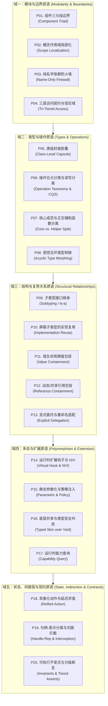

# 通用实用主义 OOD 方法论（一）：20 个通用架构与设计原语

> **溯源说明**：本文档提炼自 Bjarne Stroustrup《C++程序设计语言》（第 4 部分：第 23 章“开发和设计”、第 24 章“设计和编程”、第 25 章“类的作用”）。通过对原文中 C++ 语言机制与惯用法进行“去语言化”升维，还原其背后解决耦合、变化、状态一致性、运行效率与代码复用的本质规律，构建适用于现代主流语言（Java / C# / Rust / Go / TypeScript / Python / C++ 等）的**通用 OOD 架构原语体系**。

---

## 一、 原语升维对照总表

| 编号 | 原语域 | 通用 OOD 原语名称 | 原文中的 C++ 载体与章节 | 核心架构意图 |
| :--- | :--- | :--- | :--- | :--- |
| **P01** | 模块与边界 | **组件三元组边界** (Component Triad) | `namespace X` / `A` / `X_impl`、头文件分离 (23.4.3, 24.4) | 以“组件”而非孤立类为设计单元，严格隔离输入依赖、输出契约与私有实现。 |
| **P02** | 模块与边界 | **概念作用域局部化** (Scope Localization) | 嵌套类 `Car::Wheel` vs 顶层类 `Wheel` (24.4) | 默认将从属概念内聚在宿主内部，仅在跨场景复用证实后才提升为公开概念。 |
| **P03** | 模块与边界 | **纯名字依赖防火墙** (Name-Only Firewall) | 前置声明 `class Y; Y* a; Z& b;` (24.3.5, 24.4.2) | 将对外部复杂组件的依赖降级为“仅知其名”，切断物理布局耦合与级联重编译。 |
| **P04** | 模块与边界 | **三层访问契约与信任域** (Tri-Tiered Access) | `public` / `protected` / `private` + `friend` (23.4.3.4, 24.4.2) | 区分通用客户契约、子类扩展契约、内部封装与组件内跨类协作信任通道。 |
| **P05** | 类型与操作 | **类级封装胶囊** (Class-Level Capsule) | 同类跨实例访问私有成员 `List::on` (24.3.7.4) | 封装边界是“类型/概念”而非单个对象实例，同类实例间可直接高效协作。 |
| **P06** | 类型与操作 | **操作五元分类与读写分离** (Operation Taxonomy) | 构造/析构、`const` 与非 `const` 成员函数 (23.4.3.2) | 按基础生命周期、探查（只读）、修改、转换、迭代五类正交组织操作。 |
| **P07** | 类型与操作 | **核心成员与正交辅助函数分离** (Core vs. Helper) | 最小成员函数集 + 非成员协助函数 (23.4.3.2, 24.2.5) | 类内仅保留维护不变式的最小完备操作，便利性/对称性操作外置为独立函数。 |
| **P08** | 类型与操作 | **受控无环类型转换** (Acyclic Type Morphing) | `operator Y()`、单参构造、显式转换函数 (24.3.6) | 建立类型间隐式/显式转换通道，严格保证全局类型转换图为有向无环图（DAG）。 |
| **P09** | 结构与复用 | **子类型接口继承** (Subtyping / `is-a`) | `class D : public B` (23.4.3.1, 24.3.4) | 表达领域分类共性，承诺派生类完全遵守基类的行为契约与状态不变式（LSP）。 |
| **P10** | 结构与复用 | **屏蔽子类型的实现复用** (Implementation Reuse) | `private` / `protected` 继承 (24.3.4, 25.3) | 复用现有类的实现并覆盖其内部虚钩子，但严禁外部将其向上转型为基类。 |
| **P11** | 结构与复用 | **强生命周期值包容** (Value Containment) | 直接对象成员 `X a;` (24.3.3, 24.3.4) | 被包容对象与宿主同生共死且无需多态替换，获得最优时空效率与内存安全性。 |
| **P12** | 结构与复用 | **动态/共享引用包容** (Reference Containment) | 指针/引用成员 `X* p; X& r;` (24.3.2, 24.3.3) | 构建运行期“对象层次结构”，支持角色动态切换、多态注入与底层实例共享。 |
| **P13** | 结构与复用 | **显式委托与重命名消歧适配** (Explicit Delegation) | 转发函数、`CCowboy` / `WWindow` (24.3.6, 25.6) | 通过超薄转发层将未定义操作委托给内部成员，或重命名冲突接口实现概念缝合。 |
| **P14** | 多态与扩展 | **运行时扩展钩子与 NVI** (Virtual Hook & NVI) | 公有虚函数 vs `private virtual` (24.3.2.1) | 固定公开非虚流程骨架，将子类定制点收敛为受限/私有虚钩子，防止破坏基类契约。 |
| **P15** | 多态与扩展 | **静态参数化与策略注入** (Parametric & Policy) | `template<class T>`、排序比较准则 (23.4.3.3, 24.4.1) | 在编译期/装配期将数据类型与算法策略显式参数化，实现零运行时开销的通用性。 |
| **P16** | 多态与扩展 | **底层表示共享与类型安全外皮** (Typed Skin) | `Vector<T*> : private Vector<void*>` (25.6) | 单一无类型底层引擎承载重型逻辑，外部套上零开销内联泛型外皮，兼得安全与紧凑。 |
| **P17** | 多态与扩展 | **运行时能力查询** (Capability Query) | `dynamic_cast<Shape*>(p)`、I/O 字典 (24.4.3, 25.4.1) | 拒绝“肥大接口（Fat Interface）”，保持基类极简，按需在运行期安全窄化查询扩展能力。 |
| **P18** | 状态与契约 | **具象化动作与延迟求值** (Reified Action) | `Action` 类、函数对象、操控符、组合符 (23.4.3.1, 25.5) | 将带状态的动作升格为一等对象，支持延迟执行、排队、撤销、远程传输与合并优化。 |
| **P19** | 状态与契约 | **句柄-表示分离与切面拦截** (Handle-Rep Split) | `Handle<X>`、引用计数、`Set_controller` (25.7) | 分离轻量级外壳与重量级内核，透明接管引用计数、动态重绑定与并发锁等前后切面。 |
| **P20** | 状态与契约 | **可执行类不变式与分级断言** (Invariants & Asserts) | `String::check()`、`Assert<E>()`、前后条件 (24.3.7) | 将对象合法状态编码为可执行检查，指导类层次拆分/合并，并按环境分级启用契约断言。 |

---

## 二、 全景视图：通用 OOD 原语的五层架构

---

## 三、 五大原语域详细规范

### 域一：模块与边界原语（Modularity & Boundaries）

这一域解决**“以什么为单位进行设计、发布和隔离依赖”**的问题（对应原文 23.4.3、24.3.5、24.4 节）。

#### P01. 组件三元组边界（Component Triad Boundary）
* **原文载体**：`namespace X`（公开界面）、`namespace A`（前置依赖）、`namespace X_impl`（内部实现）及头文件分离（24.4 节）。
* **通用本质**：**设计的最小单元是“组件（Component/Module）”而非孤立的类。** 概念并非孤立存在，而是在相关概念构成语境中定义。任何组件在架构上必须显式拆分为三个集合：
  1. **输入依赖集（Required Interfaces）**：本组件公开契约所依赖的外部概念。
  2. **输出契约集（Provided Interfaces）**：向外部世界承诺的最小稳定概念集合。
  3. **私有实现空间（Implementation Space）**：绝不暴露给外部的辅助类、数据结构与算法（如 `X_impl::Widget`）。
* **跨语言映射**：
  * **Java / C#**：Module (`module-info.java`) / Assembly `internal` + Package-private
  * **Rust / Go**：Crate & `pub` vs 私有 `mod` / Go Package 首字母大小写导出规则
  * **TypeScript / Python**：Package `index.ts`（Barrel 导出契约）与内部模块 / `__all__`
* **Stroustrup 设计戒律**：
  * 严禁把仅用于内部支撑的辅助类暴露在公共名字空间；
  * 严禁让“输出契约集”反向依赖“私有实现空间”；
  * 使用组件中的某一个类，绝不应强迫用户理解或链接该组件中的所有其他类。

#### P02. 概念作用域局部化（Concept Scope Localization）
* **原文载体**：嵌套类 `Car::Wheel` 与顶层类 `Wheel` 的权衡（24.4 节）。
* **通用本质**：概念的可见范围应当与其通用性严格匹配——**默认将从属概念内聚（嵌套/私有化）在宿主概念内部**，只有当第二个独立场景证明它具备跨领域复用价值时，才将其提升为顶层公开概念。
* **Stroustrup 设计戒律**：抵御将“有趣的数据或函数”上浮到全局名字空间或单根基类（Root Class）的诱惑——那本质上是变相的全局变量与全局函数污染。

#### P03. 纯名字依赖防火墙（Name-Only Dependency Firewall）
* **原文载体**：前置声明 `class Y; Y* a; Z& b;` vs 直接包含 `Y a; Z b;`（24.3.5、24.4.2 节）。
* **通用本质**：区分**对类界面的依赖**与**对类实现的依赖**。在公开接口层，将对外部复杂类型的依赖降级为**“仅知其名（Name-Only）”**，而非**“知其内部物理布局与大小（Definition/Layout）”**。
* **核心价值**：切断编译期与结构期的级联重编译/重部署，因为“界面的依赖性将变成类所有用户的依赖性”。确保系统的**接口依赖图（Interface Dependency Graph）是一个严格的有向无环图（DAG）**。
* **Stroustrup 设计戒律**：
  * 若依赖的是基础稳定值类型（如 `list`, `complex`, `string`），可直接按值包含；
  * 若依赖的是重要业务组件的界面类（如银行账户系统、图形系统），接口层应当仅通过指针/引用/抽象接口持有。

#### P04. 三层访问契约与协作信任域（Tri-Tiered Access & Trust Zone）
* **原文载体**：`public` / `protected` / `private` + `friend`（23.4.3.4、24.4.2 节）。
* **通用本质**：一个类并非只有一个接口，而是同时面向不同角色提供**三套独立契约**，外加一条横向信任通道：
  1. **通用客户契约（Public）**：面向外部调用者，承诺最稳定的业务语义。
  2. **派生扩展契约（Protected）**：面向子类定制者，暴露受控的扩展钩子与半成品辅助函数。
  3. **内部实现封装（Private）**：面向类自身维护者，封锁底层状态表示与不变式维护细节。
  4. **跨类协作信任域（Friend / Package-Internal）**：当同一组件内的两个紧耦合类需要协同操作内部表示，但又不想向全局暴露 Public 接口时，建立点对点或包内信任通道。
* **Stroustrup 设计戒律**：
  * 成员默认必须是 `Private`，除非有充分理由提升为 `Protected` 或 `Public`；
  * **将数据成员声明为 `Public` 或 `Protected` 几乎总是坏主意**——因为一旦数据是 `Protected`，任何未知派生类都能绕过基类控制随意篡改状态，彻底摧毁基类不变式（24.3.2.1 节）。

---

### 域二：类型与操作原语（Types & Operations）

这一域解决**“单个概念如何建模为自洽的类型及其操作集”**（对应原文 23.4.3.2、24.2.5、24.3.6、24.3.7.4 节）。

#### P05. 类级封装胶囊（Class-Level Concept Capsule）
* **原文载体**：C++ 的 `class` 是类型与封装的基本单位，而非单个对象（24.3.7.4 节 `List::on(List* p)` 可直接遍历同类其他节点 `q->next`）。
* **通用本质**：封装的边界在于**“概念/类型定义本身”**而非单个运行时实例。同一类型下的不同实例共享同一套表示假设与不变式，因此可以在类方法内部直接高效访问同类其他实例的私有结构（如链表漫游、树旋转、深度比较），避免将简单迭代退化为低效递归。

#### P06. 操作五元分类与读写分离（Operation Taxonomy & Mutability Split）
* **原文载体**：23.4.3.2 节的操作分类法与 `const` / 非 `const` 成员函数。
* **通用本质**：设计类的接口时，不是随意堆砌方法，而是按对“对象内部状态”的作用严格正交划分为五类原语操作：
  1. **基础操作（Foundation）**：构造函数、析构函数和复制/移动操作（负责建立、复制和销毁状态不变式）。
  2. **探查操作（Inspectors / Queries）**：纯读取操作，不改变对象状态（由语言级 `const` / `readonly` 静态保障）。
  3. **修改操作（Mutators / Commands）**：修改对象内部状态的操作。
  4. **转换操作（Conversions）**：基于当前对象状态产生其他类型对象的操作。
  5. **迭代器（Iterators）**：按序访问或使用所包容的一系列对象的操作。
* **核心价值**：帮助设计师系统性地审视接口的**完备性（Completeness）**与**组件内各类的命名/行为一致性**。

#### P07. 核心成员操作与正交辅助函数分离（Core vs. Non-Member Helper Split）
* **原文载体**：最小成员函数集 + 非成员“协助函数”（23.4.3.2 节、24.2.5 节）。
* **通用本质**：
  * **核心操作（Member Operations）**：代表概念本质、必须直接访问内部私有表示并维护不变式的**最小操作集合**，作为类的成员方法。
  * **便利/对称操作（Orthogonal Helpers）**：为了记述方便而增加的操作，或者多个参数地位平等、不宜偏袒某一个参数作为“宿主对象”的操作，**剥离为组件名字空间下的非成员协助函数**。
* **Stroustrup 设计戒律**：保持类本身的接口最小化。“与某个函数已变成一种责任之后再去删除它相比，在某种需要已经弄清楚后加入一个函数，做起来要容易得多。”

#### P08. 受控无环类型转换（Controlled Acyclic Type Morphing）
* **原文载体**：转换运算符 `X::operator Y()`、单参构造函数 `Y::Y(X)` 与显式转换函数 `make_Rational()`（24.3.6 节）。
* **通用本质**：当类型 X 在语义上可无缝充当类型 Y 时，通过转换原语建立自动或显式的类型演化桥梁（生成新对象而非改变原对象类型）。
* **Stroustrup 设计戒律**：**必须保证在程序的转换图里不存在环路（Cycle）。** 例如若 `Big_int` 与 `Rational` 互相提供隐式转换，`r + i` 必然引发二义性编译错误。打破环路的标准手段是将至少一侧改为**显式命名转换函数**（如 `make_Rational()` 或 `explicit` 构造）。

---

### 域三：结构与复用关系原语（Structural Relationships）

这一域解决**“概念与概念之间如何连接与组合”**（对应原文 24.3.2、24.3.3、24.3.4、24.3.6 节）。

#### P09. 子类型接口继承（Subtyping / Interface Inheritance）
* **原文载体**：公用派生 `class D : public B`（23.4.3.1、24.3.4 节）。
* **通用本质**：表达领域概念间的分类学共性（“`D` 是一种 `B`”，即 `is-a` 关系）。其核心语义是**隐式向上转型与 Liskov 替换原则（LSP）**——任何期待 `B` 的代码都可以透明地接收 `D`，且 `D` 的一切操作必须维护 `B` 的不变式。
* **Stroustrup 设计戒律**：切勿照搬其他学科（如数学）的分类法作为程序中的继承模型！例如数学上“圆是椭圆的一种”，但在程序中若椭圆支持独立修改两个焦点，就会破坏圆“单中心定长半径”的不变式，因此圆与椭圆绝不可互相公用继承（23.4.3.1 节）。

#### P10. 屏蔽子类型的实现复用（Type-Shielded Implementation Reuse）
* **原文载体**：私有/保护派生 `class Cfield : private Field`、`class List_set : public Set<T>, private list<T>`（24.3.4、25.3 节）。
* **通用本质**：当新类需要复用某个具体类的实现（甚至需要覆盖其虚函数或访问其保护成员），但**在概念上新类绝不能被当成旧类自由替换**（例如 `Cfield` 是带受控访问权限的 `Field`，若允许隐式转为 `Field*` 就会彻底绕过权限控制；`List_set` 用 `list` 实现集合，但集合绝不具有链表的顺序语义）时，采用屏蔽子类型的实现继承。
* **跨语言映射**：在仅支持单继承接口的语言中，映射为**“私有成员包容 + 内部受托钩子类”**。

#### P11. 强生命周期值包容（Tightly-Bound Value Containment）
* **原文载体**：直接声明类型为 `X` 的成员 `X a;`（24.3.3、24.3.4 节）。
* **通用本质**：表达“有一个（`has-a`）”关系，且被包容对象的生命周期与宿主对象**严格绑定（构造时一并初始化，析构时自动销毁）**，在宿主存续期间无需改变所指向的实例。
* **Stroustrup 设计戒律**：在表示简单包容时，**永远优先采用直接值成员**，而非指向单独分配对象的指针——因为它在时间、空间和代码简洁度上效率最高，且天然免疫内存泄漏与悬空指针。

#### P12. 动态/共享引用包容（Dynamic / Shared Reference Containment）
* **原文载体**：声明类型为 `X*` 或 `X&` 的成员（24.3.2 急务车 `Emergency* eptr`、24.3.3 `C2`/`C3`/`C4`、24.3.4.2 窗口 `Scrollbar* sb`）。
* **通用本质**：通过对象内部的指针/引用构建运行期的**“对象层次结构（Object Hierarchy）”**，作为静态“类层次结构”的替代或补充。专门用于以下四种场景：
  1. **运行期动态改变角色/被包容对象**（如普通车辆与急务车辆角色的动态切换 `change(X* q)`）；
  2. **由外部参数多态注入具体实现**（如向 `Window` 注入 `Horizontal_scrollbar` 或 `Navigation_button`）；
  3. **多个宿主共享同一个底层对象**；
  4. **配合 P03 原语隔离编译期大小依赖**。

#### P13. 显式委托与重命名消歧适配（Explicit Delegation & Renaming Adapter）
* **原文载体**：委托转发 `void g() { p->g(); }`（24.3.6 节）与多重继承同名冲突消解类 `CCowboy::cow_draw()` / `WWindow::win_draw()`（25.6 节）。
* **通用本质**：
  * **显式委托**：当语言不内置隐式委托语法时，通过内联转发函数将特定操作显式委派给内部指针成员。
  * **重命名消歧**：当合并两个独立演进的概念体系遇到**同名但语义完全无关的操作**（如 `Window::draw()` 显示图像 vs `Cowboy::draw()` 拔枪）时，引入超薄中间接口类覆写原虚函数并转发给具有无歧义新名字的纯虚函数，从而干净地缝合两个体系。

---

### 域四：多态与扩展原语（Polymorphism & Extension）

这一域解决**“如何在不修改既有代码的前提下引入变化”**（对应原文 24.3.2.1、24.4.1、24.4.3、25.4.1、25.6 节）。

#### P14. 运行时扩展钩子与 NVI 模式（Runtime Extension Hook & Non-Virtual Interface）
* **原文载体**：虚函数与**私有虚函数**（24.3.2.1 节 `Buffer<T>`：公有非虚 `put(T)`/`get()` 内部调用 `private virtual overflow(T)`/`underflow()`）。
* **通用本质**：基类每声明一个虚函数，就意味着基类的实现反向依赖于“未知的派生类”。为了控制这种反向依赖的风险：
  * 任何虚函数都必须有极其明确的行为语义契约（如 `Shape::rotate` 只能做旋转，不能随便打印 Hello World）；
  * 若某个虚函数仅作为基类固定算法骨架中的定制步骤（如缓冲区满时的溢出策略），应将其声明为 **`private virtual`（或 `protected virtual`）**，对外仅暴露非虚的 `put()`/`get()`。这就是经典的 **NVI（Non-Virtual Interface，非虚接口/模板方法）原语**。

#### P15. 静态参数化与策略注入（Static Parametric Polymorphism & Policy Injection）
* **原文载体**：模板 `template<class T>`、`print_all<Iter_for_T>` 与 `std::sort` 的比较器参数化（23.4.3.3、24.4.1 节）。
* **通用本质**：将隐式的环境依赖或可变策略显式化为**编译期/装配期参数**，支持两大高层设计需求：
  1. **通用型程序设计（Generic Programming）**：当一组类型不适合塞进同一个继承树，或者对运行效率有严苛要求时，通过静态类型参数复用同一套算法。
  2. **策略的参数化（Policy Parameterization）**：将控制算法行为方式的策略（如排序准则、内存分配器、锁策略）作为参数注入，在不增加继承分支的前提下组合出丰富的行为变体。

#### P16. 底层表示共享与类型安全外皮（Shared Untyped Core with Typed Skin）
* **原文载体**：模板专门化 `template<class T> class Vector<T*> : private Vector<void*>`（25.6 节）。
* **通用本质**：为了消除泛型实例化带来的代码体积膨胀，或将不安全的底层通用容器/遗留 C 接口包装为现代接口，采用**“单核多皮”架构**：底层用单一的无类型实现（如 `Vector<void*>`）承载全部复杂逻辑，上层提供完全内联的强类型转发外壳（仅做静态类型转换，零运行时时间与空间开销）。

#### P17. 运行时能力查询（Runtime Capability Query / Safe Narrowing）
* **原文载体**：`dynamic_cast<Shape*>(p)` 与对象反序列化映射表 `io_map`（24.4.3、25.4.1 节）。
* **通用本质**：在设计类层次结构时，严禁为了图省事把所有子类特有操作（如链表的 `put/get` 与数组的 `operator[]`）求并集塞进顶层基类制造出**“肥大的界面（Fat Interface）”**。正确做法是保持基类接口窄而纯粹；当跨边界（如对象 I/O 流读取、事件总线接收）拿到一个宽泛基类引用、需要判断其是否支持特定扩展接口时，通过安全的运行时能力查询机制（`dynamic_cast` / 类型模式匹配）获取目标接口。

---

### 域五：状态、间接层与契约原语（State, Indirection & Contracts）

这一域解决**“如何管控复杂状态、资源生命周期、横切关注点与系统正确性”**（对应原文 24.3.7、25.5、25.7 节）。

#### P18. 具象化动作与延迟求值（Reified Action & Deferred Evaluation）
* **原文载体**：`Action` 类（`Write_file`, `Error_response`）、函数对象、流操控符、`Form`/`Matrix` 组合符（23.4.3.1、25.5 节）。
* **通用本质**：普通函数只能立即执行且无法携带状态。当一个“动作”满足以下任一条件时，必须将其具象化为一个**动作类（Action Class）**：
  1. 需要携带自己的私有上下文数据并在稍后执行（如 GUI 菜单项、重试回调）；
  2. 需要与其他动作组合或排队；
  3. 需要编码后序列化到磁盘或发送到远程机器执行；
  4. **延迟求值（Deferred Evaluation）**：如矩阵连乘或格式化输出，先用轻量级组合符对象收集操作意图，等汇集足够上下文后再一次性高效求值。
* **Stroustrup 设计戒律**：警惕过度使用！如果系统中绝大多数类都长成 `Action::do_it()` 的模样，说明设计已经退化成了披着对象外衣的“过程式功能分解”。

#### P19. 句柄-表示分离与切面拦截（Handle-Representation Split & Aspect Interception）
* **原文载体**：`Set_handle<T>`、非侵入式引用计数句柄 `Handle<X>`（含 `bind` 动态重绑定）、带锁控制器 `Set_controller<T>`（25.7、25.7.1 节）。
* **通用本质**：“计算机科学中的任何问题都可以通过引入另一个间接层来解决。”将概念拆分为**轻量级句柄（Handle）**与**实际表示（Representation）**：
  1. **值语义多态与自动内存管理**：用户按值传递小巧的句柄，句柄内部通过引用计数自动管理堆上多态对象的生命周期，免除用户手动 `delete` 的负担；
  2. **动态重绑定（Dynamic Rebinding）**：在运行期透明切换句柄所绑定的底层资源（如 `bind(X* pp)`）；
  3. **操作前后切面拦截（Interception）**：通过在句柄转发函数中织入前置/后置逻辑（如利用 RAII `Lock_ptr` 对写操作自动加解锁、统计访问频次），在不污染核心业务类的前提下注入横切关注点。

#### P20. 可执行类不变式与分级契约断言（Executable Invariant & Tiered Assertions）
* **原文载体**：`String::check()`、模板化断言 `Assert<Bad_arg>(!ARG_CHECK || cond)`、前条件与后条件（24.3.7.1 ~ 24.3.7.3 节）。
* **通用本质**：
  1. **可执行类不变式（Class Invariant）**：明确定义“使对象状态合法的逻辑准则”（如 `p != 0 && 0 <= sz && sz < TOO_LARGE && p[sz] == 0`）。构造函数负责建立不变式，每个公用操作在入口和出口维护不变式。
  2. **以不变式指导重构**：若发现类的某几个方法只触及一部分状态且大量不变式检查对其冗余，说明该类应**一分为二**；若两个类拥有高度相似的不变式，说明应**提取公共基类**。
  3. **分级异常断言（Tiered Exception Assertions）**：用抛出类型化异常的 `Assert<Exception>(cond)` 替代粗暴中止程序的 `abort()`，并配合编译期常量（如 `ARG_CHECK`）或运行期开关（如 `string_check`）实现分级管控——测试期全开（甚至抽样验证排序后条件），生产期仅保留关键防线并允许上层捕获恢复。

---

## 四、 架构自检：五大反模式警示（源自 24.2 节）

在运用上述 20 个原语时，必须时刻防范以下 5 种因背景惯性导致的原语误用：

1. **忽视类（退化为过程式 C/COBOL）**：只做功能分解，导致核心数据被迫上浮为全局数据，对变化毫无弹性。
2. **忽视继承（退化为纯数据抽象）**：把继承仅仅当成实现细节，用复杂的类型标记与 `switch` 伪装领域中的天然分类层次。
3. **忽视静态类型检查（退化为无约束动态类型）**：用自标识对象或万能容器 `Stack<Object>` 取代强类型/泛型契约，把本可在编译期拦截的错误推迟到运行期崩溃（如把汽车压入飞机栈并调用 `takeoff()`）。
4. **忽视程序设计（迷信高层 CASE 工具生成一切）**：妄图在缺乏严格数学基础的通用领域彻底消灭编码，导致生成的系统僵化低效且无法与通用语言生态集成。
5. **排他性地使用类层次结构（纯 OO 狂热症）**：把笑脸、CD-ROM 驱动、医疗记录和实时时钟强行塞进同一棵单根继承树，或拒绝使用非成员函数与具体值类型，造成严重的耦合与性能灾难。
